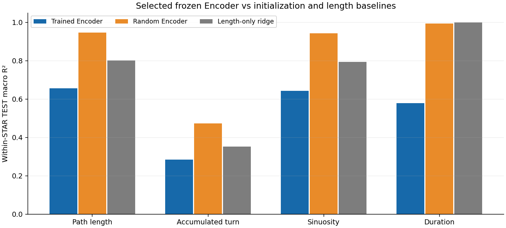
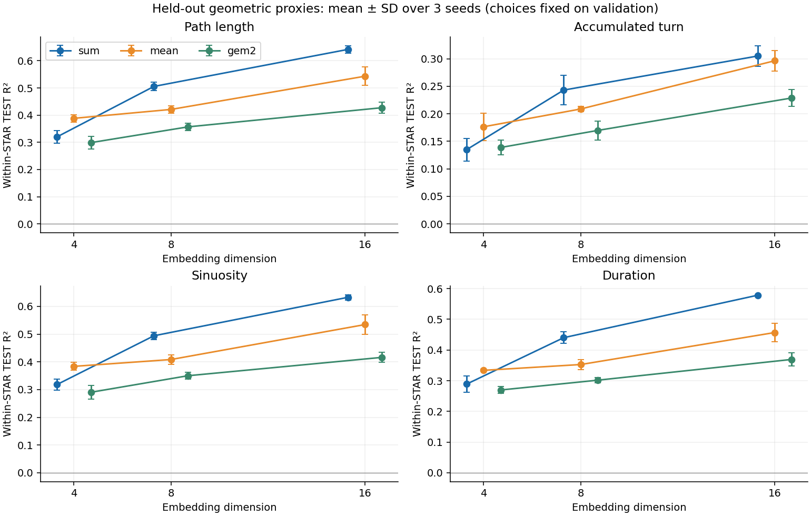

# Trajectory Representation and Scene Complexity

本项目包含已训练的轨迹 Encoder、场景 embedding 点云复杂度估计器、樟宜机场周边 OpenSky 数据及方法与实验记录。**全仓只保留本 README，依赖只维护根目录 `requirements.txt`。**

Encoder 将单条轨迹映射成向量；`Complexity` 估计同一场景内多个向量的经验关联维数。OpenSky 接入脚本可运行，但 WSSS 域迁移和小时复杂度结果尚未经过结论性验证。代理指标不等于人工复杂度真值。

## 目录

- [安装](#installation)
- [快速开始](#quick-start)
- [Encoder：推理、实验与重训](#encoder)
- [Complexity：接口与质量规则](#complexity)
- [OpenSky 数据定义与使用](#opensky-data)
- [测试与验证](#validation)
- [方法、许可与限制](#methods)

| 路径 | 内容 |
|---|---|
| `Encoder/` | 冻结权重、推理接口、训练实现、实验日志和报告 |
| `Complexity/` | NumPy/SciPy 复杂度估计器、Python/CLI 接口和测试 |
| `data/OpenSky_Changi_2026-09/` | 2026 年 9 月樟宜周边 OpenSky 数据、质量记录和提取工具 |
| `doc/` | 方法、训练计划与接口交接说明 |
| `requirements.txt` | 全项目唯一依赖清单，包含 PyTorch |

<a id="installation"></a>
## 安装

使用 **Python 3.10+**。以下命令在仓库根目录执行；只安装根目录清单，不需要进入组件目录分别安装。

macOS / Linux：

```bash
python3 -m venv .venv
source .venv/bin/activate
python -m pip install -r requirements.txt
```

Windows PowerShell：

```powershell
python -m venv .venv
.\.venv\Scripts\Activate.ps1
python -m pip install -r requirements.txt
```

后续命令均在激活此环境后执行。已有 Python 3.9 环境需要用 Python 3.10+ 重建；仅再次执行 `venv` 不会升级已有环境的解释器。依赖安装不提供原始训练数据或 CUDA 驱动；重新训练还需要适合的 GPU 环境，见 Encoder 部分。

<a id="quick-start"></a>
## 快速开始

### 1. 准备轨迹

每架飞机保存一份 `.npy` 文件，内容为有限实数 `(T, 3)` 数组：按时间排序的本地 ENU 米制坐标（east、north、up），每 5 秒一点。当前 checkpoint 使用 RKSI 本地坐标，不接受经纬度或未经处理的 OpenSky 列；每条轨迹采样后至少 30 点。

```text
trajectories/
  aircraft_001.npy
  aircraft_002.npy
  ...
```

时间切窗、坐标与高度基准转换、轨迹分段、航班身份核验和飞机去重由上游完成。一个场景只收集同一时间窗内的轨迹，每架飞机只贡献一个向量；不同小时不得混为一个点云。

### 2. 编码与 pooling

将以下代码保存为根目录 `encode_scene.py`，再执行 `python encode_scene.py`：

```python
from pathlib import Path
import numpy as np
from Encoder.trajectory_encoder.inference import FrozenEncoder

encoder = FrozenEncoder(
    "Encoder/encoder/encoder.pt", pooling="sum", device="cpu"
)
vectors = []
for path in sorted(Path("trajectories").glob("*.npy")):
    enu_m = np.load(path, allow_pickle=False)
    result = encoder.encode(enu_m, resample_from_1hz=False)
    vectors.append(result["embedding"])

scene_embeddings = np.stack(vectors) if vectors else np.empty((0, 16))
Path("artifacts").mkdir(exist_ok=True)
np.save("artifacts/scene_001_embeddings.npy", scene_embeddings)
print(scene_embeddings.shape)
```

该示例把 `trajectories/` 下全部文件视为一个场景。1 Hz 输入应改用 `resample_from_1hz=True`。`FrozenEncoder.encode()` 同时返回逐 token 向量与 pooled trajectory embedding；传给 Complexity 的是后者组成的 `(N, D)` 数组。

### 3. 估计复杂度

```bash
python -m Complexity artifacts/scene_001_embeddings.npy --output artifacts/scene_001_complexity.json
```

检查每个结果的 `status`、`reason` 和拟合诊断；`unestimable` 不能当成复杂度 0。默认精确计算所有无序点对，最多五百万对。

<a id="encoder"></a>
## Encoder

### 权重与实验记录

已完成 [PLAN.md](Encoder/PLAN.md) 中的 12 组独立训练，每组 30 轮，共 360 轮。最终冻结模型为 **16 维、sum pooling、seed 43**，RDP ε=120m、τ=0.01；验证集选择第 30 轮 checkpoint。模型已有 CPU 加载、参数冻结和真实轨迹推理校验记录。

| 文件 | 用途 |
|---|---|
| [encoder.pt](Encoder/encoder/encoder.pt) | 选定权重，含模型配置与训练集预处理参数 |
| [config.json](Encoder/encoder/config.json) | 模型、checkpoint 轮数与验证选择记录 |
| [embeddings.npz](Encoder/encoder/embeddings.npz) | 全部 16183 条轨迹的 sum / mean / signed GeM-p2 向量；不是小时场景档案 |
| [example_input_output.npz](Encoder/encoder/example_input_output.npz) | 一条真实 TEST 轨迹及 token / 轨迹向量 |
| [checkpoint_manifest.json](Encoder/reports/checkpoint_manifest.json) | 9 份权重的 SHA256、字节数与种子 |
| [checkpoints/](Encoder/checkpoints/) | 对照权重 |
| [probe_summary.csv](Encoder/reports/probe_summary.csv) | 三维数 × 三种子 × 三种 pooling 的测试指标 |
| [three_seed_summary.json](Encoder/reports/three_seed_summary.json) | 三种子均值与样本标准差 |
| [experiment_logs/](Encoder/experiment_logs/) | 逐轮损失、参数与验证记录 |
| [RESULTS_ZH.md](Encoder/reports/RESULTS_ZH.md) | 中文结果报告 |

输入为 RKSI 本地 ENU 米制坐标 `(T, 3)`。1 Hz 输入每 5 点采样并保留终点，采样后至少 30 点；已按相同规则采样的输入设 `resample_from_1hz=False`。内部构造 9 维特征，使用 checkpoint 中的训练集均值/标准差，不在推理时重新拟合。模型关闭 dropout、冻结参数；逐 token L2，sum pooled 向量不额外 L2。

```python
from Encoder.trajectory_encoder.inference import FrozenEncoder

encoder = FrozenEncoder("Encoder/encoder/encoder.pt", pooling="sum", device="cpu")
result = encoder.encode(enu_m, resample_from_1hz=True)
print(result["tokens"].shape)     # (T_sampled, 16)
print(result["embedding"].shape)  # (16,)
```

支持 `sum`、`mean`、`gem2`（带符号 GeM-p2）；返回值还包含采样点数、pooling 与预处理 ID。checkpoint 使用 `weights_only=False` 加载，**只加载可信权重**。当前接口不自动适配旧裸 state_dict。

### 实验与结果

训练数据为公开 [ATFMTraj](https://huggingface.co/datasets/petchthwr/ATFMTraj) 的 RKSIa。训练 / 验证 / 测试为 6877 / 1214 / 8092 条；官方 TRAIN 划出验证集，官方 TEST 保留作最终评估。六份本地 TSV 与公开版本 SHA256 匹配，见 [public_data_verification.json](Encoder/reports/public_data_verification.json)。原始 TSV 不随仓库分发。

模型使用 9 维输入、4 层 causal Transformer、宽 256、FFN 512、4 头、dropout .35、20% 输入掩码与 RDP flat-SNN。先做 ε=120/1200m × τ=.01/.05 的四组 8 维筛选，再比较 4/8/16 维各三个种子。真实 batch=16，AdamW lr=1e-5，bf16；历史训练设备为 RTX 5060 Laptop 8GB。sum 为预先固定的主 pooling，mean 与 signed GeM-p2 为敏感性分析。

超参数、维数及代表 seed 均仅用验证集选择，随后才运行 TEST。完整规则见 [PROTOCOL.md](Encoder/PROTOCOL.md)，实现检查见 [implementation_checks.json](Encoder/reports/implementation_checks.json)，导出校验见 [export_verification.json](Encoder/reports/export_verification.json)。所选模型在四个代理上均未超过两种基线中的较强者，不能据此声称自监督训练带来额外几何代理预测能力。






### 重新训练

下载 RKSIa 的六份 TSV 与 `RKSIa_stats.csv` 至同一目录。训练需要支持 bf16 的 CUDA 环境；历史实验使用 PyTorch 2.7.1+cu128。按目标环境选择兼容的 PyTorch CUDA wheel，安装入口仍为根 `requirements.txt`，不维护组件依赖清单。激活根环境后进入 `Encoder/`：

```bash
cd Encoder
python -m trajectory_encoder.data --source "你的RKSIa数据目录" --out prepared
python -m trajectory_encoder.checks
python -m trajectory_encoder.benchmark
python complete_local.py
```

训练缓存写入 `Encoder/runs/`；历史交付记录在 `Encoder/experiment_logs/`，不应误当作本地已完成训练。

<a id="complexity"></a>
## Complexity

### 边界与 Python 接口

组件实现独立于 Encoder，仅直接依赖 NumPy/SciPy；项目环境仍统一安装根清单。它不加载/训练 Encoder，不转换坐标、不做 PCA、不切时间窗、不自动 flatten/pooling，也不识别或去重飞机 ID。输入必须是有限实数 `(N, D)` 数组；拒绝 `(N, T, D)`、NaN、Inf、复数或字符串。重复 embedding 保留，不能擅自当成重复飞机删除。

默认不标准化或 L2 归一化。显式 `normalize=True` 会改变几何，零向量会报错；实验间必须固定 checkpoint、预处理、pooling、归一化和距离规则。

```python
import numpy as np
from Complexity import ComplexityConfig, estimate_complexity, correlation_integral

points = np.load("hour_01.npy", allow_pickle=False)
result = estimate_complexity(
    points, scene_id="2026-01-01T08:00:00Z",
    config=ComplexityConfig(normalize=False),
)
if result.status == "ok":
    print(result.dimension, result.r_squared)
else:
    print("无法估计：", result.reason)

# 仅为接口示例，不是推荐尺度；尺度依赖 checkpoint/pooling。
result = estimate_complexity(points, fit_range=(0.05, 0.5))
curve = correlation_integral(points, np.geomspace(0.01, 1.0, 64))
```

主函数签名：

```text
estimate_complexity(embeddings, *, config=None, radii=None, fit_range=None, scene_id=None)
correlation_integral(embeddings, radii, *, normalize=False, max_pairs=5_000_000)
```

`correlation_integral` 至少需要两个点。`result.to_dict()` 可直接 JSON 序列化，包含：

- `status`：`ok` / `unestimable`；仅 `ok` 提供 `dimension`。`reason` 为拒绝原因，正常时 `None`。
- `scene_id`、`n_samples`、`embedding_dim`、`n_unique`、`n_pairs`、`zero_distance_pairs`；提前拒绝、未计算距离的计数可能为 `None`。
- `radii`、`correlation`、`pair_counts`：完整离散曲线；提前拒绝时可能无曲线。
- `fit_indices`、`fit_radius_range`、`fit_slope`、`intercept`、`r_squared`：候选拟合诊断；不合格候选斜率不等于有效 `dimension`。
- `selection`、`requested_fit_range`、`config`、`warnings`：所用规则与警告。

未定义结果为 `None`（JSON `null`），不返回没有定义的 NaN/Inf；**不可估计不等于复杂度 0**。

### 数学规则与质量门槛

精确计算无序点对欧氏距离，仅统计 `i < j`，不含自身配对：

```text
C(r) = count(distance(i,j) < r, i < j) / [N(N-1)/2]
log C(r) = D2 * log r + intercept
```

使用严格 `< r`，距离等于半径不计入。自动模式是工程默认规则，不是论文保证的最优规则：

1. 至少 30 个点，但这不保证样本充分。
2. 从最小正距离到最大距离生成 64 个对数等距半径。
3. 选择全部满足 `0.02 <= C(r) <= 0.3` 且至少计入 10 个点对的半径。
4. 至少 8 个拟合半径，最大/最小半径比至少为 2。
5. 对 `log(r), log(C(r))` 做带截距 OLS；正斜率且 `R² >= 0.98` 才输出维数。

不通过搜索最高 R² 的短窗口挑选结果。显式 `fit_range=(r_min, r_max)` 时，未指定 `radii` 则在区间内生成半径，指定后则选取闭区间内半径；不使用 `0.02..0.3` 过滤，但仍排除 `C=0/1`，保留点对数、拟合点数、跨度、R² 等门槛。

| `ComplexityConfig` 参数 | 默认值 |
|---|---:|
| `normalize` | `False` |
| `n_radii` | 64 |
| `min_samples` | 30 |
| `min_fit_points` | 8 |
| `min_pairs` | 10 |
| `correlation_bounds` | `(0.02, 0.3)` |
| `min_radius_ratio` | 2.0 |
| `min_r_squared` | 0.98 |
| `max_pairs` | 5,000,000 |

| `reason` | 含义 |
|---|---|
| `insufficient_samples` | 飞机数不足 |
| `collapsed_point_cloud` | 距离全为零 |
| `no_distance_scale_range` | 所有正距离相等，无法自动生成尺度范围 |
| `insufficient_fit_scales` | 有效尺度不足，可能过稀疏或饱和 |
| `insufficient_scale_span` | 尺度范围太窄 |
| `flat_correlation_curve` | 关联积分无可辨别增长 |
| `poor_linear_fit` | R² 不达门槛 |
| `nonpositive_slope` / `nonfinite_fit` | 无效斜率或数值拟合失败 |

重复 embedding/零距离在结果中提示并保留在点对统计中；不自动合并近重复点或添加噪声。高 R² 不证明真实分形结构；这里只是有限样本经验斜率，不提供统计置信区间。各半径的 C(r) 共享点对，不能把普通 OLS 标准误当作可靠不确定度。

距离计算 `O(N²D)`，排序 `O(P log P)`，内存 `O(P + ND)`，其中 `P=N(N-1)/2`。五百万点对的距离数组约 40 MB，另有临时内存。超过资源上限直接报错，不静默采样；可显式提高上限，但不能随意拆散一个场景来绕过限制。

### 文件与命令行

单场景 `.npy` 存储 `(N,D)` 数组；多场景 `.npz` 的每个键为场景 ID，每个值为 `(N_s,D)` 数组，各场景飞机数可不同。

```python
np.save("hour_01.npy", embeddings_hour_01)
np.savez("hours.npz", hour_01=embeddings_hour_01, hour_02=embeddings_hour_02)
```

```bash
python -m Complexity --help
python -m Complexity hour_01.npy -o result.json
python -m Complexity hours.npz -o results.json
python -m Complexity hours.npz --fit-range 0.05 0.5 --normalize -o results.json
```

JSON 顶层包含 `schema_version`、`method`、`metric`、`input` 和 `results`；不指定 `-o` 时输出到标准输出。NumPy 文件以 `allow_pickle=False` 加载，不支持 pickle。输出目录须存在，不允许覆盖输入。

成功处理返回退出码 0，**包括含 `unestimable` 的场景**，调用者仍须检查每个状态。格式、参数、资源超限返回 2；批量中有非法输入则整批失败，不输出不完整结果。

### 与 Encoder 对接

把同一小时内每架飞机的 `result["embedding"]` 堆叠为 `(N,16)`，空场景可传 `(0,16)`，不要传 tokens、字典或单个 `(16,)` 向量。采样后每条轨迹至少 30 点，默认每个场景至少 30 架飞机且须通过拟合门槛。接口细节和 OpenSky 接入见 [交接说明](doc/atscc-handoff.md)。旧 `ATSCC.load_model/encode_scene` 不再适用。

**不要直接把 `Encoder/encoder/embeddings.npz` 当作小时场景档案。** 其键为 `sum/mean/gem2`，各值包含全部 16183 条轨迹，不是 `scene_id -> (N,D)`。训练数据缺绝对时间与真实航班 ID，不能据此还原真实小时场景或把不同 pooling 当作不同场景。

<a id="opensky-data"></a>
## OpenSky 数据

以下文件均位于 `data/OpenSky_Changi_2026-09/`。当前状态以 `progress.json` 和最终 `data_quality.json` 为准；完成 720 个小时且通过本地校验后才视为整月完成。

### 提取定义

- 新加坡当地时间：2026-09-01 00:00:00（含）至 2026-10-01 00:00:00（不含），Asia/Singapore / UTC+08:00。
- UTC：2026-08-31 16:00:00 至 2026-09-30 16:00:00，共 720 个完整小时。
- 中心为 WSSS ARP（控制塔）：1.3592111111° N、103.989325° E，机场标高 6.66 m。
- 范围为中心 100 km 内圆形研究区域，是提取工作定义，不是官方 TMA 边界。
- 不截断高度，保留地面状态。包含区域内实际接收的所有飞机，可能包括邻近机场和过境交通，不代表一定在樟宜起降。
- 选择 Unix 秒能被 10 整除的状态，保留实际观测，不补点、插值或制造轨迹。后续 Encoder 接入的插值与此原始提取步骤不同。

### 文件

| 路径 | 内容 |
|---|---|
| `raw/` | UTC 小时 CSV.gz，原始 10 秒采样状态，保留陈旧位置与缺失字段 |
| `sampled_10s/` | 去除位置/接收时间未知或滞后超过 15 秒的记录；每机每 10 秒桶保留最后一条实际记录，其他缺失字段仍保留 |
| `manifest/` | 每小时行数、飞机数、间隔统计、查询编号、执行信息和 SHA-256 |
| `queries/` | 准备的 SQL；实际完成查询以 manifest 编号为准，显式限定 hour 分区、时间、经纬范围和圆形距离 |
| `config.json` | 机场、时间、范围、采样与清理参数 |
| `progress.json` | 整月下载状态 |
| `flight_metadata/` | OpenSky 推断 WSSS 到离港信息，按结束 UTC 日保存并额外覆盖下一日；不是完整机场航班清单 |
| `hourly_summary.csv`、`data_quality.json` | 本地逐小时统计与质量报告 |
| `extract.mjs` | 可复用提取模块；凭据只在内存，不在交付文件内 |

### 字段与读取

| 字段 | 含义 / 单位 |
|---|---|
| `time` | 状态有效时间，UTC Unix 秒 |
| `icao24` | 应答机地址，十六进制字符串，保留前导零 |
| `callsign` | 广播呼号，可空或含尾随空格，不保证唯一 |
| `lat / lon` | WGS84 纬度 / 经度，度 |
| `baroaltitude / geoaltitude` | 气压高度 / 几何高度，m |
| `velocity` | 地速，m/s |
| `heading` | 对真北运动方向，度 |
| `vertrate` | 垂直速度，m/s，爬升为正 |
| `onground` | 地面状态，true / false |
| `lastposupdate / lastcontact` | 最近位置更新 / 信号接收时间，UTC Unix 秒 |
| `hour` | 数据库 UTC 小时分区，Unix 秒 |

CSV 空字段是缺失值，不能替换为 0。按小时读取，无需整月加载；下面从仓库根目录执行：

```python
import pandas as pd

df = pd.read_csv(
    "data/OpenSky_Changi_2026-09/sampled_10s/2026-08-31T16Z.csv.gz",
    dtype={"icao24": "string", "callsign": "string"},
)
df["time_sgt"] = pd.to_datetime(df["time"], unit="s", utc=True).dt.tz_convert("Asia/Singapore")
```

每份文件是半开一小时窗口；跨小时飞机各有片段。不得仅用 callsign 区分航班、跨长断点连轨迹，或把邻近/过境交通直接标为 WSSS 航班。元数据首末观测不是真实起飞/着陆时间，估计机场也可能缺失。

### Encoder 小时场景接入

原始数据未转换为训练方案的 9 维输入，也未拟合归一化参数。应核查高度基准、方向计算、缺失值、连续轨迹及日期/航班切分，并固定预处理版本。

`Encoder/opensky_scene.py` 筛选有效空中观测，以 ICAO24 和 UTC 小时分组，超过 60 秒断点分段；每机每小时保留最长且至少 16 个真实观测的片段。WGS84 转 WSSS ENU 后，线性插值为模型要求的 5 秒采样，使用冻结 sum pooling 并应用既有 Complexity 质量门槛。

```bash
# 先试算一小时
python Encoder/opensky_scene.py --pattern '2026-09-01T00Z.csv.gz'
# 确认后处理全部输入
python Encoder/opensky_scene.py
```

支持 `--input-dir`、`--output-dir`、`--checkpoint`、`--device`、`--max-gap-seconds`。默认输出到被忽略的 `data/OpenSky_Changi_2026-09/encoder_scenes/`，包含 `hourly_embeddings.npz`、`hourly_complexity.json` 及诊断与筛选轨迹清单。

RKSI 训练到 WSSS 推理存在域迁移，10 秒观测之间的 5 秒点是线性估计，高度基准也可能偏差。输出仅作探索，不是经验证的 WSSS 复杂度结论。OpenSky 接收覆盖不完整，空窗、稀疏窗和缺失字段应按质量报告处理，不能声称完整记录机场所有航班。

### 查询与使用依据

- [OpenSky 历史库与高效查询](https://openskynetwork.github.io/opensky-api/trino.html)
- [新加坡 AIP WSSS，2026 年 9 月版本](https://aim-sg.caas.gov.sg/aim-content/uploads/aip/17-SEP-2026/AIP/2026-09-03-000000/html/eAIP/SG-AD-2-WSSS-en-GB.html)
- [Trino great_circle_distance，返回 km](https://trino.io/docs/current/functions/geospatial.html#great_circle_distance)

本次提取遵循获批的非商业研究用途，最多两个并发查询，每批仅少量明确小时分区；五分钟未完成则中止检查，不扩大查询。

<a id="validation"></a>
## 测试与验证

在仓库根目录、激活环境后执行 Complexity 测试：

```bash
python -m unittest discover -s Complexity/tests -v
```

覆盖手算点对、严格边界、暴力计算对照、直线/平面经验维数、平移/缩放/置换、显式尺度与 OLS、重复/坍塌/空场景、非法输入、归一化、质量拒绝、资源上限、CLI 和 JSON。

Encoder 的原有验证脚本从其目录执行，使用同一个已激活的根环境：

```bash
cd Encoder
python example.py
python verify_delivery.py
```

历史验证记录在 `Encoder/reports/`；它们不等于当前机器已经重跑验证。训练检查与 benchmark 需要适当 CUDA 环境。

<a id="methods"></a>
## 方法、许可与限制

- Complexity 方法：[trajectory-embedding-point-cloud-complexity.md](doc/trajectory-embedding-point-cloud-complexity.md)。有限样本经验关联维数和工程拟合门槛不证明真实分形结构，也没有统计置信区间。
- 接口边界与交接：[atscc-handoff.md](doc/atscc-handoff.md)。小时场景要求可靠时间、飞机/航班身份与一致轨迹聚合，不能把全轨迹 archive 当作小时数据。
- Encoder 计划与冻结实验协议：[PLAN.md](Encoder/PLAN.md)、[PROTOCOL.md](Encoder/PROTOCOL.md)。
- 实现参考固定提交的 [ATSCC](https://github.com/petchthwr/ATSCC/tree/789ccd72b7496b52e03df7d8599d8c9e6659bdb9)，当前为按计划改造的 ATSCC/ITSC-inspired Encoder；第三方许可见 [THIRD_PARTY_LICENSE_ATSCC.md](Encoder/THIRD_PARTY_LICENSE_ATSCC.md)，引用见 [CITATION.md](Encoder/CITATION.md)。
- 原始数据、部分权重或训练产物可能被大小限制或 ignore 规则排除，需要另行获取；文件可用性与校验记录以实际目录和报告为准。
