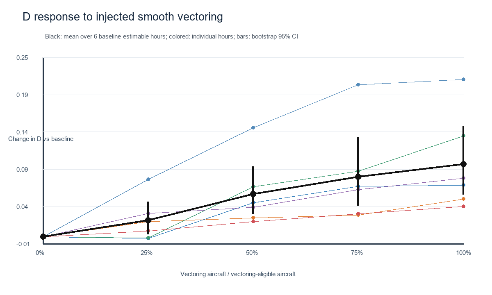
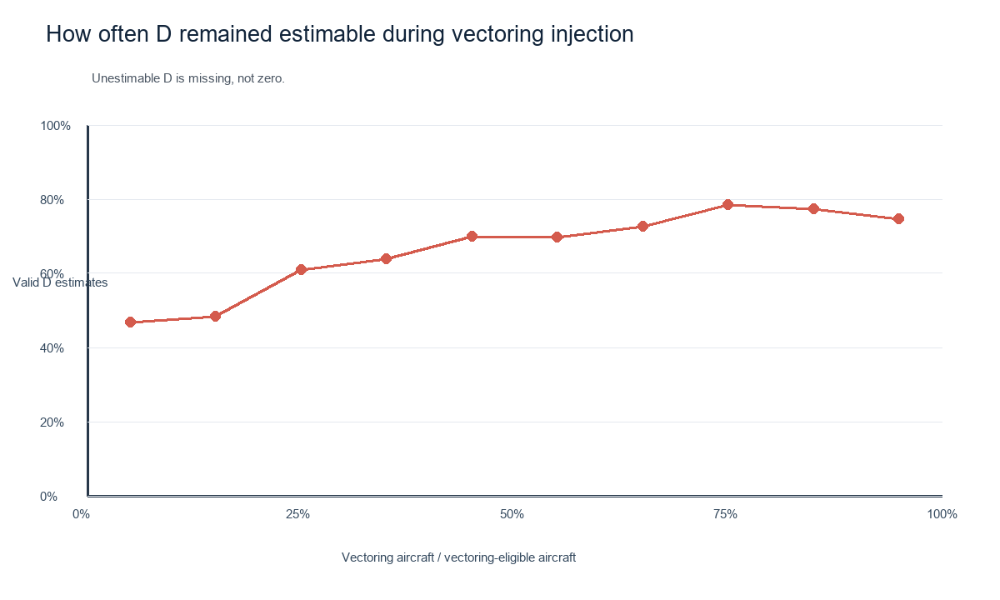

# 合成 Racetrack Holding 对复杂度 D 的 pilot evaluation

## 这轮实验想回答什么

检查 Encoder + 点云经验关联维数是否会随着场景中加入的 holding 数量而变化。这个实验是在检验指标对人工注入机动的响应，不等于证明真实运行复杂度已经被准确预测。

## 怎么做

- Encoder checkpoint SHA256：`d3abfc192a2e7a0f84bb1c4207ee04cfc4a4880755530da475124c5f711753ea`；预处理器 ID：`d69735dd5a1587c6720a4f5867a860e6a3b47fdb9ba81b239f80e1dfa5afeb35`；PyTorch `2.14.0+cu130`，CUDA 推理。

- 使用 OpenSky Changi 2026-09 原始 10 秒轨迹；每小时一场景，每个点对应一架飞机的整段小时轨迹。只保留空中且经纬度、几何高度均有效的记录；要求每条轨迹至少 16 个 10 秒观测、最大相邻间隔不超过 20 秒，再转为 WSSS 局部 ENU 坐标并线性插值到 5 秒采样。数据集查询范围内并非全部都是樟宜进场航班，因此结果按 OpenSky 查询区域的航迹场景解释。可行性审计中，720 小时有 615 小时可留下至少 30 架轨迹，有 424 小时至少 50 架。
- 用提供的 16 维 Encoder、sum pooling，把每架轨迹编码为一个点；用未归一化 Euclidean distance 和现有的相关维数估计器计算 D。
- 从 9 月中满足数据条件的小时中，按日期均匀抽取 12 个场景，每小时至少 50 架可用飞机；每场景做 5 个随机飞机顺序。
- 每次随机选一架飞机，在轨迹中点插入一圈合成 racetrack holding，然后重新编码该轨迹、更新点云并重算 D；逐架递增，直到该小时每架可用飞机都加过一圈。
- Holding 的 pilot 几何规则：每段直飞 60 秒，转弯率 3°/秒、每次 180° 转弯 60 秒；速度取局部轨迹地速，高度固定；完整一圈约 4 分钟。
- 对每个小时固定使用基线点云的 64 个半径尺度，以便每个剂量下的 D 在相同半径上估计。质量门槛沿用仓库默认值：至少 30 个点、相关积分区间 0.02–0.3、至少 8 个拟合尺度、尺度跨度至少 2 倍、拟合 R²≥0.98。

## 结果

12 个场景共 60 条随机剂量曲线、3915 个 D 估计点；其中 3281 个通过质量门槛（83.8%），其余 634 个均因 log-log 拟合 R² 未达到 0.98 而标为不可估计。每条曲线都有至少 5 个有效 D 点；逐曲线 Spearman 相关系数中位数为 -0.052，45% 为正。这表明整体没有稳定的单调递增关系。逐曲线统计包含同一小时的重复顺序，只作描述，不能把随机顺序当独立小时样本。

对基线 D 可估计的 6/12 个小时，先在每个小时内平均 5 个随机顺序，再比较 D 相对基线的变化：0%: -0.000（6 个小时场景）、25%: +0.272（6 个小时场景）、50%: +0.458（6 个小时场景）、75%: +0.358（6 个小时场景）、100%: +0.085（4 个小时场景）。在基线可估计的小时里，平均 D 在 25%–75% 注入剂量高于基线，但到全体飞机都注入时回落到接近基线；这是一个非单调的“先升后降”形状，而非“holding 越多 D 越高”。全剂量点仅 4 个小时仍可估计，需谨慎解读。

| 小时场景 | 可用飞机数 | 基线 D |
|---|---:|---|
| 2026-09-01T01Z | 57 | ok (1.199) |
| 2026-09-04T08Z | 74 | ok (0.902) |
| 2026-09-07T10Z | 62 | unestimable (poor_linear_fit) |
| 2026-09-10T06Z | 71 | unestimable (poor_linear_fit) |
| 2026-09-12T15Z | 51 | unestimable (poor_linear_fit) |
| 2026-09-15T06Z | 88 | unestimable (poor_linear_fit) |
| 2026-09-18T00Z | 64 | unestimable (poor_linear_fit) |
| 2026-09-20T04Z | 67 | ok (1.465) |
| 2026-09-23T10Z | 63 | ok (1.459) |
| 2026-09-25T23Z | 51 | ok (1.911) |
| 2026-09-28T07Z | 72 | ok (1.372) |
| 2026-09-30T15Z | 51 | unestimable (poor_linear_fit) |

## 初步解释

1. 指标对这类合成机动有反应：基线可估计的小时在中等注入剂量下，平均 D 高于基线。
2. 响应不具备稳定的剂量单调性：全曲线 Spearman 中位数约为 0，正相关只占 45%，高剂量时平均增幅回落。基线 D 只有 6/12 个小时通过 R² 门槛，现阶段不能得出“holding 越多，复杂度必然越高”的强结论。
3. 每条 holding 让轨迹多 48 个 5 秒采样点，而当前 Encoder 使用 sum pooling。D 的变化可能同时来自新机动形状和序列长度/向量模长变化；后续需要把这个混杂单独分析。
4. 这些是合成几何注入实验。它验证的是算法对可控轨迹变化的敏感性，不代表 OpenSky 中有对应的真实 holding 标签，也不直接证明复杂度标签对应真实管制负荷。

## 平滑横向 Vectoring 注入

按确认的规则，对每个小时中轨迹足够长的飞机逐架注入一次横向绕行：5 分钟内平滑偏移到 5 km，之后用 5 分钟平滑回到原航迹；左右方向随机，保持高度、采样时间和轨迹点数不变。每个场景有 35–63 架可注入飞机，仍保留该小时全部飞机的点云，每场景重复 5 个随机注入顺序。

12 个场景中 6 个基线 D 可估计。60 条曲线的 Spearman 中位数为 0.872，其中 96% 为正；在 6 个基线可估计小时中，平均 D 相对基线从 25%、50%、75%、100% 注入剂量分别变化 25% +0.022, 50% +0.058, 75% +0.082, 100% +0.100。方向上比 holding 实验更一致，但这是 6 个小时、单一绕行强度的合成几何实验，不能解释为真实 vectoring 工作负荷已经得到验证。2,800 个剂量点中 1858 个（66.4%）通过拟合门槛；基线可估计率仍为 6/12。

Vectoring 保持每条输入轨迹点数不变，因此减少了 holding 实验中 sum pooling 的长度混杂；但横向变形仍会改变轨迹方向、路程和 Encoder 表示。详细逐剂量结果见 `vectoring-dose-response.csv` 和 `synthetic-vectoring-evaluation-pilot.json`。

## 飞机数量敏感性（同一批场景的随机子采样）

另外对同 12 个小时场景做了点云样本数敏感性检查：每个小时随机抽取 30、40、50 架飞机各 50 次，比较 D 的可估计比例和相对完整小时点云 D 的绝对差异。为避免基线本身无法估计时误算偏差，偏差汇总只针对完整点云 D 可估计的 6 个小时。

- 这 6 个小时里，D 可估计比例的场景中位数：30 架时 47%，40 架时 74%，50 架时 90%。
- 与完整小时 D 的绝对差异中位数：30 架时 0.202，40 架时 0.129，50 架时 0.072；估计值的场景内 IQR 中位数也从 0.346 降到 0.104。

这说明当前 D 对每小时飞机样本数较敏感：样本少时，估计更容易无法通过拟合门槛，且数值波动更大。因此“飞机数增加时 D 是否增加”不能作为复杂度有效性的预设检验；飞机数在本轮更适合作为估计稳定性控制因素。详细结果见 `aircraft-count-sensitivity.csv`、`aircraft-count-sensitivity.json` 与 [图](aircraft-count-sensitivity.png)。

## 下一步建议

先检查不可估计原因、D 的 log-log 曲线和序列长度效应，再扩大到更多小时。飞机数量实验应通过同一小时点云的随机子采样评估估计稳定性，不能把“飞机数越多，D 必须越大”当作预设规律。Vectoring 也可以采用同样的逐架注入、逐次重算流程，但其几何定义（偏航角、持续时间、横向偏移）需要先固定，避免挑一个特定强度后误读为一般结论。

## 图

- [Holding 剂量与 D 变化](holding-dose-response.png)
- [不同剂量下 D 的可估计比例](holding-d-estimability.png)
- [逐场景、逐重复结果 CSV](holding-dose-response.csv)
