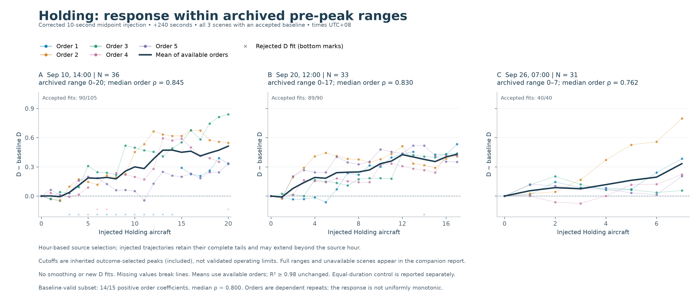
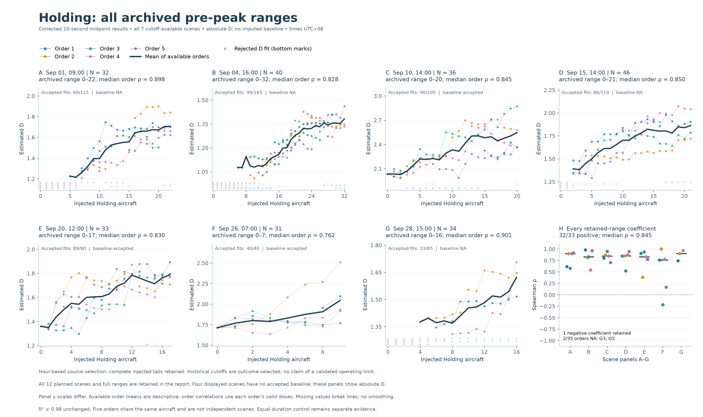
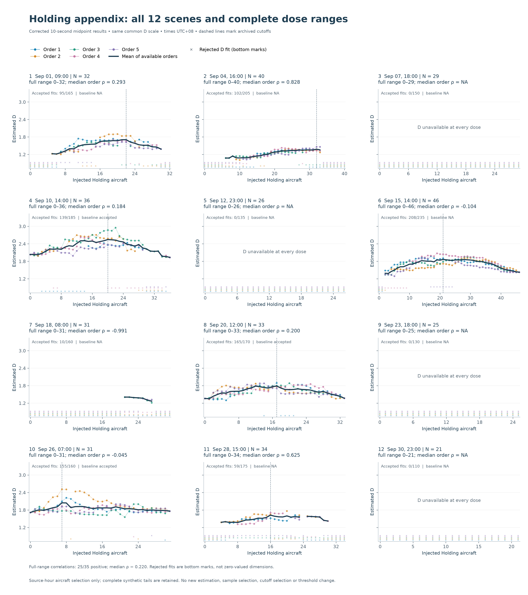

> Historical R2 >= 0.98 presentation. Superseded by the [current 0.94 report](../../holding-midpoint-response.md).

# Corrected 10-second midpoint Holding: archived pre-peak response

Rendered 2026-10-27 from existing QC500 results only. No Encoder calls, D fits, sampling, new cutoffs or threshold changes. The original experiment and terminal equal-duration results remain unchanged.

## Exact experimental scope

Aircraft were selected from a natural-hour source file. A corrected 240-second racetrack was inserted at each selected trajectory's midpoint; the original tail was retained. The injected trajectory was **not clipped back to the hour boundary**. These results describe hour-selected synthetic trajectories, not traffic confined to an unchanged natural hour after injection. The input interval is 10 seconds; the frozen epoch-90 Encoder has 9 input features and a 16-dimensional output embedding.

The archived peak is the earliest maximum of the scene's available-order mean D with at least three accepted orders. It is shared by five orders and included in the plotted range. It was selected from outcomes, not independently specified or validated as an operational limit. This renderer never searches for a new peak.

## Main response: accepted baselines only

[Vector PDF](figures/holding-midpoint-prepeak-delta.pdf) · [SVG](figures/holding-midpoint-prepeak-delta.svg)

All three scenes with an accepted baseline are shown. Subtracting a scene's constant baseline changes the vertical origin, not its order correlations. Within these archived ranges, 14/15 order coefficients are positive (median 0.800); one negative remains. The same shared vertical scale is used in all three panels. The short September 26 range is not extended to make it resemble the other panels.

## Complete pre-peak inventory

[Vector PDF](figures/holding-midpoint-prepeak-all-scenes.pdf) · [SVG](figures/holding-midpoint-prepeak-all-scenes.svg)

All seven scenes with an archived cutoff are included. Four lack an accepted baseline, so this overview uses absolute D. Across 35 planned orders, 33 coefficients are estimable: 32 positive and one negative, with median 0.845. Two orders remain NA. All seven scene median coefficients are positive. This does not mean each curve is monotonic or that every extra aircraft increases D. Panel-specific vertical scales are labelled and should not be used to compare effect magnitudes visually.

Colored points are accepted order-dose estimates. Thin lines and the dark available-order mean are unsmoothed and break at missing estimates. Bottom crosses mark failed fits on a separate axes-coordinate strip, not D=0. The set of contributing orders can change with dose; the dark line is descriptive, not a fixed-cohort estimate or a confidence interval. Coefficients are calculated per order from archived accepted doses, not from the dark line. The original R² ≥ 0.98 gate remains unchanged.

## Full ranges and unavailable scenes

[Vector PDF](figures/holding-midpoint-full-range-appendix.pdf)

Across the full ranges, 25/35 computable order coefficients are positive and the median is 0.220. On the same 33 orders used for the retained-range comparison, the full-range median is also 0.220 (24 positive). The strong pre-peak association is range-dependent. Five of 12 planned scenes have no archived cutoff and are not silently removed from this inventory.

| Source hour (UTC) | Local time (UTC+08) | N | Baseline D | Saved cutoff | Estimable pre-peak orders | Median pre-peak rho | Median full rho |
|---|---|---:|---:|---:|---:|---:|---:|
| 2026-09-01T01Z | Sep 01, 09:00 | 32 | NA | 22 | 5 | 0.898 | 0.293 |
| 2026-09-04T08Z | Sep 04, 16:00 | 40 | NA | 32 | 5 | 0.828 | 0.828 |
| 2026-09-07T10Z | Sep 07, 18:00 | 29 | NA | NA | 0 | NA | NA |
| 2026-09-10T06Z | Sep 10, 14:00 | 36 | 2.033 | 20 | 5 | 0.845 | 0.184 |
| 2026-09-12T15Z | Sep 12, 23:00 | 26 | NA | NA | 0 | NA | NA |
| 2026-09-15T06Z | Sep 15, 14:00 | 46 | NA | 21 | 5 | 0.850 | -0.104 |
| 2026-09-18T00Z | Sep 18, 08:00 | 31 | NA | NA | 0 | NA | -0.991 |
| 2026-09-20T04Z | Sep 20, 12:00 | 33 | 1.360 | 17 | 5 | 0.830 | 0.200 |
| 2026-09-23T10Z | Sep 23, 18:00 | 25 | NA | NA | 0 | NA | NA |
| 2026-09-25T23Z | Sep 26, 07:00 | 31 | 1.713 | 7 | 5 | 0.762 | -0.045 |
| 2026-09-28T07Z | Sep 28, 15:00 | 34 | NA | 16 | 3 | 0.901 | 0.625 |
| 2026-09-30T15Z | Sep 30, 23:00 | 21 | NA | NA | 0 | NA | NA |

## Interpretation for the paper

Suggested wording: “For the corrected 10-second midpoint Holding stimulus, the archived pre-peak ranges showed predominantly positive dose–dimension associations (32 of 33 computable order coefficients positive; median Spearman rho 0.845). The three scenes with accepted baselines also showed predominantly positive associations (14/15; median 0.800). These exploratory results are conditional on outcome-selected ranges and estimation gates; they do not establish a globally monotonic response or an independently validated operating range.”

Holding adds both geometry and duration. The [terminal equal-duration control](../../holding-paper-appendix.md) remains relevant evidence: straight continuation also increases D in many cases. Its midpoint-derived cutoff comparison gave matched-order medians 0.661 for endpoint Holding and 0.598 for straight continuation. Because insertion position differs, that comparison does not quantify the exact length contribution to this midpoint experiment. Do not treat it as a matched midpoint control or claim the midpoint response is entirely caused by turning geometry.

The complete evidence supports sensitivity of this representation and dimension estimate to this synthetic intervention within the displayed ranges. It does not by itself establish operational workload validity, universal superiority, or that a downward response is caused by exceeding a physical controllability limit. Five orders reuse aircraft and are dependent; no confirmatory p-values or confidence intervals are claimed.

## Reproducibility

- [Renderer](../../code/plot_holding_midpoint_response.py): accepts a new output directory and refuses overwriting an existing render.
- [Saved experiment](../../runs/strict-10s-reference/results/experiment-results.json), [saved summary](../../runs/strict-10s-reference/results/summary.json), [archived cutoff rule](../../runs/strict-10s-reference/results/analysis-manifest.json).
- [Version comparison](../../holding-version-comparison.md): original 5-second pilot, corrected midpoint experiment and endpoint control are distinct.
- The local render manifest stores source hashes and zero counts for new inference/estimation/cutoff selection. Source hashes are checked again after rendering.
