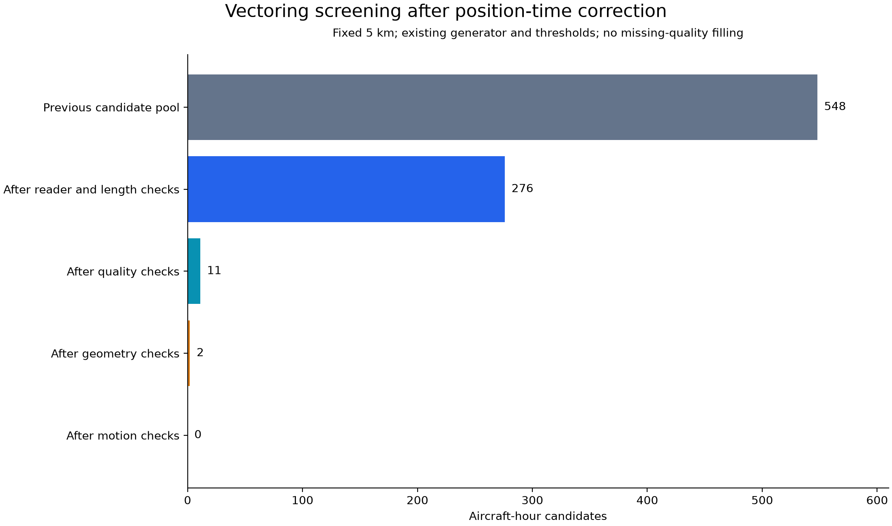

# Approved evaluation rerun comparison — 2026-10-22

The complete existing evaluation was rerun with the original checkpoint (SHA256
`d3abfc192a2e7a0f84bb1c4207ee04cfc4a4880755530da475124c5f711753ea`), the same 12 scenes,
five orders, fixed 5 km vectoring peak, and original count-sensitivity settings.
No new experiments or threshold tuning were added. No Git push was performed.

## Vectoring

**0 of 548 candidates passed.** The immediately preceding saved run accepted
1 candidate and also had no estimable correlations. The new run has baseline-only
vectoring curves. Correlation is undefined, not zero or negative.

| Sequential gate | Rejected at this stage | Remaining |
|---|---:|---:|
| Initial candidates | — | 548 |
| Original source positions and update continuity | 152 | 396 |
| Approved quality metadata and 10 s brackets | 365 | 31 |
| Conditional quadratic geometry / direction uncertainty | 27 | 4 |
| Deformed trajectory motion | 4 | 0 |

These are mutually exclusive first-stage counts. Individual reasons in the main
audit can overlap and must not be added. The geometry stage rejects 26 for
quadratic-model inconsistency with the approved error disks and 1 for direction
uncertainty. Four remaining candidates fail longitudinal acceleration; one of
those also has a speed-collapse failure on the other side. The current policy
does not demonstrate that the real flights are physically invalid. In particular,
the local quadratic assumption and temporal completeness requirements are strict
engineering conditions. They were not relaxed after observing this result.

The formerly reported positive vectoring association remains unvalidated. This
run neither confirms it nor disproves it, because no nonzero intervention dose
survives. Previously matched 327 candidates were a provisional metadata group,
not final usable interventions.

## Holding

Both QC500 and QC350 complete Holding dose outputs are **exactly equal** to the
saved pre-rerun outputs. Aircraft-count sensitivity results are also exactly equal.

| QC500 scope | Full-range median rho, before → after | Retained-prefix median rho, before → after |
|---|---:|---:|
| All computable orders | -0.110 → -0.110 (60 curves) | 0.913 → 0.913 (50 curves) |
| Baseline-estimable scenes only | 0.191 → 0.191 (30 curves) | 0.928 → 0.928 (30 curves) |
| Hour-level medians, baseline-estimable | 0.209 → 0.209 (6 hours) | 0.945 → 0.945 (6 hours) |

The apparent strong positive association applies to an outcome-selected prefix;
the full range is not uniformly increasing. Five orders within one hour are not
independent hours. Holding still adds trajectory length under sum pooling, so
these results do not isolate holding geometry from length. No equal-length
control was run.

## Validation and files

24 regression checks passed before the run. Checks cover fixed amplitude,
zero-direction rejection, circle collapse, source consistency, the 10 s metadata
boundary, correlated disk-error enclosure for a known quadratic, model rejection,
and candidate-level reason deduplication. The complete run finished successfully
and regenerated all existing figures and reports. Assumptions and reproduction
inputs are in [approved policy](vectoring-threshold-decisions.md).

The local pre-rerun backup includes code, results, figures and reports:
`C:/Users/HP/Documents/ChatGPT/UVA World Model/deliverables/evaluation-before-approved-rerun`.
Raw OpenSky messages and point matches remain local. The inference manifest
records the metadata hash and code hashes; no missing metadata was filled.
