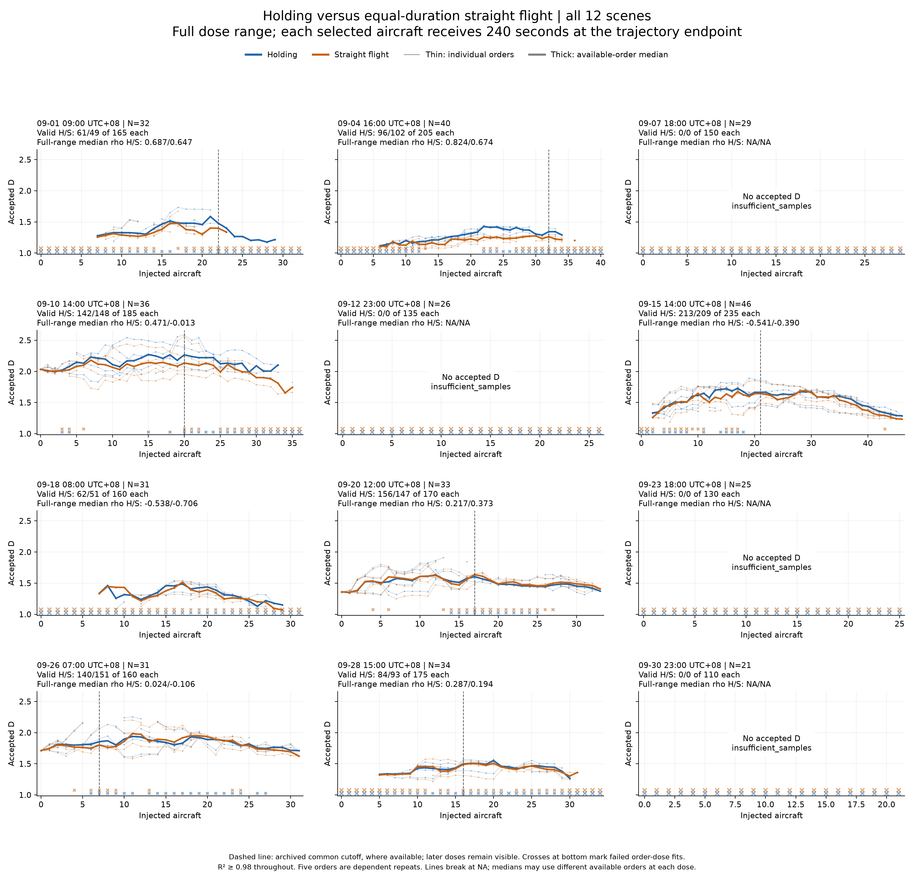
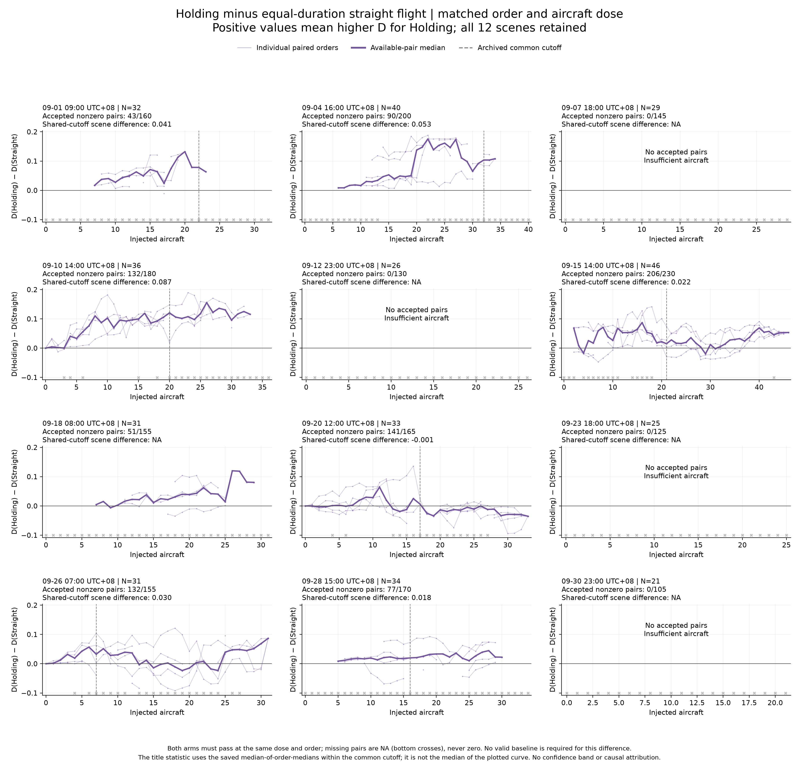

# Appendix H: complete Holding evidence and equal-duration control

This appendix documents the separate endpoint equal-duration study, not the [midpoint response](holding-midpoint-response.md). It accompanies the [endpoint historical-range figure](figures/holding-historical-range-main.png) and [main report](report.md). It retains all 12 planned scenes, full dose ranges, failure states and the equal-duration straight comparison. No experiment, cutoff selection or threshold change was made for the presentation.

## Scope of the endpoint historical-range figure

The endpoint historical-range figure shows only the retained range of all seven scenes with an existing historical cutoff, in chronological order. Full later-dose curves are presented below; they have not been deleted from the results. The five omitted from its dose panels have no archived cutoff: September 7, 12, 18, 23 and 30 (local dates). Four of these have N<30 and no accepted D; September 18 has N=31 and accepted full-range estimates but no historical cutoff. It is retained below, including its negative full-range association. No replacement cutoff is invented.

In the seven retained-range scenes there are 35 planned orders: 33 yield a correlation (30 positive, 3 negative); September 1 display order 3 and September 28 display order 3 are NA because they have fewer than five jointly valid doses. Display orders 1–5 correspond to saved replicate indices 0–4.

Endpoint historical-range curves use available Holding fits, whereas the reported correlations use exactly the same doses accepted in both arms. The median curve and median order correlation are different summaries. At each dose the available-order composition can change; failed estimates remain missing. Individual y-axis scales improve legibility but preclude judging effect-size differences by apparent slope alone.

Historical cutoffs were selected from earlier midpoint-Holding results. They are not independently established physical limits, and the later endpoint-addition experiment is a different intervention. The endpoint historical-range figure is an exploratory conditional association, not independent confirmation of a universal monotonic relationship.

## Full-range dose response and equal-duration paired difference

All 12 scenes and 5 orders per scene are shown. Both arms append 240 seconds at the trajectory endpoint; original points remain unchanged. The saved Holding study uses R²≥0.98, unlike the R²≥0.94 hourly and current Vectoring studies. These gates are not retrospectively made uniform.

Blue is Holding; orange is straight flight. Thin curves are individual orders; thick curves are the median of available orders at each dose. Crosses at the bottom mark rejected order-dose estimates; their vertical position is a status marker, not D. Dashed vertical lines show the archived common cutoff where available. Full later-dose results remain visible. Four scenes have too few aircraft and no accepted D.

| Scope, jointly valid doses | Median order rho: Holding | Straight | Orders |
|---|---:|---:|---:|
| Full range | 0.196 | 0.065 | 37 |
| Same archived cutoff in both arms | 0.661 | 0.598 | 33 |

The two rows involve different eligible order sets. Among the same 33 cutoff-eligible orders, the full-range medians are 0.217 and 0.187. Cutoffs came from earlier midpoint results, not an independently established operational limit, and were not re-selected for these plots. Correlation is calculated per order on jointly valid doses, not from the thick plotted median curve.

The vertical axis is D(Holding) minus D(Straight) for the same scene, order and dose. Both fits must pass. Positive values favor Holding; negative values favor straight flight. Full-range paired scene summaries are positive in 7/8 comparable scenes, with an equal-scene median difference of 0.034. Within the common historical cutoffs they are positive in 6/7 scenes, median 0.030. These are medians across scene/order summaries, not a pooled causal effect. All 12 scene panels remain visible, including unavailable pairs and scenes without an archived cutoff.

**Paper claim:** D responds to the tested trajectory extensions, with a generally small additional Holding-versus-straight difference. Both groups can rise, so the strong truncated Holding correlation alone does not establish a maneuver-specific effect. The equal-duration design controls duration and point count, but straight extension also changes spatial extent; it cannot assign a percentage of the response to length. Only three scenes have valid zero-dose baselines, so the plots use absolute D and paired arm differences rather than inventing baseline-relative values.

Evidence: [full equal-duration study](runs/holding-equal-duration/report.md), [shared historical cutoffs](runs/holding-equal-duration-old-cutoff/report.md).

## All 12 scene summaries

Rho columns are medians of order-level correlations on jointly accepted doses. Difference columns are saved medians across orders of dose-level paired differences. They are not correlations of the plotted median curve.

| Scene UTC+08 | N | Historical cutoff | Full rho H | Full rho S | Range rho H | Range rho S | Range paired D(H)−D(S) |
|---|---:|---:|---:|---:|---:|---:|---:|
| 09-01 09:00 | 32 | 22 | 0.687 | 0.647 | 0.785 | 0.688 | 0.041 |
| 09-04 16:00 | 40 | 32 | 0.824 | 0.674 | 0.800 | 0.674 | 0.053 |
| 09-07 18:00 | 29 | NA | NA | NA | NA | NA | NA |
| 09-10 14:00 | 36 | 20 | 0.471 | -0.013 | 0.629 | 0.504 | 0.087 |
| 09-12 23:00 | 26 | NA | NA | NA | NA | NA | NA |
| 09-15 14:00 | 46 | 21 | -0.541 | -0.390 | 0.313 | 0.223 | 0.022 |
| 09-18 08:00 | 31 | NA | -0.538 | -0.706 | NA | NA | NA |
| 09-20 12:00 | 33 | 17 | 0.217 | 0.373 | 0.477 | 0.474 | -0.001 |
| 09-23 18:00 | 25 | NA | NA | NA | NA | NA | NA |
| 09-26 07:00 | 31 | 7 | 0.024 | -0.106 | 0.762 | 0.611 | 0.030 |
| 09-28 15:00 | 34 | 16 | 0.287 | 0.194 | 0.736 | 0.549 | 0.018 |
| 09-30 23:00 | 21 | NA | NA | NA | NA | NA | NA |

No confidence intervals or confirmatory p-values are inferred from the dependent orders. Source statistics, embeddings, source tracks and earlier figures remain unchanged.
