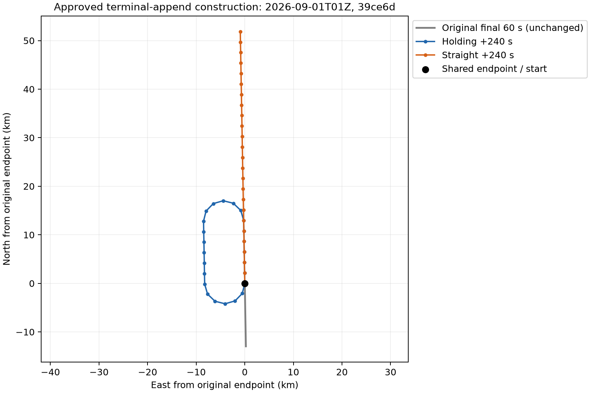
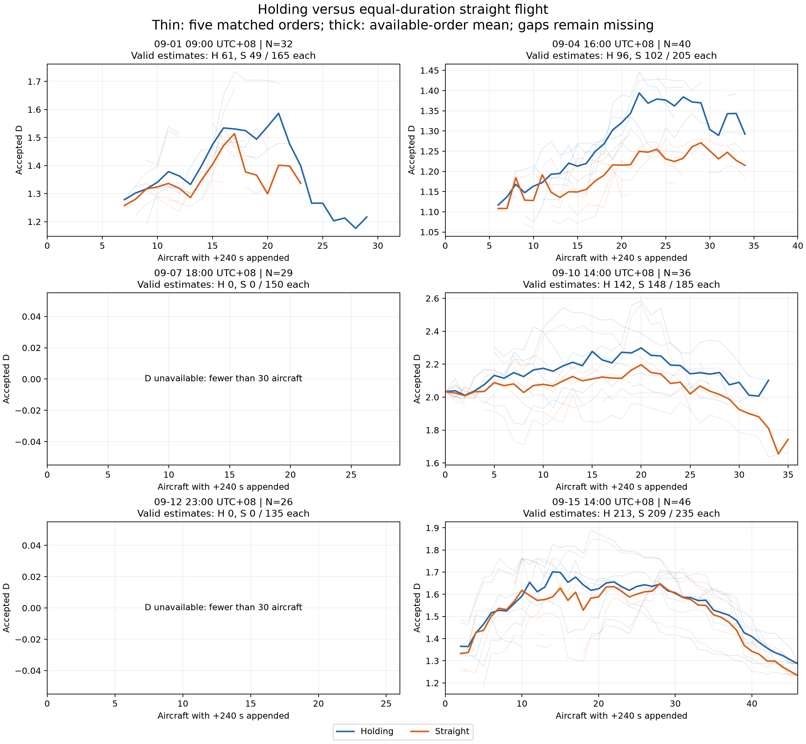
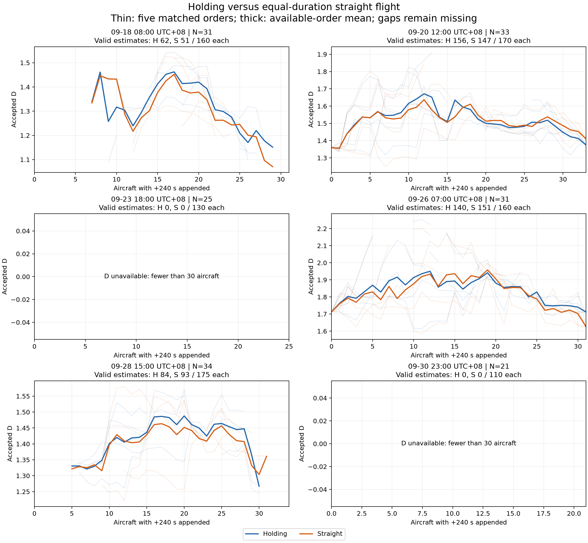
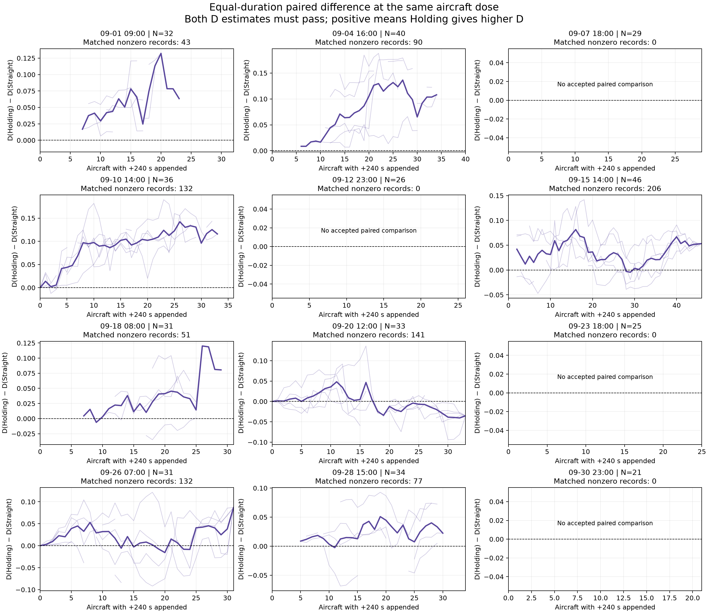

# Holding equal-duration terminal-append control

> Archived stage report. Statements about work not yet run describe this stage only. See the [current combined report](../../../report/report.md) for subsequent results. Publication excludes raw trajectories and model weights; see the [bundle notes](../../../histry/publication-records/runs-index.md).

Completed the approved experiment on all original twelve scenes with the frozen 10-second Encoder. Earlier results remain unchanged. No Vectoring run, retraining, download, threshold relaxation or outcome-selected cutoff was performed.

## Design and verification

All 384 QC500 background aircraft-hours supported both additions. Each arm appends exactly 240 seconds / 24 samples from the same endpoint, with the same starting heading, speed, constant local ENU height and injection order. The original trajectory points are retained exactly. All twelve baseline D results (including failures) exactly reproduce the earlier run.

Holding reuses the existing racetrack: two 60-second straight legs and two standard-rate 180-degree turns (3 degrees/second). Straight flight continues for 240 seconds at the same speed. Endpoint heading is the final input segment direction; speed uses the existing local median rule on the final three segments (>1 m/s). No fallback speed or direction was used. This is synthetic continuation, not an attempt to fill missing observations.

The two paths have the same continuous path length. At 10-second sampling, circular arcs are represented by chords, making the Holding polyline approximately 0.57% shorter than the straight polyline; point count and duration are exactly equal. No adjustment was made to erase that geometry difference. The existing source QC is preserved; this control is not an additional aircraft-specific feasibility certification.

## Main numerical results

| Full-range correlation summary | Holding | Straight |
|---|---:|---:|
| Each arm's own valid-dose subset: median rho | +0.196 (37 curves) | +0.082 (38 curves) |
| Same jointly valid doses in each pair: median rho | +0.196 (37 curves) | +0.065 (37 curves) |
| Same doses, baseline-valid scenes only: median rho | +0.158 (15 curves) | -0.013 (15 curves) |

There are 8 scenes with accepted nonzero paired comparisons, out of twelve. 7 have a positive median Holding-minus-Straight difference. The equal-scene median paired difference is +0.03429. Only 3 scenes have an accepted zero-injection baseline; their equal-scene median paired difference is +0.01242.

Paired differences use only the same scene/order/dose with both D estimates accepted. Baseline-relative changes additionally require an accepted baseline. Missing D is never filled or treated as zero. Every rejected record and reason is retained. Five orders and their nested doses are not independent experimental samples; the reported medians are descriptive and no p-values are claimed.

| Scene (UTC+08) | N | Baseline D | Joint nonzero records | Common-dose rho H | Common-dose rho S | Median paired D(H) − D(S) |
|---|---:|---:|---:|---:|---:|---:|
| 09-01 09:00 | 32 | NA | 43 | +0.687 | +0.647 | +0.04087 |
| 09-04 16:00 | 40 | NA | 90 | +0.824 | +0.674 | +0.05301 |
| 09-07 18:00 | 29 | NA | 0 | NA | NA | NA |
| 09-10 14:00 | 36 | +2.033 | 132 | +0.471 | -0.013 | +0.09384 |
| 09-12 23:00 | 26 | NA | 0 | NA | NA | NA |
| 09-15 14:00 | 46 | NA | 206 | -0.541 | -0.390 | +0.03802 |
| 09-18 08:00 | 31 | NA | 51 | -0.538 | -0.706 | +0.03056 |
| 09-20 12:00 | 33 | +1.360 | 141 | +0.217 | +0.373 | -0.00572 |
| 09-23 18:00 | 25 | NA | 0 | NA | NA | NA |
| 09-26 07:00 | 31 | +1.713 | 132 | +0.024 | -0.106 | +0.01242 |
| 09-28 15:00 | 34 | NA | 77 | +0.287 | +0.194 | +0.02060 |
| 09-30 23:00 | 21 | NA | 0 | NA | NA | NA |

Within each scene, the paired difference is summarized by the median across orders of each order's median over valid nonzero doses. Common-dose rho is similarly summarized across orders, subject to the unchanged minimum of five valid doses. Joint record counts include repeated orders and are not independent sample counts.

## Interpretation and limits

Straight continuation also changes D, and both arms show positive and negative dose associations depending on the scene/order. Thus an increase in Holding D alone cannot establish that the effect is specific to turning geometry. The matched Holding-minus-Straight difference is positive in seven of eight scene summaries, supporting a geometry/location contribution beyond equal additional duration and token count. One scene has a negative median difference. A higher D than the straight control is distinct from a strong positive correlation with the number of injected aircraft.

This experiment controls added duration and point count, but it cannot assign a percentage of the old response to pure sequence length: straight flight itself changes spatial extent, position features and contextual Encoder outputs. The matched contrast estimates the difference between these two specified continuations, not a universal isolated effect of Holding.

The old experiment inserted Holding at the midpoint. This approved control appends both arms at the endpoint. It therefore does not directly validate or invalidate the old midpoint pre-peak coefficient, and should not be presented as the same intervention. Full-range results are retained here; no high-correlation prefix was selected.

D is still subject to the unchanged finite-count and fit-quality gates. Four scenes have fewer than 30 background aircraft and cannot yield D at any dose. Other failures are preserved. A shared radius grid does not imply an identical eligible fitting-scale subset: that subset can change under the existing pair-count/C(r) rules. Correlations on available accepted doses remain conditional on those gates.

The paper can report this as a paired equal-duration sensitivity/control experiment with mixed scene-dependent outcomes. These results do not establish a universal strong positive Holding-specific dose response or complete validation of the D method.

## Reproducibility

- `policy.json` and `assignments.json`: choices frozen before inference.
- `geometry-audit.json` and `inputs/`: exact paired arrays, source QC and geometry checks.
- `results/run-manifest.json`: checkpoint, source hashes, original inputs and environment.
- `results/experiment-results.json`: every D attempt, scale, pair count and failure reason.
- `results/summary.json`, `repeat-summary.json`, `paired-dose-records.json`: reported statistics.
- `verification.json`: independent replays of saved D records, rank correlations, path geometry and protected-file hashes.
- `run.py`: run once into a new directory; refuses to overwrite an existing results directory.
