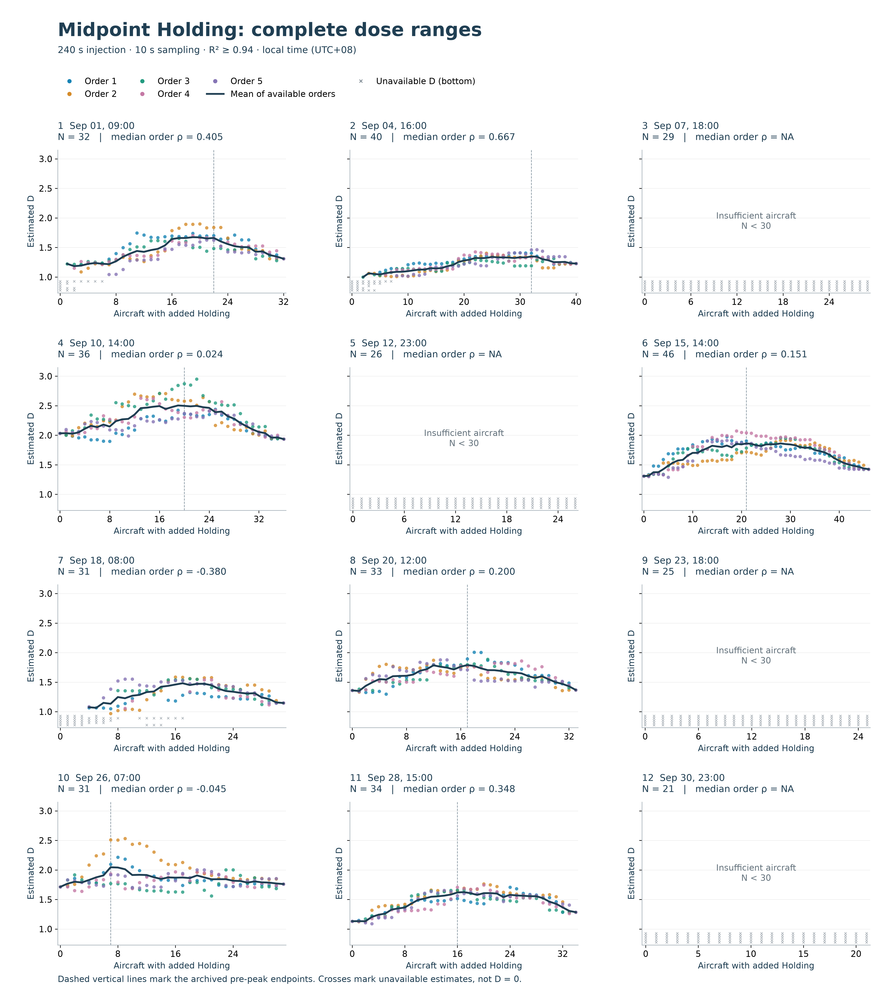

# Midpoint Holding: dose–dimension response

Updated 2026-10-27. **The primary midpoint Holding fit threshold is now R² ≥ 0.94**, as explicitly selected by the user. R² ≥ 0.98 is preserved as the historical comparison, not the current primary gate. The endpoint control and Vectoring are separate experiments and are unchanged.

## Main paper figure

[Vector PDF](figures/holding-midpoint-prepeak-all-scenes.pdf) · [Editable SVG](figures/holding-midpoint-prepeak-all-scenes.svg)

**Figure caption.** Dose–dimension responses to a corrected 240-second midpoint Holding insertion, using trajectories sampled every 10 seconds and the frozen epoch-90 Encoder. Panels A–G include every scene with an archived pre-peak endpoint; endpoints are inherited unchanged from the earlier R² ≥ 0.98 analysis and were selected from its outcomes. Points denote five injection orders, and dark lines are unsmoothed means of available orders. Missing estimates are marked at the bottom and are never imputed; lines break where the mean is unavailable. Panel H displays every per-order Spearman coefficient within the corresponding displayed range; horizontal bars denote scene medians. Panel-specific D axes are labelled and should not be used to compare effect magnitudes by apparent slope. Dates are September 2026, local UTC+08. The five orders reuse aircraft and are dependent repeats.

Within these seven archived ranges, **34/35 order correlations are positive**, with **median Spearman ρ = 0.884**. All 35 order coefficients are computable, including one negative coefficient. This median is over per-order correlations, not a correlation of the mean line and not 35 independent scene replications. The strong association is conditional on these exploratory, outcome-selected ranges.

## Exact experiment and processing

Aircraft were selected from natural-hour source files. A corrected 240-second racetrack was inserted at the trajectory midpoint; the complete original tail was retained. Injected trajectories were not clipped back to the source hour. The frozen Encoder uses 9 input features and a 16-dimensional embedding.

The final log C(r)–log r fit gate changes from R² ≥ 0.98 to R² ≥ 0.94. Aircraft QC, the minimum 30 aircraft, at least 8 fitting scales, at least 10 pairs, C(r) in [0.02, 0.3], radius ratio ≥ 2, the original adaptive fitting windows, five injection orders and archived endpoints remain unchanged. No new peak or favorable scene subset is selected. This is a declared post-analysis gate revision; 0.94 follows the existing engineering convention elsewhere in this evaluation, not a universally validated cutoff or a threshold optimized here by a search.

Saved positive slopes rejected solely for poor_linear_fit are re-screened. Earlier-stage failures remain unavailable. Acceptance changes from 933/1980 to **1371/1980** order-dose records; accepted baselines change from 3/12 to **5/12**. This changes availability of D, not the aircraft population. No Encoder inference, new D fit or new trajectory generation is needed for this gate-only update.

## Baseline-relative companion

[Vector PDF](figures/holding-midpoint-prepeak-delta.pdf)

All five accepted-baseline scenes are shown on a common ΔD scale. Within their archived ranges, 24/25 coefficients are positive; median ρ = 0.866. Subtracting a constant baseline does not change an order's correlation. The remaining two pre-peak scenes have no accepted baseline and are retained in absolute D in the main figure.

## Complete ranges and unavailable scenes

[Vector PDF](figures/holding-midpoint-full-range-appendix.pdf)

All twelve planned scenes are retained. Across complete ranges, 28/40 computable order correlations are positive; median ρ = **0.218**. Four scenes remain below the minimum sample count; another has no archived pre-peak endpoint and is not assigned a new one. The complete-range response is not uniformly positive or monotonic.

| Local UTC+08 | Aircraft N | Archived endpoint | Baseline accepted | Accepted D / attempted | Median pre-peak ρ | Median full-range ρ |
|---|---:|---:|---|---:|---:|---:|
| Sep 01, 09:00 | 32 | 22 | No | 149/165 | 0.937 | 0.405 |
| Sep 04, 16:00 | 40 | 32 | No | 180/205 | 0.897 | 0.667 |
| Sep 07, 18:00 | 29 | NA | No | 0/150 | NA | NA |
| Sep 10, 14:00 | 36 | 20 | Yes | 185/185 | 0.818 | 0.024 |
| Sep 12, 23:00 | 26 | NA | No | 0/135 | NA | NA |
| Sep 15, 14:00 | 46 | 21 | Yes | 235/235 | 0.884 | 0.151 |
| Sep 18, 08:00 | 31 | NA | No | 117/160 | NA | -0.380 |
| Sep 20, 12:00 | 33 | 17 | Yes | 170/170 | 0.830 | 0.200 |
| Sep 23, 18:00 | 25 | NA | No | 0/130 | NA | NA |
| Sep 26, 07:00 | 31 | 7 | Yes | 160/160 | 0.762 | -0.045 |
| Sep 28, 15:00 | 34 | 16 | Yes | 175/175 | 0.945 | 0.348 |
| Sep 30, 23:00 | 21 | NA | No | 0/110 | NA | NA |

## Paper interpretation and controls

Suggested manuscript wording: “With an R² ≥ 0.94 fit-quality criterion, the corrected midpoint Holding intervention showed predominantly positive dose–dimension associations within the seven archived pre-peak ranges (34/35 per-order coefficients positive; median Spearman ρ = 0.884). These exploratory ranges were inherited from an earlier analysis. Complete-range responses were weaker and included negative associations.”

The response is evidence of sensitivity to this synthetic intervention, not proof of global monotonicity or operational workload validity. Holding adds both geometry and duration. The [endpoint equal-duration control](../controls/holding-paper-appendix.md) remains necessary context: straight continuation also changes D. That control uses a different insertion position and cannot identify the exact duration contribution to midpoint Holding. It remains at its previously reported gate; no control result is relabelled as a newly computed 0.94 result.

## Reproducibility and history

- [Current renderer](../code/plot_holding_primary.py) replays screening from saved fits and creates all three figures and this report; `--output` requires a new directory.
- [Saved-fit screening logic](../code/audit_holding_r2_sensitivity.py) preserves original statuses and checks source hashes. Its internal sensitivity naming records the provenance; this report defines the user-selected primary presentation.
- [Archived R² ≥ 0.98 report](../history/midpoint-r098/holding-midpoint-response.md) preserves the previous figures. The immutable strict-10s-reference run remains the original 0.98 source experiment.
- Local screening records, per-order statistics and render manifests are retained outside publication artifacts. The rendering step performed no Git push; the reviewed code, report and figures are published separately.
