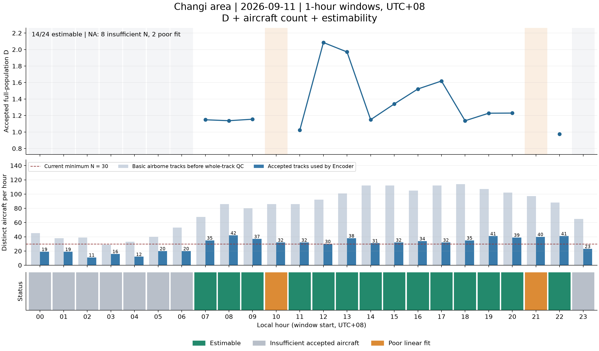
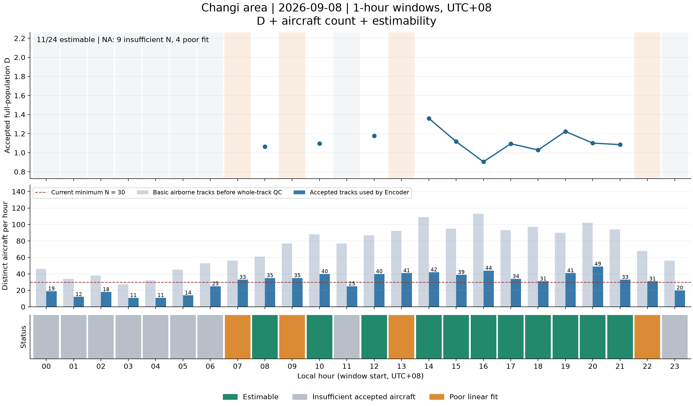
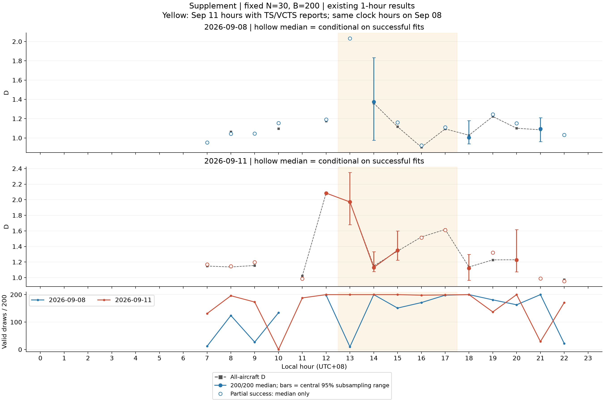
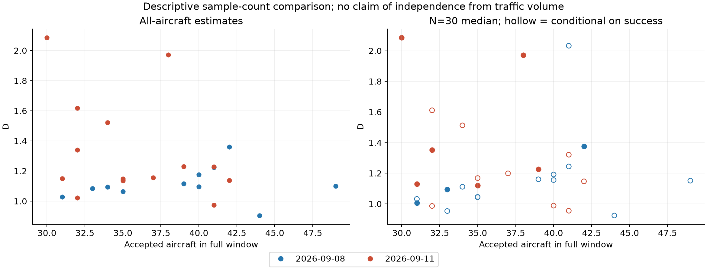

# Changi: a 24-hour real-traffic application case

This case demonstrates hourly application and explicitly reports when D cannot be reliably estimated under the current rules. The complete 24-hour display combines accepted D, aircraft counts before and after whole-track QC, and estimability. It does not claim 24 valid D estimates or complete validation of operational complexity.

Only 1-hour windows are presented. NA is retained, never filled with zero or interpolated, and lines do not bridge failed hours. This publication regenerates figures and text from saved results only; no training, inference, D estimation, new sampling or threshold change was performed.

## Primary coverage

| Local date | Estimable D | Insufficient accepted aircraft | Poor fit | Valid subsets / attempts | Hours with 200/200 |
|---|---:|---:|---:|---:|---:|
| 2026-09-08 | 11/24 | 9 | 4 | 1991/3000 | 3 |
| 2026-09-11 | 14/24 | 8 | 2 | 2622/3200 | 6 |

## Primary figures

Counts before QC are distinct ICAO identifiers with basic finite airborne records, not a complete airport movement census. Counts after QC are the actual Encoder population. The study covers 100 km around Changi, including overflights and other airport traffic. Each status cell represents one hour; missing D means unavailable under these rules, not zero complexity.

## Frozen method

- Strict 10-second barometric input, one full-window sequence per accepted aircraft, frozen epoch-90 9-feature Encoder, training normalization and sum pooling. Checkpoint SHA-256: `bc1e0d74255cfee60a1c09c64dab8fac5a31f3175c4c234f8cf3983bc07af976`.
- Minimum 30 aircraft, 8 fitting scales, 10 pairs, C(r) in [0.02, 0.3], radius ratio >=2, R²>=0.94. These are the saved case-study gates, not a retrospective relaxation of historical 0.98 maneuver results.
- A shared 64-radius logarithmic grid (0.21153999267980197 to 377.183110301039), built from positive within-window distances across all 24 September 11 populations, including low-N hours, and saved before D. Both days and all subsets use it. Eligible regression scales can still vary by population.
- Fixed N=30; exactly B=200 subsets without replacement within each draw for every eligible hour. Repeated subsets are permitted; failed draws are not replaced. There are 6,200 saved draws across 31 eligible hours.

## Why some hours are unavailable

The full-population results have 17 insufficient-N hours and 6 poor-fit hours. Every computed full-population and subset fit met the scale-count and radius-span gates; fit failures occur at the R² gate. This does not establish that the shared grid is optimal or that physical traffic lacks a geometric dimension. Changing plot ticks or distance units cannot remove curvature in the log-correlation curve.

Whole-track QC rejects an entire aircraft-hour at its first failure. Source auditing found 849 first rejections for non-advancing position time across both days: all were repeated timestamps with unchanged coordinates, not backward timestamps. Of those, 565 also have excessive position age or gaps between distinct position observations; 284 have no such additional time flags. The latter are NOT accepted or recovered tracks: downstream checks have not been established under a different observation-stream treatment. This conservative policy can reduce availability. It remains unchanged in the reported results.

| First screening outcome (aircraft-hours) | September 8 | September 11 |
|---|---:|---:|
| accepted | 723 | 711 |
| fewer_than_16_source_records | 130 | 119 |
| fewer_than_30_grid_points | 73 | 90 |
| position_timestamp_not_advancing | 428 | 421 |
| position_update_gap_over_20_s | 54 | 60 |
| repeated_raw_horizontal_position | 1 | 0 |
| source_record_gap_over_20_s | 321 | 489 |

## Supplement: fixed N and weather comparison

Fixed-N results retain time variation but often depend on which subsets pass. Partial-success medians are conditional and shown hollow without a range or continuous median curve. A central 95% subsampling range is shown only for 200/200 valid draws with more than one distinct subset; it is not a bootstrap confidence interval. At September 11 12:00, N=30 yields the same subset on all 200 draws, so this is not resampling robustness.

September 11 is the thunderstorm day and September 8 the clearer-weather comparator. Independent WSSS TS/VCTS reports occur in September 11 clock bins 13–17; shading does not identify exact continuous storm boundaries. The comparison has mixed directions: at 14:00 the event-day fixed-N median is lower (both 200/200); at 15:00–17:00 it is higher, with some partial-success hours. At 13:00 the control full fit fails and only 10/200 subsets pass. No storm-caused increase, wind-shear detection, or universal positive association is established.

Weather evidence: [WSSS archive provider](https://mesonet.agron.iastate.edu/request/download.phtml?network=SG__ASOS) and [Meteorological Service Singapore retrospective](https://www.weather.gov.sg/more-showers-expected-in-the-coming-fortnight/). The local evidence summary records the archived observations; absence of a weather code is not proof that no adverse weather occurred.

## Every hour retained

| Date | Hour | Before QC | Accepted | D | Status | Valid / attempted draws | Conditional median |
|---|---:|---:|---:|---:|---|---:|---:|
| 2026-09-08 | 00 | 46 | 19 | NA | insufficient_samples | 0/0 | NA |
| 2026-09-08 | 01 | 34 | 12 | NA | insufficient_samples | 0/0 | NA |
| 2026-09-08 | 02 | 38 | 18 | NA | insufficient_samples | 0/0 | NA |
| 2026-09-08 | 03 | 27 | 11 | NA | insufficient_samples | 0/0 | NA |
| 2026-09-08 | 04 | 32 | 11 | NA | insufficient_samples | 0/0 | NA |
| 2026-09-08 | 05 | 45 | 14 | NA | insufficient_samples | 0/0 | NA |
| 2026-09-08 | 06 | 53 | 25 | NA | insufficient_samples | 0/0 | NA |
| 2026-09-08 | 07 | 56 | 33 | NA | poor_linear_fit | 12/200 | 0.953 |
| 2026-09-08 | 08 | 61 | 35 | 1.063 | ok | 124/200 | 1.044 |
| 2026-09-08 | 09 | 77 | 35 | NA | poor_linear_fit | 27/200 | 1.045 |
| 2026-09-08 | 10 | 88 | 40 | 1.096 | ok | 134/200 | 1.156 |
| 2026-09-08 | 11 | 77 | 25 | NA | insufficient_samples | 0/0 | NA |
| 2026-09-08 | 12 | 87 | 40 | 1.176 | ok | 198/200 | 1.192 |
| 2026-09-08 | 13 | 92 | 41 | NA | poor_linear_fit | 10/200 | 2.033 |
| 2026-09-08 | 14 | 109 | 42 | 1.361 | ok | 200/200 | 1.375 |
| 2026-09-08 | 15 | 95 | 39 | 1.117 | ok | 151/200 | 1.160 |
| 2026-09-08 | 16 | 113 | 44 | 0.905 | ok | 171/200 | 0.924 |
| 2026-09-08 | 17 | 93 | 34 | 1.094 | ok | 198/200 | 1.112 |
| 2026-09-08 | 18 | 97 | 31 | 1.028 | ok | 200/200 | 1.005 |
| 2026-09-08 | 19 | 90 | 41 | 1.223 | ok | 181/200 | 1.244 |
| 2026-09-08 | 20 | 102 | 49 | 1.101 | ok | 163/200 | 1.151 |
| 2026-09-08 | 21 | 94 | 33 | 1.085 | ok | 200/200 | 1.095 |
| 2026-09-08 | 22 | 68 | 31 | NA | poor_linear_fit | 22/200 | 1.032 |
| 2026-09-08 | 23 | 56 | 20 | NA | insufficient_samples | 0/0 | NA |
| 2026-09-11 | 00 | 45 | 19 | NA | insufficient_samples | 0/0 | NA |
| 2026-09-11 | 01 | 38 | 19 | NA | insufficient_samples | 0/0 | NA |
| 2026-09-11 | 02 | 39 | 11 | NA | insufficient_samples | 0/0 | NA |
| 2026-09-11 | 03 | 29 | 16 | NA | insufficient_samples | 0/0 | NA |
| 2026-09-11 | 04 | 33 | 12 | NA | insufficient_samples | 0/0 | NA |
| 2026-09-11 | 05 | 40 | 20 | NA | insufficient_samples | 0/0 | NA |
| 2026-09-11 | 06 | 53 | 20 | NA | insufficient_samples | 0/0 | NA |
| 2026-09-11 | 07 | 68 | 35 | 1.149 | ok | 131/200 | 1.169 |
| 2026-09-11 | 08 | 86 | 42 | 1.137 | ok | 196/200 | 1.147 |
| 2026-09-11 | 09 | 80 | 37 | 1.155 | ok | 173/200 | 1.199 |
| 2026-09-11 | 10 | 86 | 32 | NA | poor_linear_fit | 0/200 | NA |
| 2026-09-11 | 11 | 86 | 32 | 1.023 | ok | 188/200 | 0.986 |
| 2026-09-11 | 12 | 92 | 30 | 2.085 | ok | 200/200 | 2.085 |
| 2026-09-11 | 13 | 101 | 38 | 1.971 | ok | 200/200 | 1.972 |
| 2026-09-11 | 14 | 112 | 31 | 1.150 | ok | 200/200 | 1.131 |
| 2026-09-11 | 15 | 112 | 32 | 1.340 | ok | 200/200 | 1.351 |
| 2026-09-11 | 16 | 105 | 34 | 1.522 | ok | 198/200 | 1.513 |
| 2026-09-11 | 17 | 112 | 32 | 1.618 | ok | 199/200 | 1.611 |
| 2026-09-11 | 18 | 114 | 35 | 1.136 | ok | 200/200 | 1.120 |
| 2026-09-11 | 19 | 107 | 41 | 1.228 | ok | 137/200 | 1.321 |
| 2026-09-11 | 20 | 102 | 39 | 1.230 | ok | 200/200 | 1.226 |
| 2026-09-11 | 21 | 97 | 40 | NA | poor_linear_fit | 29/200 | 0.988 |
| 2026-09-11 | 22 | 88 | 41 | 0.974 | ok | 171/200 | 0.955 |
| 2026-09-11 | 23 | 65 | 23 | NA | insufficient_samples | 0/0 | NA |

## Interpretation and publication limits

Suitable claim: the case demonstrates an auditable hourly application to observed airport-area traffic and makes estimator availability explicit. It does not establish a complete reliable day/night D pattern, independence from traffic count, causal weather sensitivity, or general operational-complexity validity.

Fixed N controls count, not route composition, trajectory duration or data availability. The dates differ in weekday. Subsets are dependent within-hour draws, not independent days; aircraft may recur across hours. September 11 input sequences reach 357 samples versus 298 in the prepared training data; no new length cutoff was applied.

Reproduction: use `python evaluation/hourly/code/report_changi_hourly.py --input LOCAL_SAVED_PACKAGE --output NEW_DIRECTORY` from the repository root. The saved input package is retained locally and is not distributed on GitHub. The command verifies saved records and regenerates this report and four figure sets without Encoder/D calls. Source results remain immutable. The run package README documents the local input requirements.
