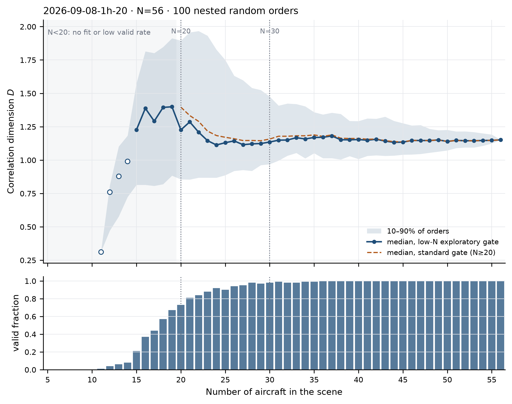

# D versus aircraft count: 2026-09-08 20:00 UTC+08

**Design:** one frozen scene (N=56), 100 nested random orders. Each order starts
with 5 aircraft and adds one aircraft at a time to the full scene. D is computed
on the frozen 64-radius grid.

## Result

| N | Valid orders / 100 | Median D (low-N gate) | Median D (standard gate) |
|---:|---:|---:|---:|
| 5–10 | 0 | — | — |
| 11 | 1 | 0.31 (not reliable) | — |
| 12 | 4 | 0.76 (not reliable) | 0.36 (1/100) |
| 14 | 8 | 0.99 (not reliable) | 0.99 (4/100) |
| 15 | 21 | 1.23 | 1.03 (6/100) |
| 18 | 57 | 1.39 | 1.40 (26/100) |
| 19 | 67 | 1.40 | 1.48 (36/100) |
| 20 | 73 | 1.23 | 1.40 (46/100) |
| 25 | 90 | 1.13 | 1.17 (70/100) |
| 30 | 98 | 1.14 | 1.16 (83/100) |
| 40 | 100 | 1.15 | 1.16 (92/100) |
| 56 | 100 | 1.15 | 1.15 (100/100) |

The low-N median rises from N=15 to a peak around N=19–20 (≈1.4), then falls to
≈1.15 and is essentially flat from N=30 onward. The full-scene D is 1.151.

## Interpretation

1. **N<15 is not usable** on this fixed grid: at N=5–10 no fit is possible; at
   N=11–14 fewer than 10/100 orders pass even the exploratory gate.
2. **The rise at N≈15–20 is not evidence that more aircraft cause higher
   complexity.** It is the region where the estimator is least stable and most
   biased. The valid rate is only 21–73%, and the 10–90% band is very wide.
3. **From N≈30 onward D is stable at ≈1.15.** Adding aircraft from 30 to 56 does
   not increase D in this scene. This is consistent with D measuring the
   geometry of the embedding cloud, not aircraft count.
4. The standard-gate curve is similar where it is estimable, but its low-N
   points are based on a selected minority of orders; they are not a cleaner
   truth.

## Limits

- One scene only; this does not establish a general D–N relationship.
- The low-N gate (`min_fit_points=4`, `R²>=0.90`) is exploratory. It is used to
  see the shape of the curve, not to redefine the primary D.
- Nested orders are dependent; the 10–90% band describes order-to-order spread,
  not a confidence interval for a population.
- The fixed radius grid was built from the 24 September 11 populations; it is
  reused here and is not rebuilt for this scene.
- No Encoder calls were made; all D values use stored embeddings.
