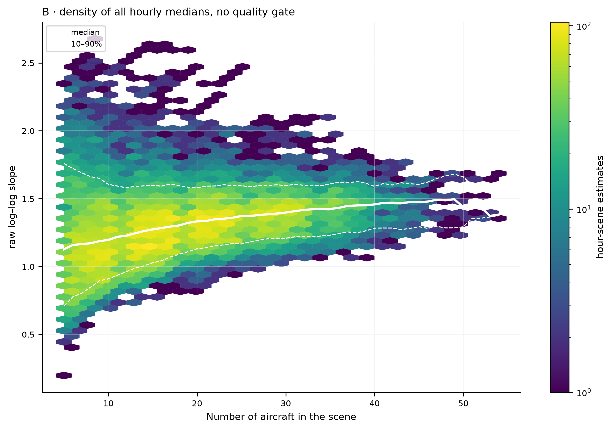
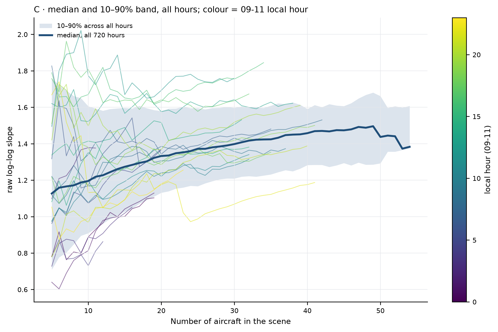
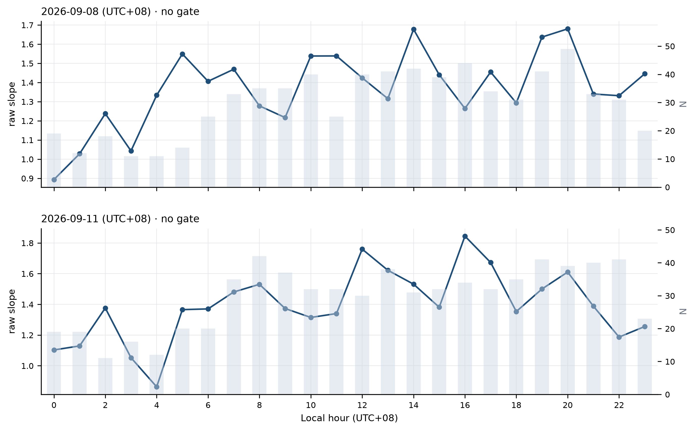
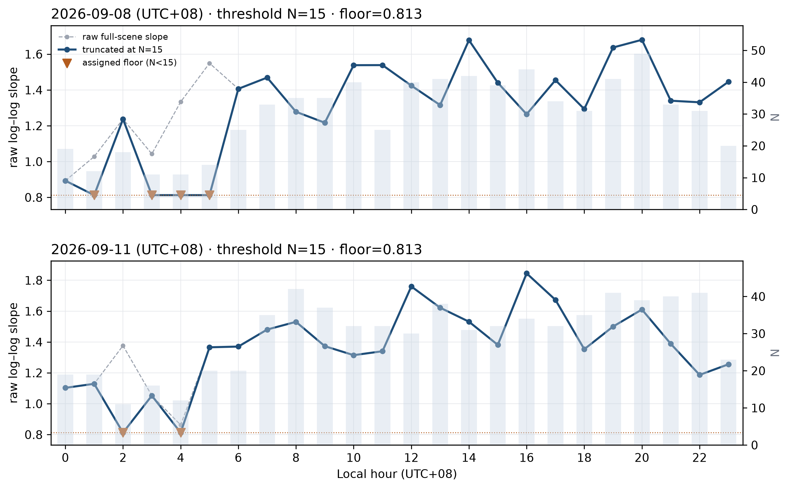
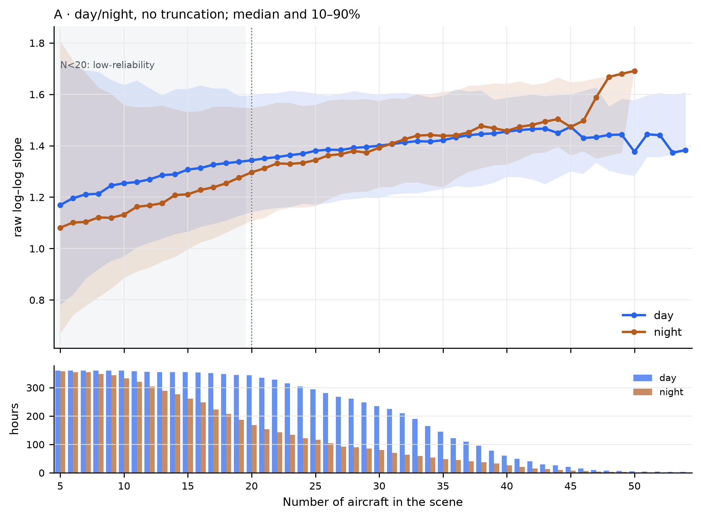
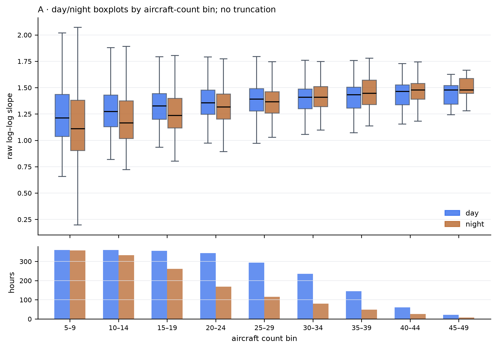
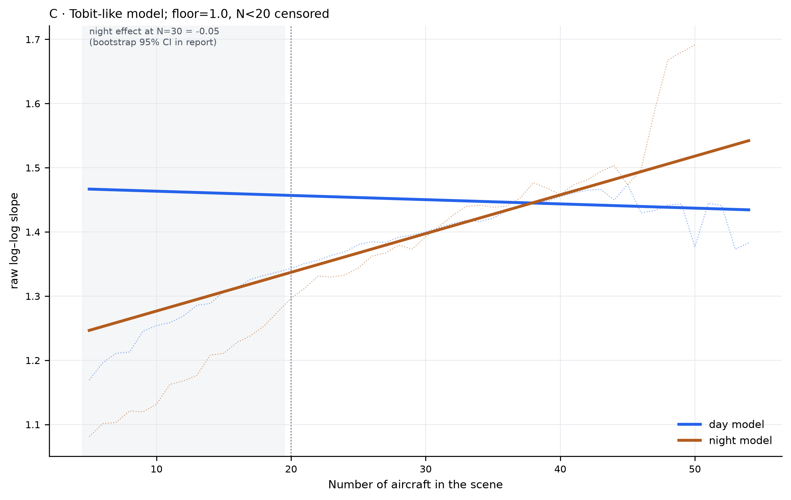

# OpenSky 30-day raw-scene analysis (no quality gate)

**Question:** what does complexity look like when no candidate, QC or dedup
screening is applied, and all raw tracks are used?

**Answer:** a raw log–log slope exists for every N>=5 in 718 of 720 hours. It
rises from about 1.13 at N=5 to about 1.40 at N=30 and then flattens around
1.44–1.46. This is a descriptive raw-slope curve, not a validated D.

## Data and execution

- 720 hourly source files, 2026-08-31T16Z through 2026-09-30T15Z;
- 19,306 raw tracks encoded, 0 failures;
- no candidate screening, position deduplication, speed/QC filtering;
- 20 nested random orders per scene, every N from 5 to the scene total;
- fixed 64-radius grid, frozen Encoder, sum pooling;
- no Encoder calls at D time; D uses stored embeddings.

Two hours have N=4 and no 5-aircraft curve. The Encoder itself requires at
least 30 input points per trajectory; all 19,306 tracks met that condition.

## No-gate definition

The quality gates of the D estimator are removed. The slope uses every radius
with `0 < C(r) < 1`, with at least two scales. There is no C(r) bound, no
radius-ratio gate and no R² threshold. It is a **raw slope**, not D.






The boxplot, hexbin and quantile band show the same shape: a fast low-N rise
and a plateau after N≈30. At high N the number of contributing hours falls
sharply (6 hours in the 50–54 bin), so the right edge is sparse.

## 24h raw view



Both days have a full-scene raw slope for every local hour. N is shown on the
right axis. No threshold, floor or interpolation is applied here.

## N=15 truncation



The requested rule is:

```
raw slope,   N >= 15
0.813,       N < 15
```

`0.813` is the minimum full-scene raw slope among hours with N>=15. Affected
hours:

- 09-08: 01 (N=12), 03 (N=11), 04 (N=11), 05 (N=14);
- 09-11: 02 (N=11), 04 (N=12).

The grey dashed line is the original value. The floor creates visible
discontinuities, e.g. 09-08 05:00 falls from 1.549 to 0.813. It is an assigned
display value, not measured complexity.

## Day/night supplementary comparison







Plan A (no truncation) shows day above night mainly at low N; the medians
converge around N=30. Plan C, a Tobit-like model with floor 1.0 and N<20
censored, gives a night effect of −0.05 at N=30, but the result is sensitive to
the censoring threshold (moving it to 30 changes the effect to about −0.63).
Plan A is the primary description; Plan C is supplementary.

## Limits

- Raw slopes are not quality-controlled; do not mix them with gated D results.
- Low-N estimates are unstable by construction.
- Hourly scenes are not independent: 30 days share aircraft, airspace and season.
- The 100 km area includes overflights and traffic from other airports.
- No raw tracks, embeddings or weights are published.
