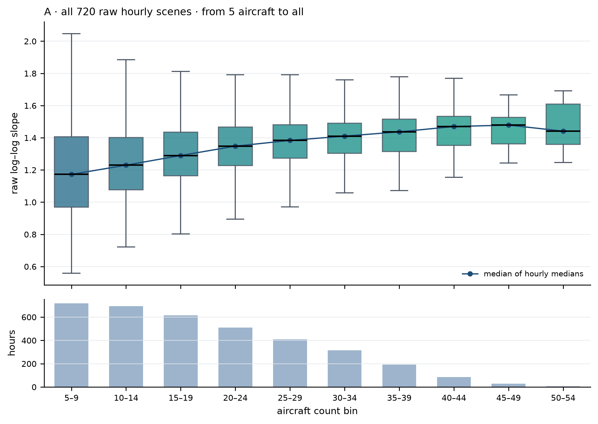
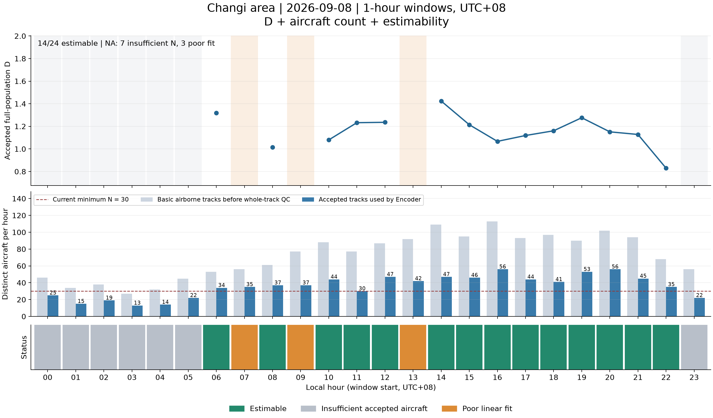
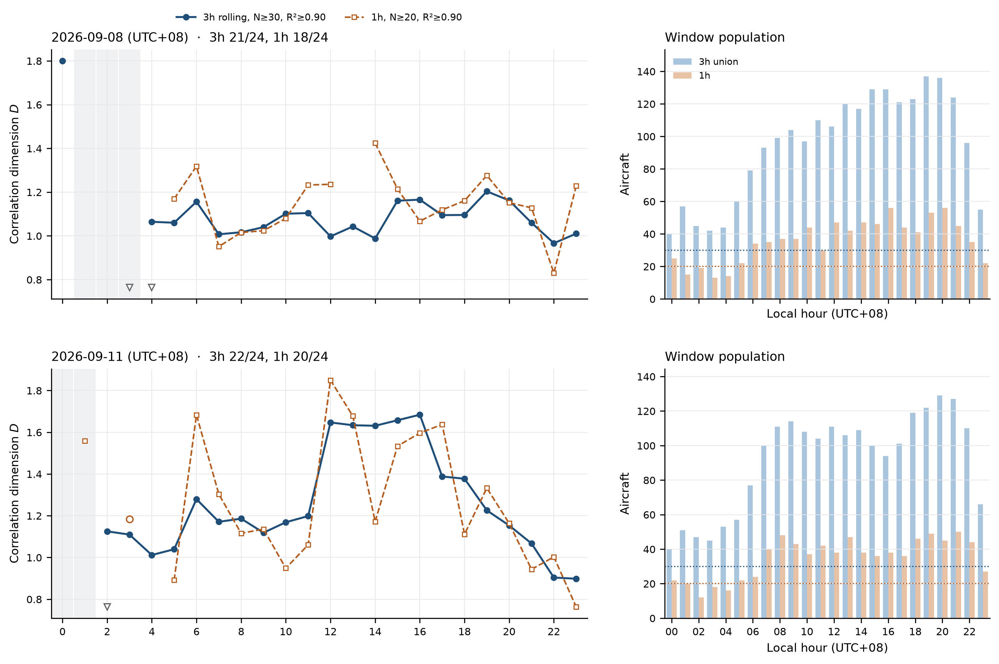
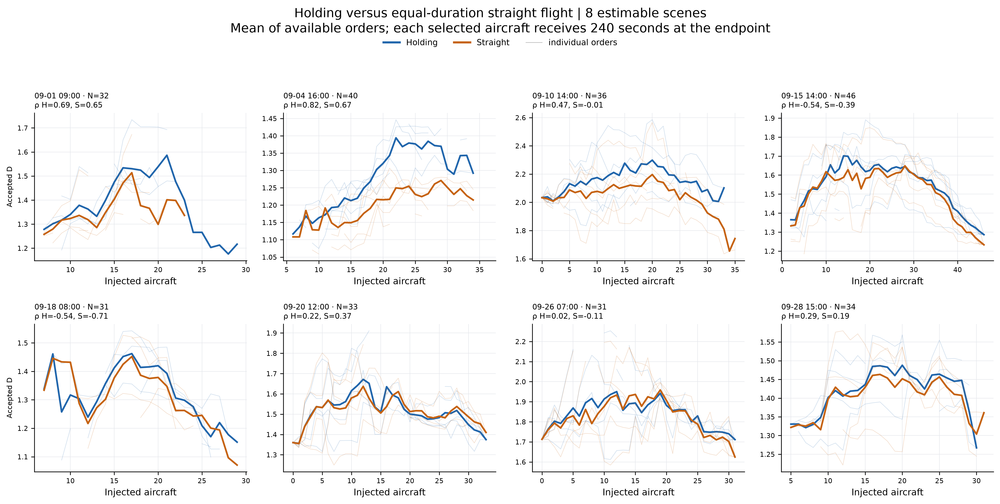
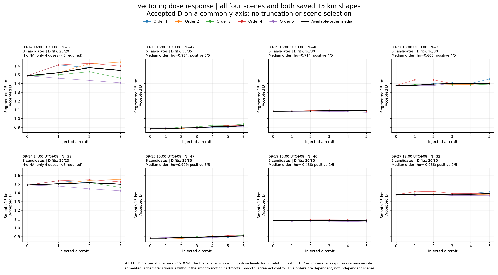
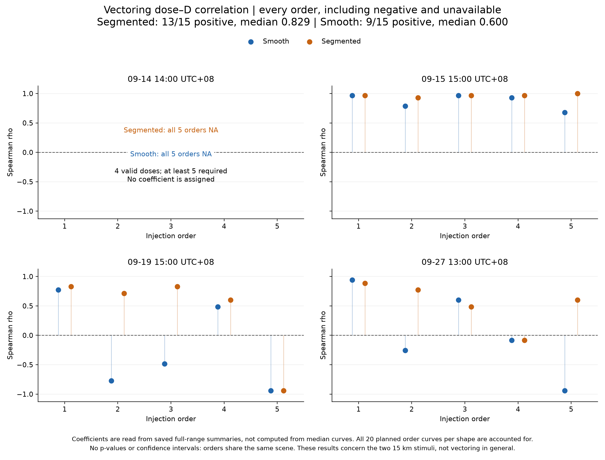

# Evaluation: current paper presentation

Updated 2026-10-26. The 24h deduplicated result remains the main application result; the original is preserved as an appendix. Maneuver results are unchanged. A new threshold review recomputes hourly D from the frozen deduplicated embeddings only, with no Encoder calls, new trajectories or changes to the primary maneuver gates.

## 0. OpenSky 30-day raw-scene analysis (no quality gate)

A separate raw-scene analysis removes candidate/QC/dedup screening: 720 hourly
scenes, 19,306 tracks, 20 nested orders per scene, every N from 5 to the scene
total. D is reported as a **raw log–log slope** (all scales with 0<C(r)<1, at
least two scales; no C bounds, no radius-ratio gate, no R² gate). The Encoder's
minimum of 30 input points remains.

The median raw slope rises from 1.127 at N=5 to 1.398 at N=30 and then
flattens around 1.44–1.46. This is a low-N/small-sample shape, not evidence that
adding aircraft causes complexity. The run also contains the 24h raw curves for
09-08/09-11, the requested N<15 floor display (0.813), and the day/night
Plan A/Plan C comparison. Run report:
[runs/opensky-30d-no-gate](runs/opensky-30d-no-gate/report.md).

## 1. Changi: complete 24h application display

The [hourly main report](runs/changi-hourly/report.md) shows September 11 and September 8 in 1-hour windows. Each figure contains accepted D, aircraft counts before/after QC, and status for every hour. NA is never zero, and lines do not bridge missing estimates.

| Local date | Original valid D | Deduplicated valid D | Remaining insufficient N | Remaining poor fit |
|---|---:|---:|---:|---:|
| September 8 | 11/24 | **14/24** | 7 | 3 |
| September 11 | 14/24 | **15/24** | 8 | 1 |

Exactly repeated horizontal observations are collapsed while retaining all altitude observations and original age/gap checks. This recovers 263 aircraft-hours; all 1,434 original accepted arrays and embeddings were verified identical. The same frozen 10-second Encoder, original 64-radius grid, N=30, B=200 and R²≥0.94 remain. This is a correction to observation handling, not selection based on favorable D.

All three schemes use the deduplicated results consistently. Fixed-N valid draws change from 1,991/3,000 to 2,496/3,400 on September 8, and from 2,622/3,200 to 2,555/3,200 on September 11. More accepted tracks do not guarantee more stable subsets. Weather differences still have mixed signs. See the [complete comparison](runs/changi-hourly/comparison-with-original.md) and [original appendix](runs/changi-hourly/appendix-original/report.md).

### Threshold review: 3h primary vs 1h exploratory

The original gap was mostly `insufficient_samples`, not R². A centered 3-hour
window (union of the center hour and its neighbors, one embedding per aircraft)
keeps N>=30 and recovers most hours:

| Rule | 2026-09-08 | 2026-09-11 |
|---|---:|---:|
| 1h, N>=30, R²>=0.94 (published) | 14/24 | 15/24 |
| 1h, N>=20, R²>=0.90 | 18/24 | 20/24 |
| 3h, N>=30, R²>=0.94 | 20/24 | 21/24 |
| **3h, N>=30, R²>=0.90 (primary display)** | **21/24** | **22/24** |

Blue is the 3h primary display; orange dashed is the 1h N>=20 exploratory
estimate. Grey bands are 3h poor-fit hours, open circles are low-confidence 1h
N=15–19 points, and triangles are the assigned floor for N<15 (floor 0.7633).
The floor is a display convention, not a measured D. The remaining 3h gaps —
09-08 hours 01–03 and 09-11 hours 00–01 — are poor fits at N=42–57, so they
are not filled by the low-traffic floor. The review does **not** claim 24/24.
See [the run report and full per-hour records](runs/changi-thresholds/report.md).

### D versus aircraft count: one-scene pilot

One frozen scene (2026-09-08 20:00 UTC+08, N=56) was resampled in 100 nested
random orders, starting at 5 aircraft and adding one at a time.

N=5–10 cannot be fitted on the fixed radius grid; N=11–14 is based on only
1–8/100 valid orders. D rises to ≈1.4 around N=19–20, where the valid rate is
still only 67–73/100, then falls to ≈1.15 and is flat from N=30 to 56.
This is a small-N instability, not evidence that adding aircraft increases
complexity. At N>=30 the curve is stable, which is consistent with D measuring
embedding geometry rather than count. This is one scene, not a general volume
experiment. See [the pilot report](runs/changi-n-scaling/report.md).

**Paper claim:** an auditable real-airport-area application with hourly estimates and explicit availability limits. A complete 24h display is not 24 reliable D estimates. No causal storm effect or independence from traffic volume is established. The 100 km area includes overflights and traffic from other airports.

## 2. Holding: dose response and equal-duration paired difference

The main view now shows the **8 estimable scenes**, 2×4, each with its own
y-axis: this avoids the empty panels and shared-axis compression of the earlier
all-scene layout. Both arms append 240 seconds at the trajectory endpoint;
original points remain unchanged. The saved Holding study uses R²≥0.98, unlike
the R²≥0.94 hourly and current Vectoring studies. These gates are not
retrospectively made uniform.

Blue is Holding; orange is straight flight. Thin curves are individual orders;
thick curves are the **mean** of available orders at each dose. Four scenes
have fewer than 30 aircraft and no accepted D; they are omitted from this main
view but retained in the full run and in the paired-difference figure.

| Scope, jointly valid doses | Median order rho: Holding | Straight | Orders |
|---|---:|---:|---:|
| Full range | 0.196 | 0.065 | 37 |
| Same archived cutoff in both arms | 0.661 | 0.598 | 33 |

The two rows involve different eligible order sets. Among the same 33 cutoff-eligible orders, the full-range medians are 0.217 and 0.187. Cutoffs came from earlier midpoint results, not an independently established operational limit, and were not re-selected for these plots. Correlation is calculated per order on jointly valid doses, not from the thick plotted median curve.

The vertical axis is D(Holding) minus D(Straight) for the same scene, order and dose. Both fits must pass. Positive values favor Holding; negative values favor straight flight. Full-range paired scene summaries are positive in 7/8 comparable scenes, with an equal-scene median difference of 0.034. Within the common historical cutoffs they are positive in 6/7 scenes, median 0.030. These are medians across scene/order summaries, not a pooled causal effect. All 12 scene panels remain visible, including unavailable pairs and scenes without an archived cutoff.

**Paper claim:** D responds to the tested trajectory extensions, with a generally small additional Holding-versus-straight difference. Both groups can rise, so the strong truncated Holding correlation alone does not establish a maneuver-specific effect. The equal-duration design controls duration and point count, but straight extension also changes spatial extent; it cannot assign a percentage of the response to length. Only three scenes have valid zero-dose baselines, so the plots use absolute D and paired arm differences rather than inventing baseline-relative values.

Evidence: [full equal-duration study](runs/holding-equal-duration/report.md), [shared historical cutoffs](runs/holding-equal-duration-old-cutoff/report.md).

## 3. Vectoring: all scenes, dose curves and correlations

The active saved study is **15 km segmented Vectoring versus smooth 15 km control**, not the older 5 km pilot. There are four scene-hours, 157 background tracks and 19 injectable candidates. Both use the frozen epoch-90 9-feature 10-second Encoder, R²≥0.94 and the full dose range. No STAR features are used.

Columns are all four scenes; rows are segmented and smooth shapes. Colors identify the five orders, and the black curve is the available-order median. All panels use a common D axis to show the absolute change without magnifying small effects. All 115 saved D fits per arm pass. September 14 has only three candidates and four dose levels: its D values can be displayed, but its five order correlations are NA because at least five valid doses are required. This is distinct from a failed D fit.

| Shape | Estimable order correlations | Positive | Median order rho | Median of scene medians |
|---|---:|---:|---:|---:|
| Segmented 15 km | 15/20 | 13/15 | 0.829 | 0.714 |
| Smooth 15 km | 15/20 | 9/15 | 0.600 | −0.086 |

The segmented negative curves are September 19 **display order 5** (saved replicate 4), rho −0.943, and September 27 **display order 4** (saved replicate 3), rho −0.086. Display orders are consistently 1–5; stored replicates are 0–4. No negative curve or unavailable scene is removed. Five orders are dependent within-scene repeats, not five independent scenes; no confirmatory p-values or confidence intervals are claimed.

**Paper claim:** a predominantly positive dose–D association for this particular segmented 15 km stimulus in the three correlation-estimable scenes. This does not establish universal positive response to real vectoring, and a high rank correlation need not mean a large absolute D change. Differences between shapes could involve geometry, speed/time allocation and the pooled representation; the saved comparison does not isolate a causal mechanism.

The segmented shape is a schematic stress stimulus: 150 s outward, 300 s at 15 km, 150 s return, with a 30 s corner blend. Its workflow skips deformed-kinematics rejection and it does **not** carry the smooth generator's C2 / 2 m s⁻² longitudinal / 35° bank certificate. The smooth control remains physically screened. Do not describe the segmented stimulus as a certified flyable maneuver or 15 km as routine vectoring. See [study evidence and methods](runs/segmented-15km/README.md), [geometry illustration](figures/injection-geometry-smooth-vs-segmented.png), and [inactive STAR note](STAR_INACTIVE.md).

## Reporting, figures and preserved history

- [Figure index and captions](figures/README.md): new figures are available as PNG, SVG and vector PDF.
- [Hourly evidence requirements](runs/changi-hourly/README.md): only code, reports and figures are publication artifacts; hourly derived data remain local.
- [Maneuver figure renderer](code/make_review_figures.py): saved files only; refuses an existing output directory and verifies source hashes.
- [Workflow documentation](code/README.md) and [all run packages](runs/README.md).
- [Historical 5 km report](archive/report-5km-2026-10-24.md): retained evidence, not the current 15 km result.

Hourly position deduplication is not retroactively applied to Holding or Vectoring. Their saved data, thresholds and experimental definitions remain unchanged. Earlier maneuver figures remain historical views; the four all-scene figures above are the preferred current presentation. No experiments were rerun to produce this report.

## Additional compact overview preserved from the concurrent update

The teammate's [Holding-versus-Vectoring overview](figures/holding-vs-vectoring-comparison.png) ([PDF](figures/holding-vs-vectoring-comparison.pdf)) is retained, with its latest order-visibility update, along with its [renderer](figures/make_combined_figure.py). It shows three Holding scenes (September 1, 4 and 10) and the three correlation-estimable Vectoring scenes (September 15, 19 and 27). Pastel points are individual orders, offset horizontally at each dose so all five are visible; thin pastel lines connect each order across doses. Black lines are means, and the dashed grey Holding-side line is the straight-flight mean. This is a compact selected-scene view, not the complete scene inventory. The all-scene figures above remain the preferred evidence for unavailable scenes, negative responses and full coverage. These curves use means, whereas the new complete-scene figures use medians.
