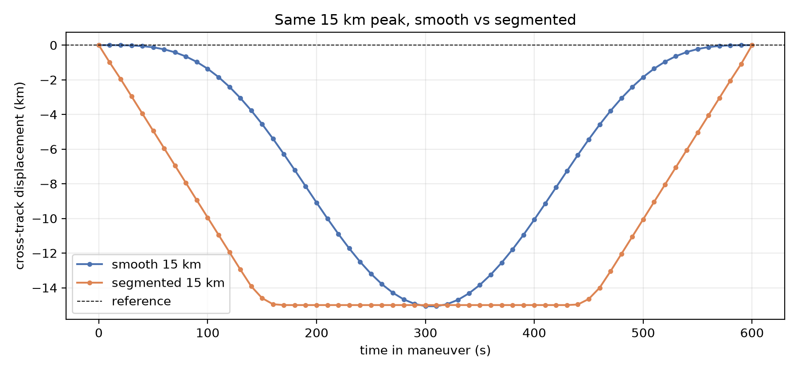
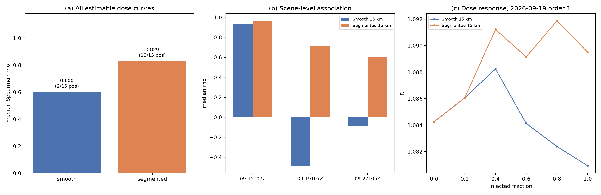
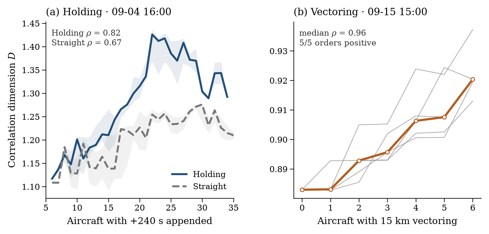
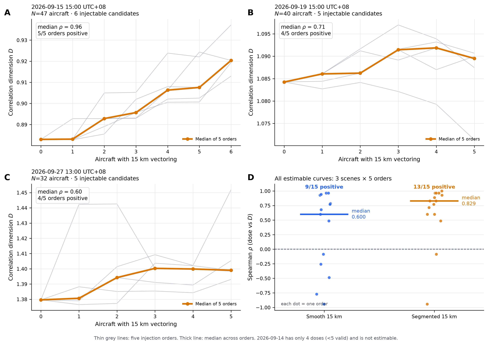
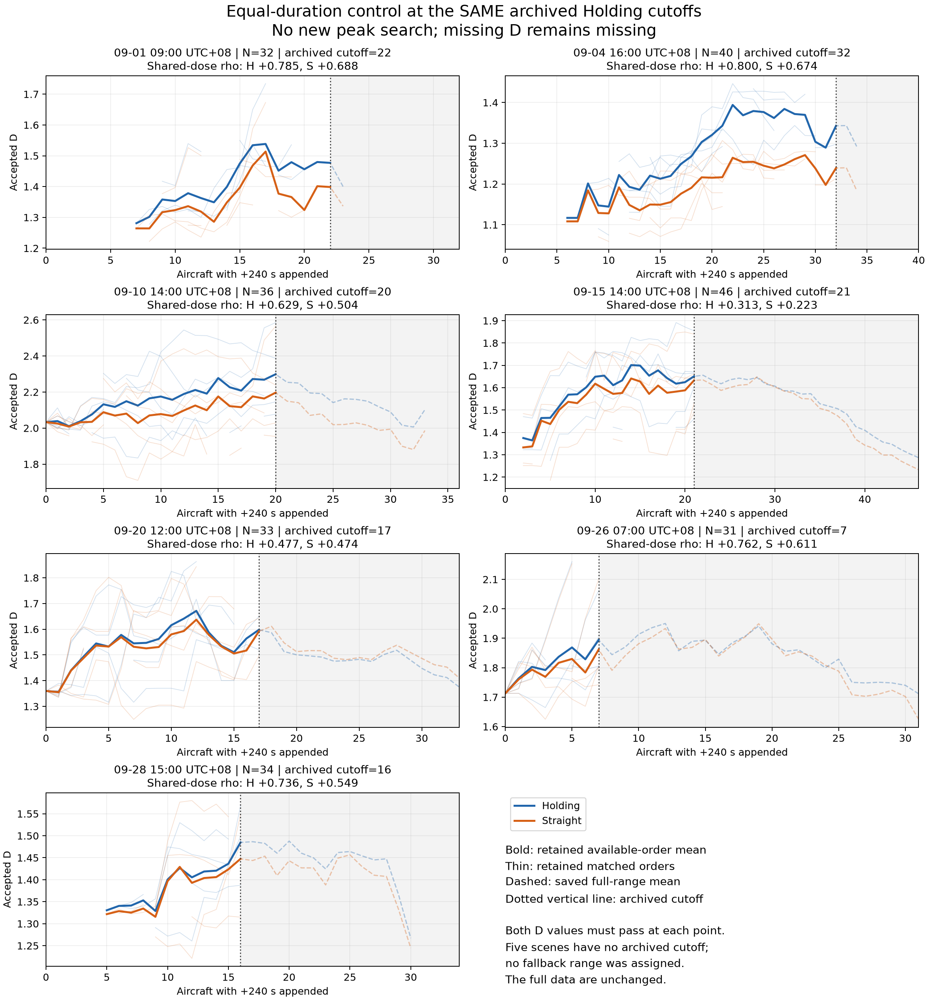

# Evaluation — maneuver studies and hourly real-traffic application

Updated: 2026-10-25. This is the active evaluation report. The previous
5 km / R²≥0.98 / smooth-generator report is archived as
[report-5km-2026-10-24](archive/report-5km-2026-10-24.md).

Hourly application presentation added on 2026-10-26 from existing results only. No experiments or thresholds were changed for this publication.

## Changi: complete 24-hour application display

The [hourly case report](runs/changi-hourly/report.md) presents September 11 and September 8 using 1-hour windows. Each main figure shows accepted D, aircraft counts before and after whole-track QC, and a status cell for every hour. NA remains unavailable and lines do not bridge gaps.

| Local date (UTC+08) | Accepted D | Insufficient accepted aircraft | Poor linear fit |
|---|---:|---:|---:|
| September 11 | 14/24 | 8 | 2 |
| September 8 | 11/24 | 9 | 4 |

This supports a real-scene application case with explicit availability limits, not a complete reliable day/night D curve or general operational-complexity validation. The case retains its original R²≥0.94, N≥30 and fixed 64-radius grid. The fixed-N/200-draw and weather comparisons remain descriptive supplements; partial-success medians are conditional, and weather differences have mixed signs.

Before-QC counts refer to distinct observed aircraft with basic airborne fields within 100 km of Changi, not airport movements. The existing conservative whole-track reader excludes repeated position timestamps as well as unsupported gaps. Source auditing found 849 repeated-timestamp first rejections across the two days; 565 also have age/gap flags. The remaining 284 are not recovered or admitted tracks. This preprocessing limitation is disclosed, and no recovery policy was introduced for publication.

- [September 11: D + aircraft + estimability](runs/changi-hourly/figures/2026-09-11-24h-D-count-status.png)
- [September 8: D + aircraft + estimability](runs/changi-hourly/figures/2026-09-08-24h-D-count-status.png)
- [Saved-result reporting command and evidence](runs/changi-hourly/README.md)

## Vectoring: active 15 km segmented study

**Vectoring scope:** four scene-hours, 157 background tracks, 19 injectable candidates.
The injection is a schematic, piecewise-straight vectoring stimulus at a fixed
15 km peak over 600 s. The Encoder is the original 9-feature, fixed-epoch-90
10-second checkpoint. No STAR/reference-relative features are used.

## Active code

| File | Role |
|---|---|
| [code/vectoring_path.py](code/vectoring_path.py) | `PEAK=15000`; `generate_segmented()` builds the trapezoid offset; `generate()` remains the smooth control |
| [code/vectoring_population.py](code/vectoring_population.py) | `SEGMENTED=True`; 10-second population uses the segmented generator and skips the deformed-kinematics rejection |
| [code/run_vectoring_eval.py](code/run_vectoring_eval.py) | `MAX_OFFSET=15000`; legacy five-second helpers remain for regression use |
| [code/run_evaluation.py](code/run_evaluation.py) | explicit workflow entrypoint; no implicit run |
| [../complexity/calculator.py](../complexity/calculator.py) | `min_r_squared=0.94` |

The STAR work is set aside: `Encoder/trajectory_encoder/star.py` and the
15-feature checkpoint remain in the repository but are **not** used by this
evaluation. Do not mix the STAR pilot numbers with this report; see
[STAR_INACTIVE.md](STAR_INACTIVE.md).

## Injection shape

The lateral offset is a trapezoid in the chord-normal direction:

- 0–150 s: straight diagonal out;
- 150–450 s: straight plateau at 15 km;
- 450–600 s: straight diagonal back;
- each of the three corners is rounded by a 30 s moving average so the sampled
  track has no numerical spike, while the long legs stay visibly straight.



The segmented arm is a **schematic stimulus**, not a C2-certified path. It does
not claim the smooth generator’s 2 m s⁻² longitudinal / 35° bank certificate.
The smooth 15 km arm remains the physically screened control.

## Results

Same 19 candidates, same 600 s window, same 15 km peak, same 9-feature Encoder,
R²≥0.94:

| Injection | Estimable curves | Positive | Median rho | Scene-level median | Positive scenes |
|---|---:|---:|---:|---:|---:|
| Smooth 15 km (control) | 15/20 | 9/15 | 0.600 | −0.086 | 1/3 |
| **Segmented 15 km** | **15/20** | **13/15** | **0.829** | **0.714** | **3/3** |

Per-scene median rho:

| Scene | Smooth 15 km | Segmented 15 km |
|---|---:|---:|
| 2026-09-15 15:00 | 0.929 | 0.964 |
| 2026-09-19 15:00 | −0.486 | 0.714 |
| 2026-09-27 13:00 | −0.086 | 0.600 |

`2026-09-14 14:00` has only three injectable candidates (four doses), below the
five-valid-dose requirement; it is not estimable under either shape.

Two negative curves are retained, not removed:

- `2026-09-19` order 4: −0.943;
- `2026-09-27` order 3: −0.086.



Interpretation: a smooth S-curve spends little time at large offset and is easy
for sum pooling to average out. The segmented track holds a 15 km offset for
300 s and has visible corners, which changes the local direction/curvature and
the pooled representation much more. The result is consistent with the visual
intuition that segmented vectoring is easier to see than a smooth curve.

## Paper figures

A curated set is indexed in [figures/README.md](figures/README.md). All panels
are drawn from stored results; no encoder calls or new D estimates were made to
produce them.

**Figure P1 — Holding vs Vectoring (main).** Left: representative Holding
scene 09-04 16:00. Solid line is the median D for Holding, dashed is straight
continuation, and bands are the IQR across the five orders; Holding rho 0.82
vs straight 0.67. Right: representative Vectoring scene 09-15 15:00. Grey
lines are the five injection orders and the orange line is their median;
median rho 0.96, 5/5 orders positive. All-scene summaries remain in P2
(Vectoring) and P5 (Holding); four Holding scenes and 09-14 for Vectoring are
not estimable.



PDF: [holding-vs-vectoring-comparison.pdf](figures/holding-vs-vectoring-comparison.pdf).

**Figure P2 — the detailed positive result (main).** Segmented 15 km vectoring
gives a positive dose–D association at the scene level in all three estimable
scenes (13/15 curves positive overall). Thin grey lines are the five injection
orders; the thick orange line is their median. Two negative curves are visible
and retained.



PDF: [segmented-positive-dose-response.pdf](figures/segmented-positive-dose-response.pdf).

**Figure P3 — injection geometry (methods).** Smooth S-curve vs segmented
trapezoid at the same 15 km peak. The segmented track is schematic, not a
C2-certified maneuver:
[injection-geometry-smooth-vs-segmented.png](figures/injection-geometry-smooth-vs-segmented.png).

**Figure P4 — shape comparison.** All-curve median, scene-level medians and one
representative dose response for smooth vs segmented:
[d-association-smooth-vs-segmented.png](figures/d-association-smooth-vs-segmented.png).

**Figure P5 — Holding control (supplement).** Equal-duration terminal control
at the same archived cutoffs. Both arms increase D with dose; Holding is above
straight in most comparable scenes, but the effect is smaller and mixed across
scenes. Use as a control, not as a second positive result.



**Figure P6 — paired Holding differences (supplement).**
[holding-paired-differences.png](figures/holding-paired-differences.png).

## Historical arms (not the active result)

- **5 km smooth, R²≥0.98:** [archived report](archive/report-5km-2026-10-24.md).
  95/125 dose records failed only because R² was 0.948–0.950; three of four
  scenes had no accepted D.
- **5 km smooth at R²≥0.94:** 20/20 curves, 12/20 positive, median 0.382.
  Lowering the gate restores estimability but does not create a positive
  association.
- **15 km smooth at R²≥0.94:** [smooth-control summary](runs/segmented-15km/results/smooth-control/summary.json),
  15/20 curves, 9/15 positive, median 0.600; this is the active control.
- **STAR-relative Encoder / official STAR pilot:** inactive. The STAR baseline
  reference gave 15/20 curves, 14/15 positive, median 0.943, but that is not an
  independent reference; the official STAR pilot covered only 41% of arrivals
  within 2 km and degraded when forced (7/10 positive, median 0.457). The STAR
  reports are archived outside this repository and are not part of this
  publication.

## Holding (unchanged)

The equal-duration terminal control remains as previously reported; this
update does not rerun or reinterpret it. At the same archived cutoffs and
jointly valid doses, median Spearman rho is 0.661 for Holding and 0.598 for
straight flight; six of seven comparable scene summaries have positive
Holding-minus-Straight D differences. These remain conditional descriptive
results, not complete validation of operational complexity. Evidence:
[runs/holding-equal-duration](runs/holding-equal-duration/).

## Reproduce the active four-scene run

The frozen population, source scripts and full diagnostics are in
[runs/segmented-15km](runs/segmented-15km/).

The portable production path is the explicit screening/evaluation workflow.
With local source tracks, quality evidence and the frozen checkpoint:

```bash
python evaluation/code/screen_approved_scenes.py \
  --source-tracks /local/source-tracks \
  --quality /local/point-evidence.jsonl.gz \
  --output /local/new-screen

python evaluation/code/run_evaluation.py vectoring \
  --screening /local/new-screen \
  --checkpoint /local/encoder-10s.pt \
  --output /local/new-vectoring
```

`vectoring_population.py` now uses the segmented generator when
`SEGMENTED=True` (default) and skips the deformed-kinematics rejection in that
mode. Set `SEGMENTED=False` to reproduce the smooth control.

The exact four-scene generators/runners used for the published numbers are
kept in `runs/segmented-15km/source/` as provenance snapshots; their internal
paths refer to the original local workspace and are not portable entrypoints.

## Limitations

1. **Segmented injection is schematic.** The smooth control is the only arm
   with the original motion certificate. Do not describe the segmented track as
   a flyable procedure.
2. **15 km is a stress-test amplitude**, not a claim about routine vectoring.
3. **No STAR.** This report intentionally omits the STAR/reference-relative
   Encoder; the STAR experiment is archived separately.
4. **D is descriptive.** Five orders are within-scene repeats, not five
   independent scenes; no confirmatory p-values.
5. **Scene 14 is candidate-limited**, not gate-limited; three candidates cannot
   produce five valid doses.

## File map

- Run package: [runs/segmented-15km](runs/segmented-15km/)
- Population: [runs/segmented-15km/population](runs/segmented-15km/population/)
- Segmented diagnostics: [runs/segmented-15km/results/segmented](runs/segmented-15km/results/segmented/)
- Smooth control: [runs/segmented-15km/results/smooth-control](runs/segmented-15km/results/smooth-control/)
- Paper figure set: [figures/README.md](figures/README.md)
- Figure generator: [runs/segmented-15km/source/make_paper_figures.py](runs/segmented-15km/source/make_paper_figures.py)
- Shape generator: [code/vectoring_path.py](code/vectoring_path.py)
- Active population switch: [code/vectoring_population.py](code/vectoring_population.py)
