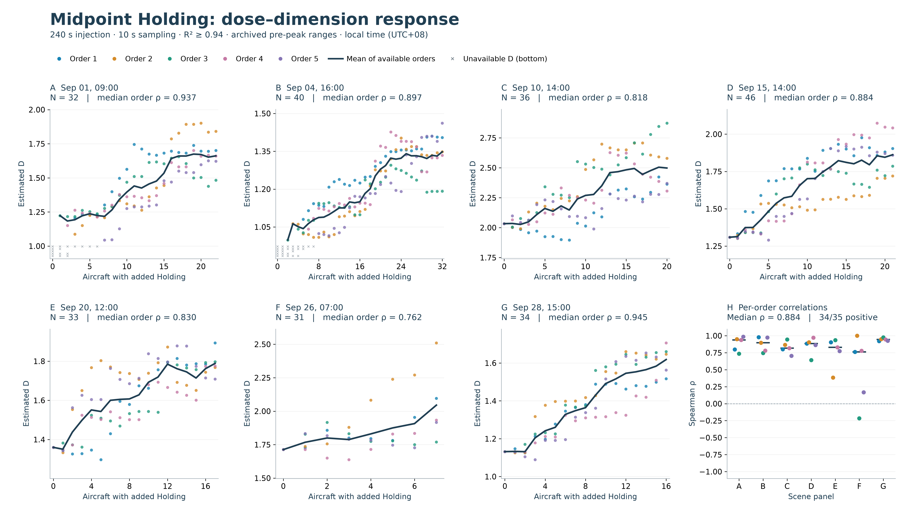
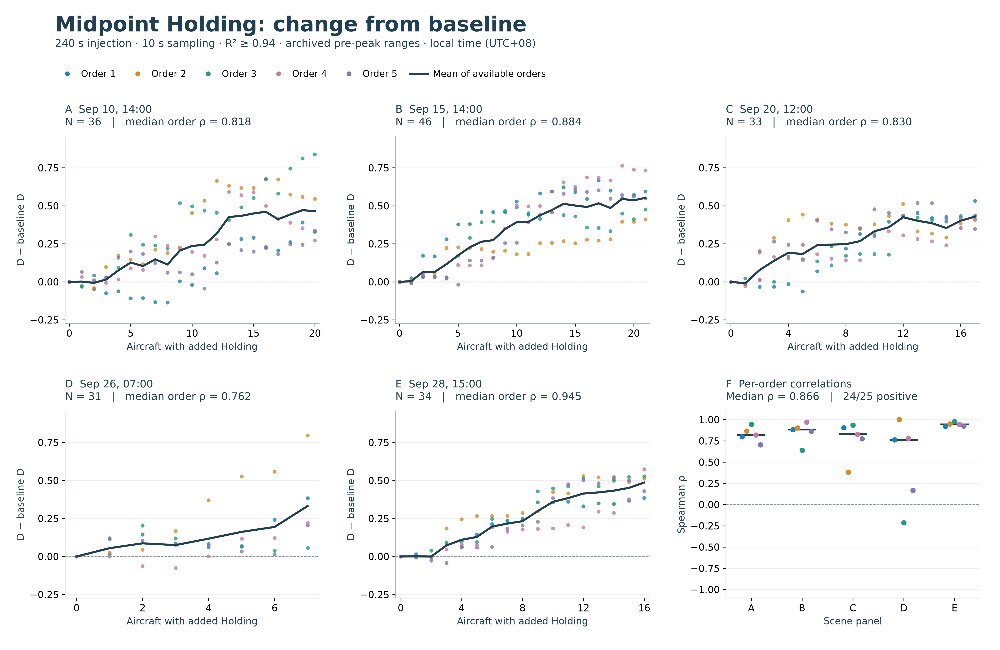

# Evaluation: current paper presentation

Updated 2026-10-27. Primary midpoint Holding uses R²≥0.94 with its archived exploratory pre-peak ranges. Latest Vectoring uses the repaired 20-second quality-matching version with 26 candidates, compared against the prior 25-candidate version. The hourly application and endpoint duration-control studies remain separate. This publication packages completed work; no experiment was rerun during publication.

## 1. Changi: complete 24h application display

The [hourly main report](runs/changi-hourly/report.md) shows September 11 and September 8 in 1-hour windows. Each figure contains accepted D, aircraft counts before/after QC, and status for every hour. NA is never zero, and lines do not bridge missing estimates.

| Local date | Original valid D | Deduplicated valid D | Remaining insufficient N | Remaining poor fit |
|---|---:|---:|---:|---:|
| September 8 | 11/24 | **14/24** | 7 | 3 |
| September 11 | 14/24 | **15/24** | 8 | 1 |

Exactly repeated horizontal observations are collapsed while retaining all altitude observations and original age/gap checks. This recovers 263 aircraft-hours; all 1,434 original accepted arrays and embeddings were verified identical. The same frozen 10-second Encoder, original 64-radius grid, N=30, B=200 and R²≥0.94 remain. This is a correction to observation handling, not selection based on favorable D.

All three schemes use the deduplicated results consistently. Fixed-N valid draws change from 1,991/3,000 to 2,496/3,400 on September 8, and from 2,622/3,200 to 2,555/3,200 on September 11. More accepted tracks do not guarantee more stable subsets. Weather differences still have mixed signs. See the [complete comparison](runs/changi-hourly/comparison-with-original.md) and [original appendix](runs/changi-hourly/appendix-original/report.md).

**Paper claim:** an auditable real-airport-area application with hourly estimates and explicit availability limits. A complete 24h display is not 24 reliable D estimates. No causal storm effect or independence from traffic volume is established. The 100 km area includes overflights and traffic from other airports.

## 2. Holding: midpoint dose response at R² ≥ 0.94

The primary midpoint Holding fit gate is now **R² ≥ 0.94**, following the explicit decision to replace 0.98 for this presentation. The original 0.98 experiment and [previous presentation](archive/holding-midpoint-r098/holding-midpoint-response.md) remain historical evidence. The saved final slopes are re-screened; trajectories, adaptive fit scales, five orders and archived peak endpoints are unchanged.

[Main vector PDF](figures/holding-midpoint-prepeak-all-scenes.pdf) · [Full caption, methods and scene table](holding-midpoint-response.md)

All seven scenes with archived pre-peak endpoints are shown. **34/35 per-order coefficients are positive; median Spearman ρ = 0.884.** The negative coefficient remains in panel H. These are dependent repeats within seven scenes, not 35 independent experiments. Dark curves are unsmoothed means of available orders; coefficients are calculated per order, not from the mean curve. The absolute-D panels have individually labelled vertical scales.

Aircraft were selected from natural-hour files; a corrected 240-second racetrack was inserted at the trajectory midpoint at a 10-second input cadence. Complete original tails were retained, so synthetic trajectories can extend beyond the source hour. This is not a post-injection fixed-hour reconstruction.

Five scenes now have an accepted baseline. Their ΔD companion uses a common vertical scale: 24/25 order coefficients are positive, median ρ = 0.866. Two other pre-peak scenes have no accepted baseline and remain in absolute D in the main figure. Accepted order-dose estimates increase from 933/1,980 to 1,371/1,980; aircraft counts do not change.

**Range and control disclosure.** Endpoints are inherited unchanged from the earlier outcome-selected peaks. No new peak is chosen at 0.94. The [all-twelve-scene, complete-range appendix](figures/holding-midpoint-full-range-appendix.pdf) retains unavailable scenes and later responses: full-range median ρ = 0.218, with 28/40 coefficients positive. This is an exploratory range-conditional association, not a globally monotonic result or a validated operating limit. The gate revision is post-analysis and is explicitly documented.

The [endpoint equal-duration control](holding-paper-appendix.md) remains a separate, unchanged experiment at its archived gate: matched retained-range medians were 0.661 for Holding and 0.598 for straight continuation. It shows that trajectory duration remains a concern, but cannot quantify the exact length contribution to midpoint Holding because insertion locations differ.

**Suggested manuscript statement.** With R² ≥ 0.94, the corrected midpoint Holding intervention showed predominantly positive dose–dimension associations within seven archived pre-peak ranges (34/35 per-order coefficients positive; median Spearman ρ = 0.884). The ranges were inherited from an earlier analysis, and complete-range responses were weaker and included negative associations. These results do not isolate Holding geometry from the additional trajectory duration.

The [current renderer](code/plot_holding_primary.py) reproduces the gate-only screening and figures from saved fits; no new inference, D estimation or trajectory generation is performed. See the [version comparison](holding-version-comparison.md) for the distinct 5-second pilot, corrected midpoint study and endpoint control.

## 3. Vectoring: repaired 20-second version, complete ranges

The latest run has **26 injectable candidates and 157 background tracks in four scenes**. It retains the frozen 10-second Encoder, exact prior baseline radius grids, R²≥0.94, five master orders and their side assignments, 15 km target, full dose ranges and all physical limits. The newly restored `3c6709` is the only added intervention; baseline arrays and the 25 old intervention arrays remain exactly unchanged. The 20-second parameter is a quality-message matching sensitivity, not the trajectory cadence or a standards-certified validity interval.

| Shape | Median order rho, 25 → 26 candidates | Positive / 20 | Negative / 20 | Zero / 20 | Valid D records, before → after |
|---|---:|---:|---:|---:|---:|
| Segmented 15 km | 0.887 → 0.887 | 14 → 14 | 5 → 5 | 1 → 1 | 145/145 → 150/150 |
| Smooth 15 km | 0.625 → 0.625 | 12 → 12 | 8 → 8 | 0 → 0 | 145/145 → 150/150 |

Only September 15 gains a candidate. Its segmented median rises 0.964 → 0.976 and smooth median 0.929 → 0.952; other scenes reproduce exactly. September 19's smooth median remains −0.571. These are 20 dependent order coefficients within four scenes, not 20 independent experiments. All 290 prior dose records were reproduced exactly, including complete diagnostics. No failed D or unavailable correlation occurs in the new run, and all negative and zero coefficients remain visible.

**Interpretation:** the numerical repair restores one candidate and slightly strengthens an already positive scene. It does not improve the aggregate median or establish a stable, universally positive Vectoring response. A high median for the segmented stimulus coexists with negative orders. No truncation or favorable-scene selection was used.

The segmented stimulus is schematic and does not inherit the smooth trajectory's C2/motion certificate. Smooth routes undergo continuous peak, motion, projection and joining checks. The [numerical repair report](runs/vectoring-certificate-repair/report.md) distinguishes actual conflicts, numerical uncertainty and solver feedback. The eight reference/chord-geometry rejections remain unchanged.

See the [latest detailed report and full ledger](runs/vectoring-20s-repaired/report.md), [prior time-window comparison](runs/vectoring-time-window-sensitivity/report.md), and [historical 19-candidate 10-second reference](runs/segmented-15km/README.md). Newly generated embeddings, route arrays, assignments and machine-readable results remain local; only code, reports and figures are published.

## Reporting, figures and preserved history

- [Figure index and captions](figures/README.md): new figures are available as PNG, SVG and vector PDF.
- [Hourly evidence requirements](runs/changi-hourly/README.md): only code, reports and figures are publication artifacts; hourly derived data remain local.
- [Maneuver figure renderer](code/make_review_figures.py): saved files only; refuses an existing output directory and verifies source hashes.
- [Workflow documentation](code/README.md) and [all run packages](runs/README.md).
- [Historical 5 km report](archive/report-5km-2026-10-24.md): retained evidence, not the current 15 km result.

Hourly position deduplication is not retroactively applied to Holding or Vectoring. Their saved source data and experimental definitions remain unchanged; only the primary midpoint Holding fit-acceptance gate is revised to 0.94 as described above. The midpoint pre-peak figures are the current Holding response presentation, with its complete ranges and the distinct endpoint equal-duration control linked explicitly. The repaired 20-second before/after figures are the current Vectoring presentation. Earlier 10-second Vectoring figures remain historical evidence. No experiments were rerun during this publication step.

## Additional compact overview preserved from the concurrent update

The teammate's [Holding-versus-Vectoring overview](figures/holding-vs-vectoring-comparison.png) ([PDF](figures/holding-vs-vectoring-comparison.pdf)) is retained unchanged, along with its [renderer](figures/make_combined_figure.py). It shows three Holding scenes (September 1, 4 and 10) and the three correlation-estimable Vectoring scenes (September 15, 19 and 27). Pastel points are individual orders; black lines are means, and the dashed grey Holding-side line is the straight-flight mean. This is a compact selected-scene view, not the complete scene inventory. The all-scene figures above remain the preferred evidence for unavailable scenes, negative responses and full coverage. That overview remains an earlier endpoint-control presentation. It must not be read as the current midpoint 0.94 result; the current midpoint figures use available-order means.
