# 修复与筛选后的 Holding / Vectoring evaluation

更新日期：2026-10-19。本报告直接替换原 `evaluation-pilot.md`；当前结果、图和复现代码位于原有 `results/`、`figures/`、`code/`。Git 历史保留之前的已提交版本，不另设日期版本目录。完整剂量曲线仍保存；截断只决定相关性使用哪些点。

**结论范围：Holding 截断后的前段呈明显正相关，但峰值由同一批结果选择，因此这是事后、探索性的局部关联，不能视为独立验证，不能证明下降段无效，也不能证明算法已超出适用范围。** 完整范围仍然先升后降。Vectoring 不截断，清洗后正相关仍存在。五次随机顺序是小时内重复，不是五个独立小时；不报告确认性 p 值。

## 已修复的问题

- Holding 第二次转弯不再额外旋转起始朝向；先验证轨迹自然闭合，再吸附末点以消除浮点误差，避免原来的大幅跳跃。
- 原始轨迹除空缺、非有限值、地面记录、长度和间隔筛选外，增加经纬度范围、高度 −500 至 20000 m、水平速度以及垂直速度绝对值 ≤100 m/s 检查。整条飞机—小时被剔除，不通过插值修补异常跳变。主筛选水平速度 ≤500 m/s，严格敏感性筛选 ≤350 m/s；这是诊断阈值，并非已验证飞行包线。
- Vectoring 的候选机动增加左右两种偏移均 ≤500 m/s 的速度筛选。失败飞机仍留在合格基线点云中，但不注入。`safe` 仅为运行名，不保证全部物理可行性。改变坐标会改变速度，不能称为保持原速度。
- 相关性严格要求 `status=ok`、D 有限、至少五个有效点。报告分母按实际可计算曲线数生成；100% 剂量纳入最后一个可估计率分箱；飞机数不足时跳过对应子采样规模。
- 原先手工替换数字的报告脚本改为统一数据生成流程，避免旧数字重新覆盖报告。

## 实验条件

固定原来的 12 个小时与每小时 5 个随机注入顺序，不因清洗结果更换场景。先生成原飞机顺序及 Vectoring 左右方向，再移除不合格飞机，保留幸存飞机的相对顺序和方向。主筛选保留 761/771 条飞机—小时轨迹，严格筛选保留 652/771 条。

使用同一 frozen Encoder、sum pooling、未归一化 Euclidean 距离。每个场景按自身基线生成 64 个固定半径，估计器质量门槛不变：至少 30 个点、至少 8 个拟合尺度、尺度跨度至少 2 倍、相关积分区间 0.02–0.3、R²≥0.98。

Holding 每架增加 48 个五秒采样点；长度与 sum pooling 的混杂仍存在。尚未通过等长度对照或多样化 holding 对照解释下降机制。本报告没有将这些未采用的对照纳入结论。

## Holding 截断规则

每小时五个随机顺序共用一个截断点：计算每个剂量有效 D 的平均值，只允许至少三个有效重复的剂量参与选峰，取平均 D 首次达到全局最高值的位置。保留峰值及之前的全部剂量，不平滑、不逐曲线挑峰。峰前的局部下降仍保留，不是逐段删除所有负斜率。

## Holding：全部可用曲线

| 筛选 | 样本范围 | 完整曲线数 | 完整 ρ 中位数 | 截断曲线数 | 截断 ρ 中位数 | 截断正相关 |
| --- | --- | --- | --- | --- | --- | --- |
| qc500 | 全部场景 | 60 | -0.110 | 50 | 0.913 | 50/50 |
| qc500 | 仅基线可估计 | 30 | 0.191 | 30 | 0.928 | 30/30 |
| qc350 | 全部场景 | 57 | -0.099 | 53 | 0.868 | 52/53 |
| qc350 | 仅基线可估计 | 35 | -0.176 | 35 | 0.863 | 34/35 |

QC500 截断后 50 条曲线全部为正；原来的 60 条中，10 条因保留段有效点不足而不能计算。QC350 为 53 条中 52 条正相关，不能忽略这些分母变化。

## 同一批曲线的配对比较

| 筛选 | 样本范围 | 前后均可计算曲线数 | 完整 ρ 中位数 | 截断 ρ 中位数 |
| --- | --- | --- | --- | --- |
| qc500 | 全部场景 | 50 | 0.073 | 0.913 |
| qc500 | 仅基线可估计 | 30 | 0.191 | 0.928 |
| qc350 | 全部场景 | 53 | -0.067 | 0.868 |
| qc350 | 仅基线可估计 | 35 | -0.176 | 0.863 |

主筛选中，6 个基线有效小时的 30 条曲线全部保留，ρ 中位数从 0.191 升到 0.928；这个比较没有曲线数量变化，但仍存在峰值选取偏差。按小时先取重复中位数，QC500 截断后有 11 个可计算小时，11 个均为正，小时中位数为 0.904；QC350 同样为 11 个小时，中位数为 0.877。

## 每小时截断点

| 筛选 | 小时（UTC） | 截断飞机数 / 场景飞机数 | 曲线数：完整 → 截断 | 完整小时 ρ | 截断小时 ρ |
| --- | --- | --- | --- | --- | --- |
| qc500 | 2026-09-01T01Z | 31/56 (55.4%) | 5 → 5 | 0.428 | 0.970 |
| qc500 | 2026-09-04T08Z | 42/73 (57.5%) | 5 → 5 | 0.370 | 0.970 |
| qc500 | 2026-09-07T10Z | 30/62 (48.4%) | 5 → 1 | -0.898 | 0.950 |
| qc500 | 2026-09-10T06Z | 28/71 (39.4%) | 5 → 5 | -0.735 | 0.844 |
| qc500 | 2026-09-12T15Z | 26/51 (51.0%) | 5 → 4 | -0.380 | 0.904 |
| qc500 | 2026-09-15T06Z | 36/87 (41.4%) | 5 → 5 | -0.366 | 0.877 |
| qc500 | 2026-09-18T00Z | 33/63 (52.4%) | 5 → 5 | -0.242 | 0.867 |
| qc500 | 2026-09-20T04Z | 36/67 (53.7%) | 5 → 5 | 0.234 | 0.937 |
| qc500 | 2026-09-23T10Z | 29/59 (49.2%) | 5 → 5 | 0.183 | 0.899 |
| qc500 | 2026-09-25T23Z | 30/51 (58.8%) | 5 → 5 | 0.094 | 0.752 |
| qc500 | 2026-09-28T07Z | 34/71 (47.9%) | 5 → 5 | 0.041 | 0.952 |
| qc500 | 2026-09-30T15Z | 24/50 (48.0%) | 5 → 0 | -0.950 | 不可计算 |
| qc350 | 2026-09-01T01Z | 35/51 (68.6%) | 5 → 5 | 0.692 | 0.840 |
| qc350 | 2026-09-04T08Z | 41/62 (66.1%) | 5 → 5 | 0.361 | 0.851 |
| qc350 | 2026-09-07T10Z | 26/55 (47.3%) | 5 → 3 | -0.528 | 0.888 |
| qc350 | 2026-09-10T06Z | 25/63 (39.7%) | 5 → 5 | -0.427 | 0.886 |
| qc350 | 2026-09-12T15Z | 25/45 (55.6%) | 5 → 5 | -0.032 | 0.930 |
| qc350 | 2026-09-15T06Z | 32/78 (41.0%) | 5 → 5 | -0.300 | 0.877 |
| qc350 | 2026-09-18T00Z | 30/54 (55.6%) | 5 → 5 | -0.161 | 0.860 |
| qc350 | 2026-09-20T04Z | 31/55 (56.4%) | 5 → 5 | 0.216 | 0.943 |
| qc350 | 2026-09-23T10Z | 20/44 (45.5%) | 5 → 5 | -0.275 | 0.812 |
| qc350 | 2026-09-25T23Z | 17/42 (40.5%) | 5 → 5 | -0.184 | 0.713 |
| qc350 | 2026-09-28T07Z | 27/62 (43.5%) | 5 → 5 | -0.223 | 0.939 |
| qc350 | 2026-09-30T15Z | 无合格峰值 | 2 → 0 | -0.976 | 不可计算 |

QC500 的截断比例约 39%–59%，并非统一截掉 50% 以后。QC350 的 2026-09-30T15Z 没有任何剂量满足三个有效重复，未强行选峰；QC500 同一小时虽然存在合格峰值，但截断后各曲线不足五个有效点，仍不能计算相关性。

## Vectoring：完整范围，不截断

| 筛选 | 可计算曲线 | ρ 中位数 | 正相关曲线 |
| --- | --- | --- | --- |
| qc500 | 46 | 0.848 | 42/46 |
| qc350 | 45 | 0.807 | 39/45 |
| qc500_safe | 43 | 0.832 | 38/43 |
| qc350_safe | 40 | 0.820 | 36/40 |

主结果 `synthetic-vectoring-evaluation-pilot.json` 使用 QC500 加候选机动速度筛选（qc500_safe）。未进行候选机动筛选的 QC500 与 QC350 仅作为敏感性对照，保存在统一的 `experiment-results.json` 中。正相关支持对合成变形的响应，尚不能证明真实管制工作负荷的有效性。

## 飞机数量敏感性

在 QC500 的六个完整基线可估计小时中，N=30、40、50 的可估计率小时中位数分别为 52%、67%、92%；相对完整点云 D 的绝对差中位数分别为 0.235、0.126、0.048。每个规模随机子采样 50 次。严格筛选的 N=50 只有五个小时满足飞机数条件且基线有效；不能把样本组成变化误读成纯飞机数效应。

## 图

Matplotlib 生成 200 dpi PNG 和矢量 SVG。彩色表示 Holding 保留段，灰色表示排除段，黑线是各剂量可用重复的均值，橙色虚线和星号是所选峰值。缺失 D 不补零；参与均值的重复数可能变化。各图均保留完整范围作为参照。

### qc500-holding-scenes-1

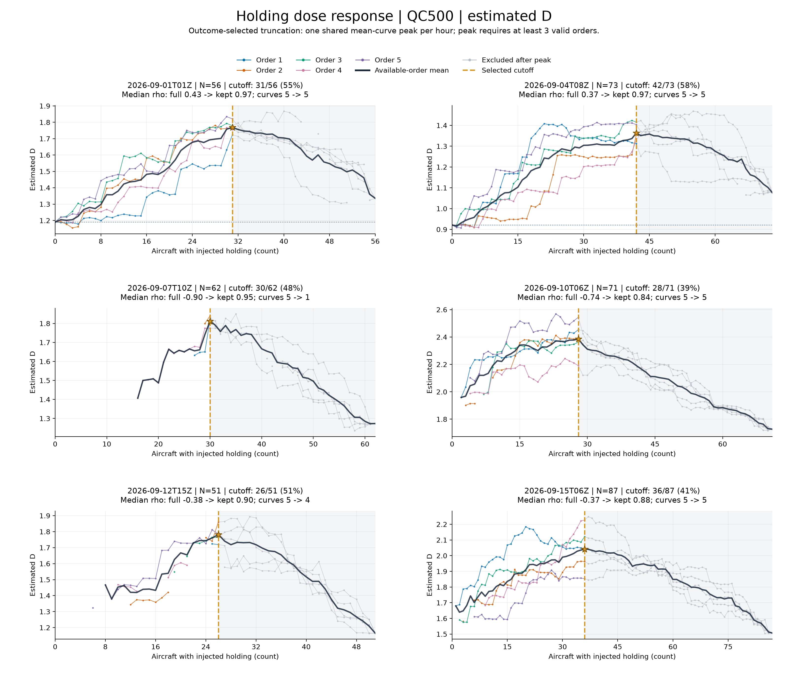

[矢量 SVG](../figures/qc500-holding-scenes-1.svg)

### qc500-holding-scenes-2

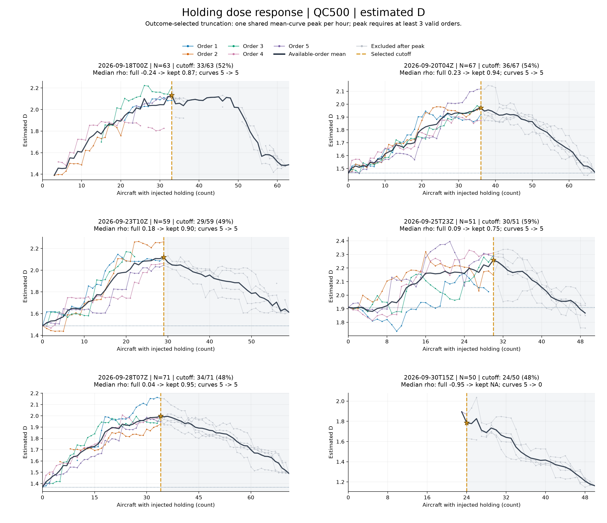

[矢量 SVG](../figures/qc500-holding-scenes-2.svg)

### qc350-holding-scenes-1

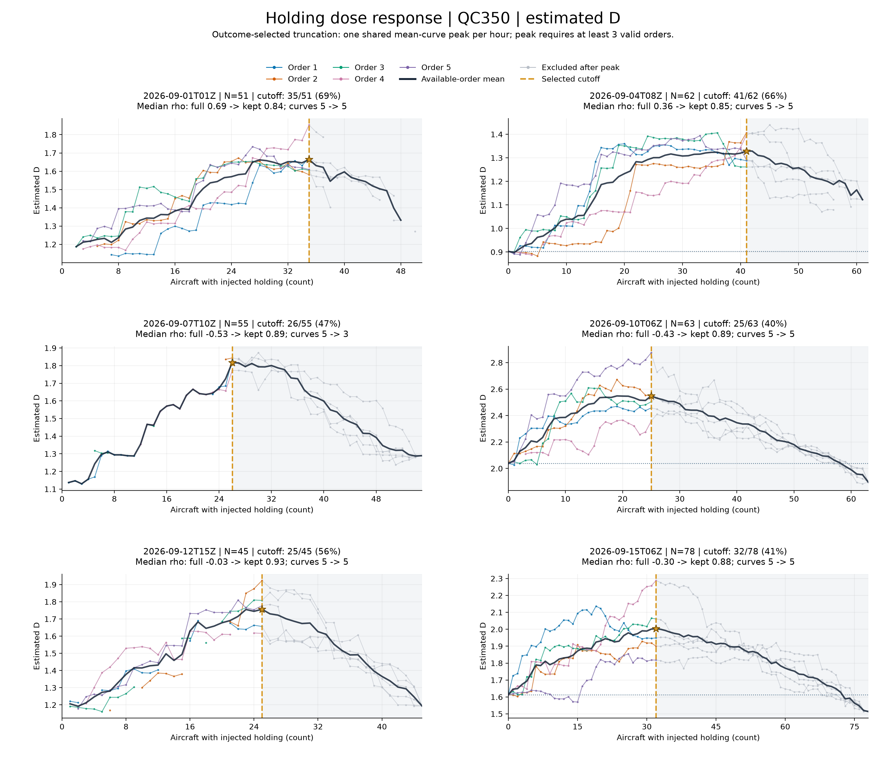

[矢量 SVG](../figures/qc350-holding-scenes-1.svg)

### qc350-holding-scenes-2

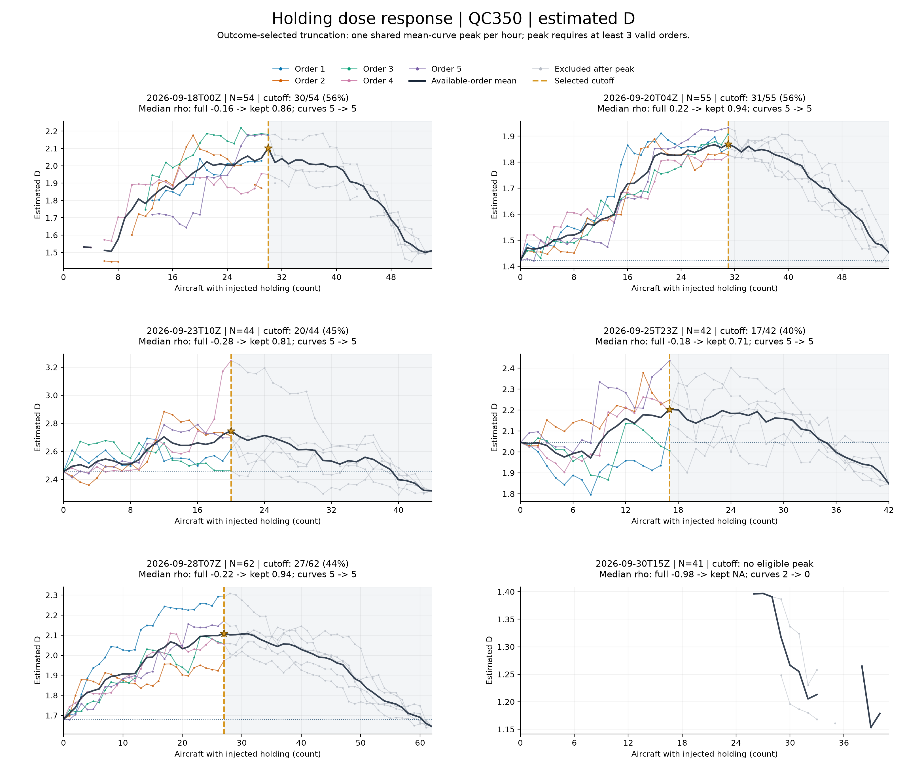

[矢量 SVG](../figures/qc350-holding-scenes-2.svg)

### holding-dose-response

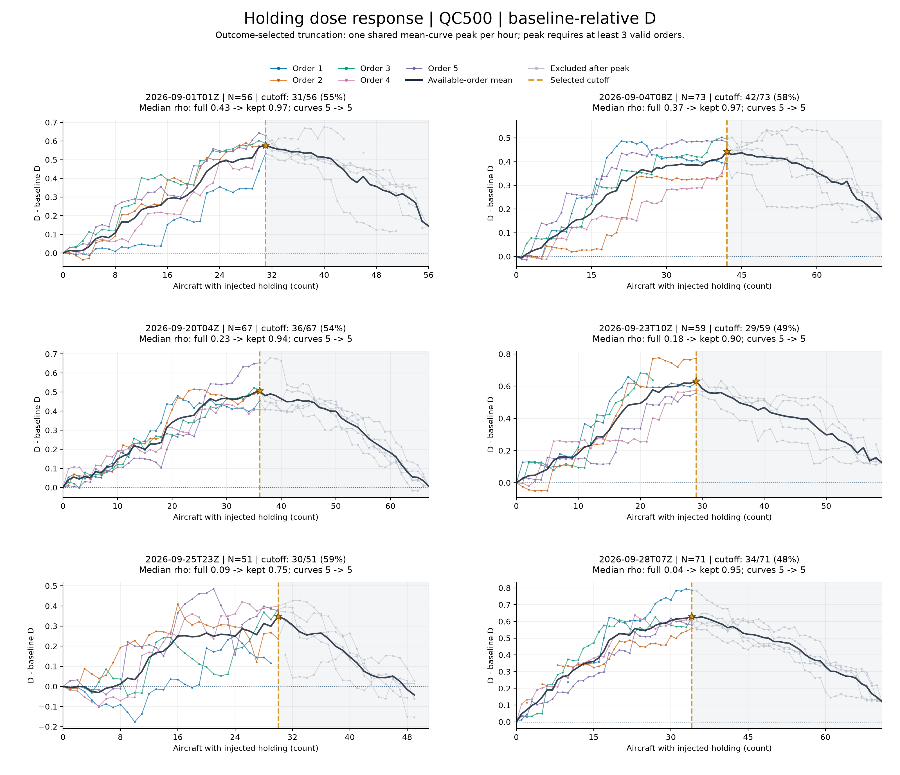

[矢量 SVG](../figures/holding-dose-response.svg)

### holding-correlation-comparison

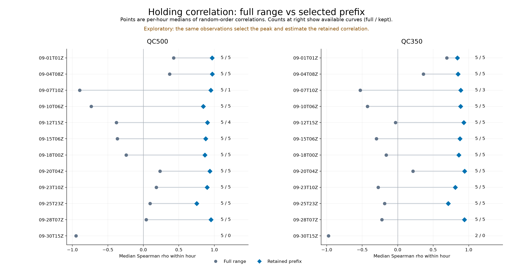

[矢量 SVG](../figures/holding-correlation-comparison.svg)

### vectoring-full-range

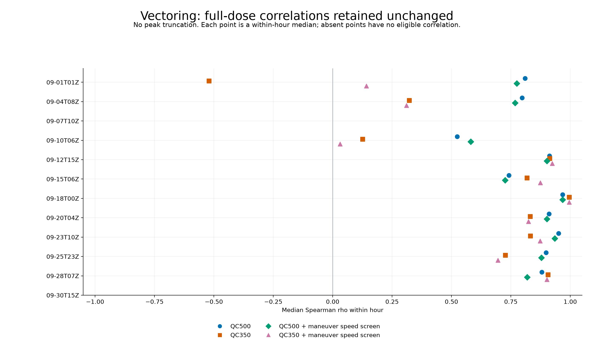

[矢量 SVG](../figures/vectoring-full-range.svg)

### aircraft-count-sensitivity

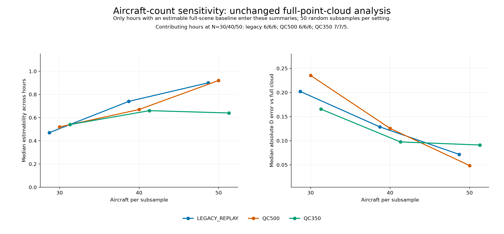

[矢量 SVG](../figures/aircraft-count-sensitivity.svg)

### holding-d-estimability

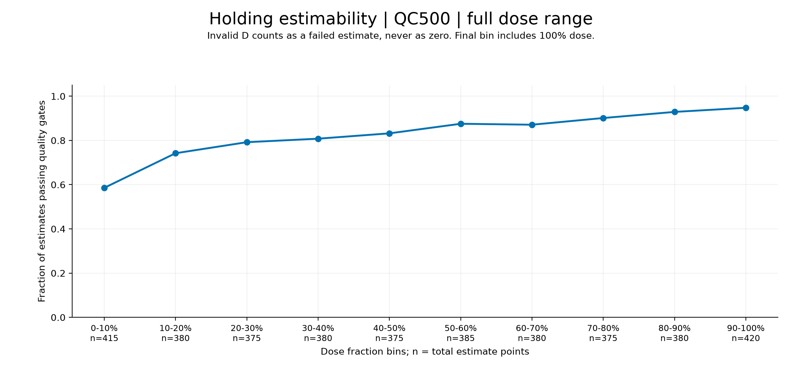

[矢量 SVG](../figures/holding-d-estimability.svg)

### vectoring-d-estimability

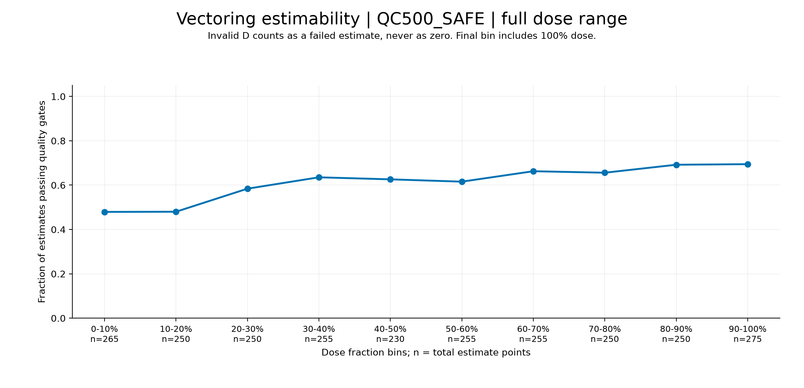

[矢量 SVG](../figures/vectoring-d-estimability.svg)

### vectoring-dose-response

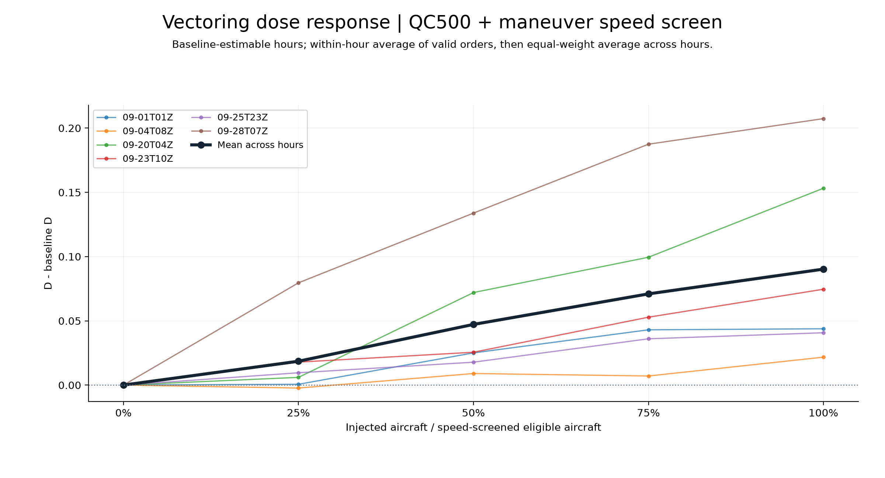

[矢量 SVG](../figures/vectoring-dose-response.svg)

## 数据和复现

- [全部统计与逐小时结果](../results/summary.json)
- [统一完整剂量数据](../results/experiment-results.json)
- [Holding 主结果](../results/synthetic-holding-evaluation-pilot.json)
- [Vectoring 主结果](../results/synthetic-vectoring-evaluation-pilot.json)
- [Holding 逐点保留与排除原因](../results/holding-dose-response.csv)
- [严格筛选逐点清单](../results/qc350-holding-point-selection.csv)
- [原始轨迹剔除清单](../results/quality_audit.json)
- [飞机数量敏感性数据](../results/aircraft-count-sensitivity.json)
- [运行环境和源文件哈希](../results/run-manifest.json)
- [统计规则和输入哈希](../results/analysis-manifest.json)
- [执行说明](../README.md)

从已保存完整结果重新生成统计、图和本报告，不需要原始轨迹或 checkpoint：

```bash
python evaluation/code/refresh_outputs.py
```

从原始轨迹重跑 Encoder 推理及全部实验，需要设置 `ATM_DATA_ZIP` 和 `ATM_ENCODER_CHECKPOINT`：

```bash
python evaluation/code/run_evaluation.py
python evaluation/code/refresh_outputs.py
```

本次推理环境：PyTorch `2.14.0+cu130`，device `cuda`。Checkpoint SHA256：`d3abfc192a2e7a0f84bb1c4207ee04cfc4a4880755530da475124c5f711753ea`。
