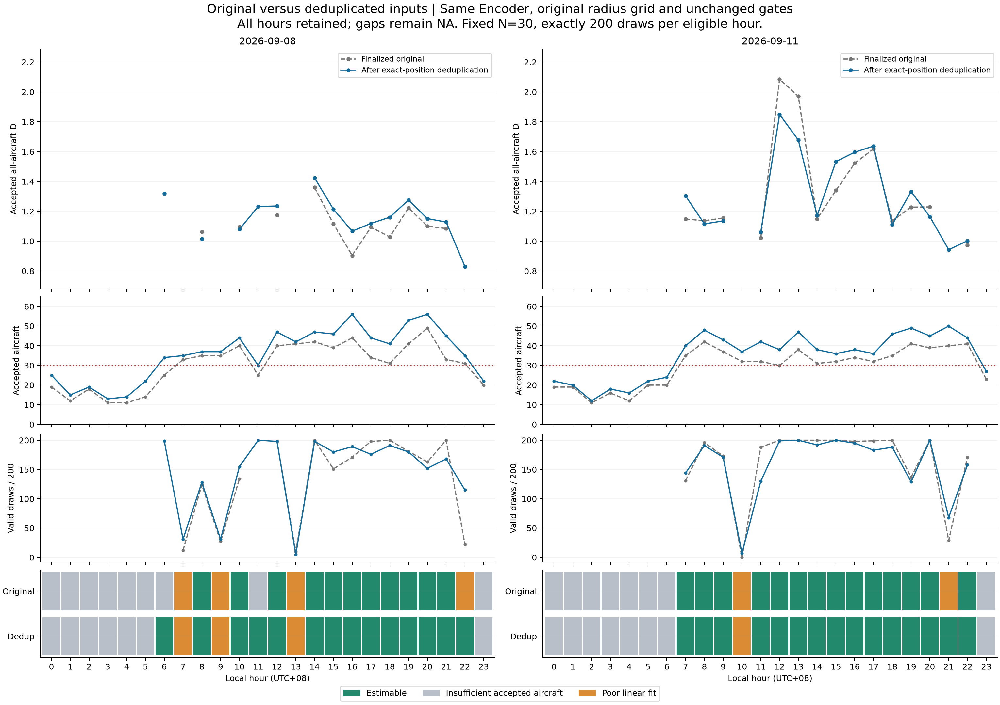
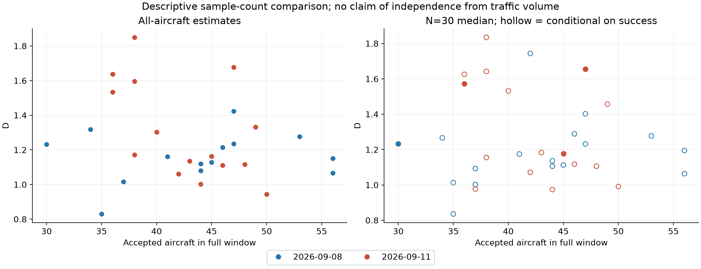

# Changi hourly rerun after exact-position deduplication

This is the comparison supporting the deduplicated main result for September 8 and September 11, 2026. All three schemes use only 1-hour windows. The [original presentation](appendix-original/report.md) is retained as an appendix; see the [current main report](report.md). This document presents an already completed rerun, not a new experiment.

## What changed and what stayed fixed

The sole input change is the previously validated collapse of identical horizontal position observations. All altitude snapshots and original QC thresholds remain. The rerun adds 136 aircraft-hours on September 8 and 127 on September 11. All 1,434 original accepted trajectory arrays AND their newly encoded embeddings are bitwise identical to the finalized run.

The same frozen strict-10-second epoch-90 9-feature Encoder, normalization, sum pooling and original 64 radius values were used. The grid was reused verbatim, not rebuilt from the larger population. D gates remain N>=30, >=8 scales, >=10 pairs, C(r) in [0.02,0.3], radius ratio>=2 and R²>=0.94. Scale eligibility can still change on this fixed grid.

N=30, B=200, the same deterministic seed rule, and the same uniform sampling without replacement within a draw were retained. Pools now contain additional aircraft, so matching seed/draw numbers do not imply identical aircraft subsets or paired treatment effects. All 6,600 draw assignments were saved before inference/D. No failed draw was replaced.

## Scheme 1: estimable-hour coverage

| Date | Eligible N>=30, old → new | Valid D, old → new | Gained local hours | Lost valid hours |
|---|---|---|---|---|
| 2026-09-08 | 15 → 17 | 11 → 14 | 06:00, 11:00, 22:00 | None |
| 2026-09-11 | 16 → 16 | 14 → 15 | 21:00 | None |

The increase in coverage does not establish 24 accepted estimates. The original comparison is retained wherever one side is NA; no delta is invented for such hours.

## Scheme 1: D changes at jointly valid hours

| Date | Jointly valid hours | D increased / decreased | Delta minimum / maximum | Median absolute change |
|---|---:|---|---|---:|
| 2026-09-08 | 11 | 9 / 2 | -0.048 / 0.163 | 0.053 |
| 2026-09-11 | 14 | 8 / 6 | -0.293 / 0.193 | 0.052 |

## Scheme 2: fixed-N subset stability

| Date | Valid draws old | New | Hours with 200/200 old → new | With >1 distinct subset old → new | Partial-success hours old → new |
|---|---|---|---|---|---|
| 2026-09-08 | 1991/3000 | 2496/3400 | 3 → 1 | 3 → 0 | 12 → 16 |
| 2026-09-11 | 2622/3200 | 2555/3200 | 6 → 3 | 5 → 3 | 9 → 13 |

Only 200/200 valid draws with multiple distinct subsets receive a central 95% subsampling range; this is not a bootstrap confidence interval. Partial-success medians remain hollow and conditional on acceptance. September 8 11:00 now has N=30, so all 200 draws are the identical aircraft set; 200/200 there is not robustness across aircraft compositions.

## Scheme 3: unchanged weather comparison

September 11 TS/VCTS-observed clock bins 13–17 are compared with the same hours on September 8. These dates, independent observations and annotations are unchanged. No additional weather search, date selection, lag analysis or significance test was added.

| Hour | Full D event minus control, old → new | Subset median event minus control, old → new | New valid draws control / event |
|---|---|---|---|
| 13:00 | NA → NA | -0.061 → -0.088 | 5/200 ; 200/200 |
| 14:00 | -0.211 → -0.252 | -0.244 → -0.247 | 198/200 ; 192/200 |
| 15:00 | 0.224 → 0.319 | 0.191 → 0.284 | 180/200 ; 200/200 |
| 16:00 | 0.617 → 0.529 | 0.589 → 0.578 | 189/200 ; 195/200 |
| 17:00 | 0.524 → 0.518 | 0.500 → 0.489 | 176/200 ; 183/200 |

The two-day contrast remains descriptive and can have mixed signs. Conditional medians can compare differently selected successful subsets. These results do not establish a causal storm effect, wind-shear detection, or independence from traffic volume.

## Every hour: original versus rerun

| Date | Hour | N old → new | D old → new | New minus old D | State old → new | Valid draws old → new | Conditional median old → new |
|---|---:|---|---|---|---|---|---|
| 2026-09-08 | 00 | 19 → 25 | NA → NA | NA | insufficient_samples → insufficient_samples | 0/0 → 0/0 | NA → NA |
| 2026-09-08 | 01 | 12 → 15 | NA → NA | NA | insufficient_samples → insufficient_samples | 0/0 → 0/0 | NA → NA |
| 2026-09-08 | 02 | 18 → 19 | NA → NA | NA | insufficient_samples → insufficient_samples | 0/0 → 0/0 | NA → NA |
| 2026-09-08 | 03 | 11 → 13 | NA → NA | NA | insufficient_samples → insufficient_samples | 0/0 → 0/0 | NA → NA |
| 2026-09-08 | 04 | 11 → 14 | NA → NA | NA | insufficient_samples → insufficient_samples | 0/0 → 0/0 | NA → NA |
| 2026-09-08 | 05 | 14 → 22 | NA → NA | NA | insufficient_samples → insufficient_samples | 0/0 → 0/0 | NA → NA |
| 2026-09-08 | 06 | 25 → 34 | NA → 1.318 | NA | insufficient_samples → ok | 0/0 → 199/200 | NA → 1.266 |
| 2026-09-08 | 07 | 33 → 35 | NA → NA | NA | poor_linear_fit → poor_linear_fit | 12/200 → 31/200 | 0.953 → 1.013 |
| 2026-09-08 | 08 | 35 → 37 | 1.063 → 1.015 | -0.048 | ok → ok | 124/200 → 128/200 | 1.044 → 1.001 |
| 2026-09-08 | 09 | 35 → 37 | NA → NA | NA | poor_linear_fit → poor_linear_fit | 27/200 → 31/200 | 1.045 → 1.093 |
| 2026-09-08 | 10 | 40 → 44 | 1.096 → 1.080 | -0.016 | ok → ok | 134/200 → 155/200 | 1.156 → 1.106 |
| 2026-09-08 | 11 | 25 → 30 | NA → 1.232 | NA | insufficient_samples → ok | 0/0 → 200/200 | NA → 1.232 |
| 2026-09-08 | 12 | 40 → 47 | 1.176 → 1.236 | 0.060 | ok → ok | 198/200 → 198/200 | 1.192 → 1.231 |
| 2026-09-08 | 13 | 41 → 42 | NA → NA | NA | poor_linear_fit → poor_linear_fit | 10/200 → 5/200 | 2.033 → 1.744 |
| 2026-09-08 | 14 | 42 → 47 | 1.361 → 1.424 | 0.064 | ok → ok | 200/200 → 198/200 | 1.375 → 1.402 |
| 2026-09-08 | 15 | 39 → 46 | 1.117 → 1.215 | 0.098 | ok → ok | 151/200 → 180/200 | 1.160 → 1.289 |
| 2026-09-08 | 16 | 44 → 56 | 0.905 → 1.067 | 0.163 | ok → ok | 171/200 → 189/200 | 0.924 → 1.064 |
| 2026-09-08 | 17 | 34 → 44 | 1.094 → 1.119 | 0.025 | ok → ok | 198/200 → 176/200 | 1.112 → 1.136 |
| 2026-09-08 | 18 | 31 → 41 | 1.028 → 1.161 | 0.132 | ok → ok | 200/200 → 191/200 | 1.005 → 1.175 |
| 2026-09-08 | 19 | 41 → 53 | 1.223 → 1.276 | 0.053 | ok → ok | 181/200 → 180/200 | 1.244 → 1.277 |
| 2026-09-08 | 20 | 49 → 56 | 1.101 → 1.151 | 0.051 | ok → ok | 163/200 → 152/200 | 1.151 → 1.195 |
| 2026-09-08 | 21 | 33 → 45 | 1.085 → 1.128 | 0.043 | ok → ok | 200/200 → 168/200 | 1.095 → 1.112 |
| 2026-09-08 | 22 | 31 → 35 | NA → 0.830 | NA | poor_linear_fit → ok | 22/200 → 115/200 | 1.032 → 0.836 |
| 2026-09-08 | 23 | 20 → 22 | NA → NA | NA | insufficient_samples → insufficient_samples | 0/0 → 0/0 | NA → NA |
| 2026-09-11 | 00 | 19 → 22 | NA → NA | NA | insufficient_samples → insufficient_samples | 0/0 → 0/0 | NA → NA |
| 2026-09-11 | 01 | 19 → 20 | NA → NA | NA | insufficient_samples → insufficient_samples | 0/0 → 0/0 | NA → NA |
| 2026-09-11 | 02 | 11 → 12 | NA → NA | NA | insufficient_samples → insufficient_samples | 0/0 → 0/0 | NA → NA |
| 2026-09-11 | 03 | 16 → 18 | NA → NA | NA | insufficient_samples → insufficient_samples | 0/0 → 0/0 | NA → NA |
| 2026-09-11 | 04 | 12 → 16 | NA → NA | NA | insufficient_samples → insufficient_samples | 0/0 → 0/0 | NA → NA |
| 2026-09-11 | 05 | 20 → 22 | NA → NA | NA | insufficient_samples → insufficient_samples | 0/0 → 0/0 | NA → NA |
| 2026-09-11 | 06 | 20 → 24 | NA → NA | NA | insufficient_samples → insufficient_samples | 0/0 → 0/0 | NA → NA |
| 2026-09-11 | 07 | 35 → 40 | 1.149 → 1.303 | 0.155 | ok → ok | 131/200 → 144/200 | 1.169 → 1.532 |
| 2026-09-11 | 08 | 42 → 48 | 1.137 → 1.116 | -0.022 | ok → ok | 196/200 → 191/200 | 1.147 → 1.106 |
| 2026-09-11 | 09 | 37 → 43 | 1.155 → 1.136 | -0.020 | ok → ok | 173/200 → 171/200 | 1.199 → 1.183 |
| 2026-09-11 | 10 | 32 → 37 | NA → NA | NA | poor_linear_fit → poor_linear_fit | 0/200 → 7/200 | NA → 0.977 |
| 2026-09-11 | 11 | 32 → 42 | 1.023 → 1.061 | 0.038 | ok → ok | 188/200 → 130/200 | 0.986 → 1.071 |
| 2026-09-11 | 12 | 30 → 38 | 2.085 → 1.850 | -0.236 | ok → ok | 200/200 → 199/200 | 2.085 → 1.834 |
| 2026-09-11 | 13 | 38 → 47 | 1.971 → 1.678 | -0.293 | ok → ok | 200/200 → 200/200 | 1.972 → 1.656 |
| 2026-09-11 | 14 | 31 → 38 | 1.150 → 1.172 | 0.022 | ok → ok | 200/200 → 192/200 | 1.131 → 1.155 |
| 2026-09-11 | 15 | 32 → 36 | 1.340 → 1.534 | 0.193 | ok → ok | 200/200 → 200/200 | 1.351 → 1.573 |
| 2026-09-11 | 16 | 34 → 38 | 1.522 → 1.596 | 0.074 | ok → ok | 198/200 → 195/200 | 1.513 → 1.642 |
| 2026-09-11 | 17 | 32 → 36 | 1.618 → 1.637 | 0.019 | ok → ok | 199/200 → 183/200 | 1.611 → 1.626 |
| 2026-09-11 | 18 | 35 → 46 | 1.136 → 1.112 | -0.025 | ok → ok | 200/200 → 188/200 | 1.120 → 1.117 |
| 2026-09-11 | 19 | 41 → 49 | 1.228 → 1.333 | 0.104 | ok → ok | 137/200 → 129/200 | 1.321 → 1.457 |
| 2026-09-11 | 20 | 39 → 45 | 1.230 → 1.164 | -0.066 | ok → ok | 200/200 → 200/200 | 1.226 → 1.177 |
| 2026-09-11 | 21 | 40 → 50 | NA → 0.943 | NA | poor_linear_fit → ok | 29/200 → 68/200 | 0.988 → 0.991 |
| 2026-09-11 | 22 | 41 → 44 | 0.974 → 1.003 | 0.029 | ok → ok | 171/200 → 158/200 | 0.955 → 0.974 |
| 2026-09-11 | 23 | 23 → 27 | NA → NA | NA | insufficient_samples → insufficient_samples | 0/0 → 0/0 | NA → NA |

## New main figures and descriptive supplement

## Reproducibility and limits

Checked 6648 saved estimates and independently verified 6633 exact pair-count arrays and 5080 accepted regression slopes/R² values. Original output hashes, source arrays, old embeddings, radius values and saved assignments were checked. No finalized file was changed.

Missing D is NA and breaks lines. Fixed N controls count, not composition, duration or observation availability; repeated draws are not independent days. The different weekdays and single event/control pair limit weather interpretation. The unchanged whole-track reject policy still excludes unsupported intervals. Larger input populations can change both point-cloud geometry and the dynamically eligible regression scales.

Files: `policy.json`, `run-manifest.json`, `input-manifest.json`, `radius-grid.json`, `draws/`, `embeddings/`, `results/one-hour-summary.json`, `results/comparison.json`, all per-window attempt files, and `verification.json`. These underlying data remain local. The deduplicated presentation now replaces the main hourly presentation; the original remains an appendix comparator.
