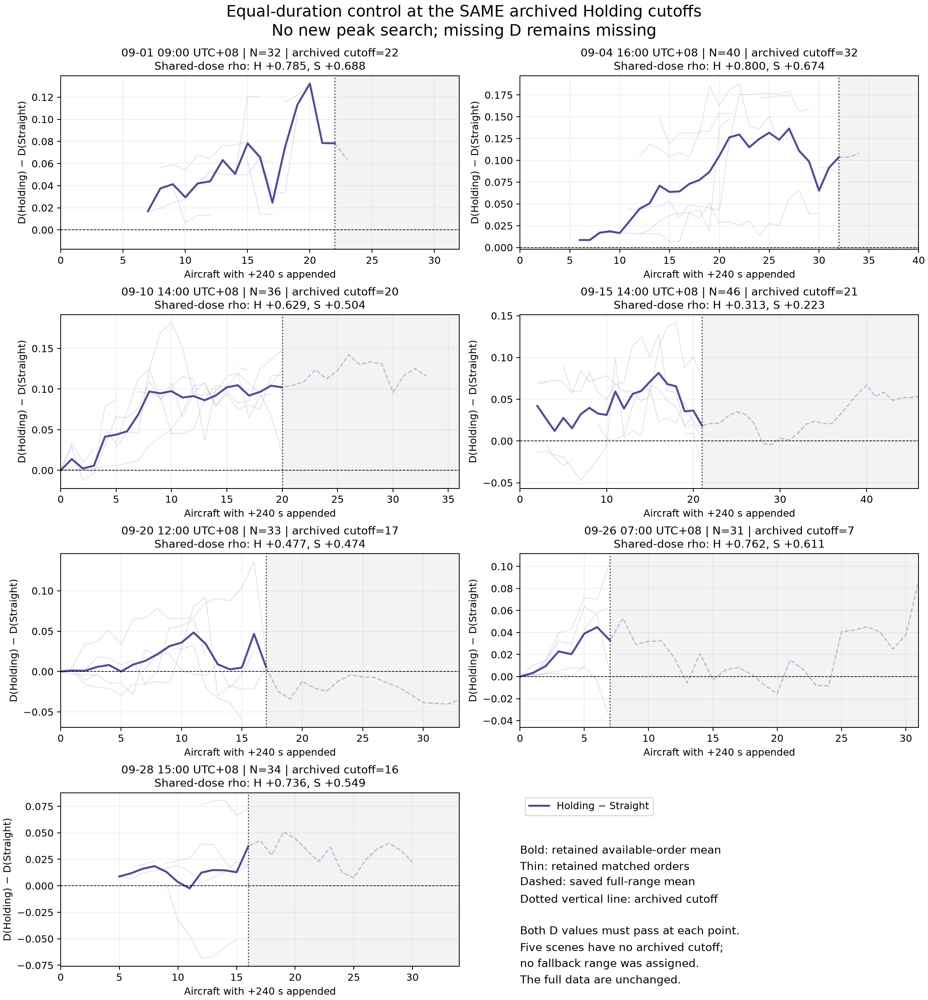

# Equal-duration Holding control at archived common cutoffs

> Archived stage report. Statements about work not yet run describe this stage only. See the [current combined report](../../report.md) for subsequent results. Publication excludes raw trajectories and model weights; see the [bundle notes](../README.md).

This analysis uses only the saved terminal-append control results. Both arms receive exactly the archived QC500, strict-10-second, midpoint-Holding cutoff for each scene, including its endpoint. No trajectory generation, model inference, D estimation, threshold change, or new peak selection was performed. Complete prior results remain unchanged.

## Cutoff provenance

The cutoffs were read from `evaluation-10s/workspace/evaluation/results/summary.json`, under `qc500.holding.scenes`, and cross-checked against the archived point-selection CSV. Counts are used directly, not rescaled fractions. The source populations match the current control populations. Five scenes have no archived cutoff; they receive no retained-range estimate or replacement cutoff.

| Scene UTC+08 | Background N | Archived cutoff (aircraft) |
|---|---:|---:|
| 09-01 09:00 | 32 | 22 |
| 09-04 16:00 | 40 | 32 |
| 09-07 18:00 | 29 | Unavailable |
| 09-10 14:00 | 36 | 20 |
| 09-12 23:00 | 26 | Unavailable |
| 09-15 14:00 | 46 | 21 |
| 09-18 08:00 | 31 | Unavailable |
| 09-20 12:00 | 33 | 17 |
| 09-23 18:00 | 25 | Unavailable |
| 09-26 07:00 | 31 | 7 |
| 09-28 15:00 | 34 | 16 |
| 09-30 23:00 | 21 | Unavailable |

## Correlation results

Primary comparisons use identical doses where BOTH D values are accepted. Each arm's own valid-dose subset is also recorded in the machine-readable output; it is not substituted for the matched comparison. The unchanged minimum is five accepted doses per correlation.

| Comparison | Holding median rho | Straight median rho | Matched orders |
|---|---:|---:|---:|
| Archived cutoff: all computable | +0.661 | +0.598 | 33 |
| Archived cutoff: baseline-valid scenes | +0.553 | +0.504 | 15 |
| Full range: same orders as retained analysis | +0.217 | +0.187 | 33 |

A matched order is a within-scene repeat, not an independent scene. Full-versus-retained comparisons above keep the same order identifiers; within an order, the full range naturally contains more doses. No confirmatory p-values are claimed.

| Scene UTC+08 | Cutoff | Common rho H | Common rho S | Joint nonzero records | Median D(H) − D(S) |
|---|---:|---:|---:|---:|---:|
| 09-01 09:00 | 22 | +0.785 | +0.688 | 42 | +0.04087 |
| 09-04 16:00 | 32 | +0.800 | +0.674 | 87 | +0.05301 |
| 09-10 14:00 | 20 | +0.629 | +0.504 | 94 | +0.08681 |
| 09-15 14:00 | 21 | +0.313 | +0.223 | 82 | +0.02184 |
| 09-20 12:00 | 17 | +0.477 | +0.474 | 76 | -0.00094 |
| 09-26 07:00 | 7 | +0.762 | +0.611 | 32 | +0.03004 |
| 09-28 15:00 | 16 | +0.736 | +0.549 | 35 | +0.01833 |

Among 7 scenes with retained paired differences, 6 have positive scene medians. The equal-scene median difference is +0.03004. Among 3 baseline-valid scenes, 2 have positive scene medians and the corresponding median difference is +0.03004.

Difference aggregation: median over accepted nonzero doses within each order, then median across orders within a scene, then median across scenes. Dose zero is excluded from difference summaries. Baseline-relative changes are provided only for baseline-valid scenes; D failures are never filled with zero.

## What this comparison establishes

A common archived cutoff prevents choosing a favorable peak independently for each arm. Stronger prefix correlations in both arms show that early-dose growth is not unique to Holding. A positive paired D difference at equal duration and point count supports sensitivity to route geometry/location beyond those two matched properties. A higher D than Straight and a strong dose correlation are different claims.

The experiment does not isolate pure sequence-length contribution: straight continuation also changes trajectory position and spatial extent. It cannot assign a percentage of the old Holding response to length. The imported cutoffs were originally chosen using midpoint Holding outcomes; they were not independently established physical limits. Applying them without reselection to the terminal experiment does not remove that provenance or make this an independent validation dataset.

Only three original scenes have valid zero-dose D. Correlations remain conditional on the unchanged D quality gates and available jointly valid doses. These limitations, the shared cutoffs, and both-arm results should accompany any paper claim.

## Saved evidence

- `policy.json`: immutable cutoff source, exact values, inclusion and missing-cutoff policy.
- `results/summary.json`: scene and aggregate statistics, including matched-order full-range comparison.
- `results/repeat-summary.json`: own-valid and common-valid correlations for each order.
- `results/point-selection.json`: all original dose pairs, retained flags, D values, reasons and differences.
- `verification.json`: source preservation, archived cutoff checks and independent rank-correlation verification.
