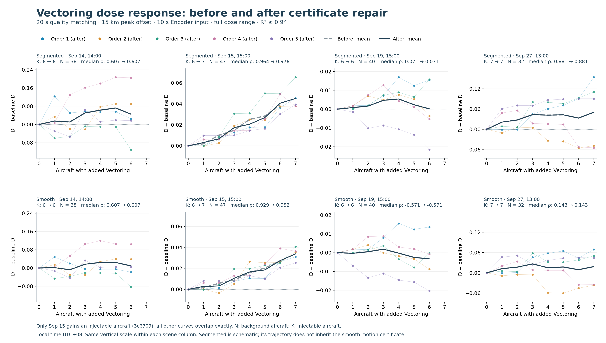
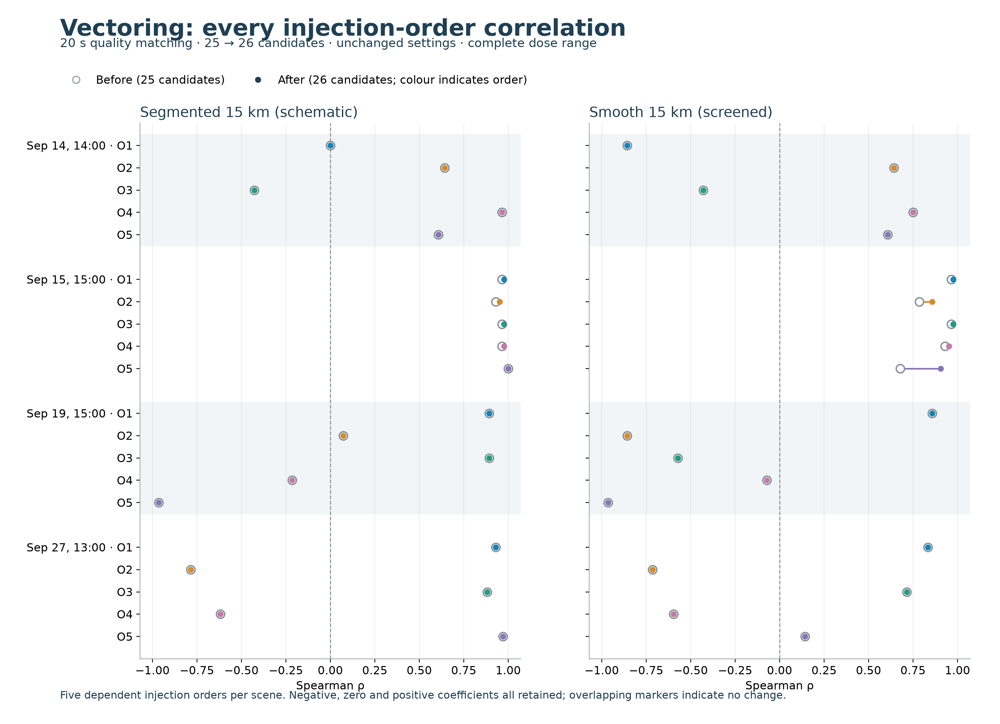

# Vectoring: repaired 20-second version versus the prior 25-candidate result

> Publication note: this package contains reports, figures and execution-source snapshots only. Population arrays, embeddings, per-dose JSON, assignments, quality evidence and manifests remain local. Statements about “no Git push” describe the original experiment run; this reviewed presentation was subsequently published. No experiment was rerun for publication.

2026-10-27. New results are saved separately. No Git push or replacement of published results.

## Main result

**The added candidate improves positive association slightly in the September 15 scene, but does not improve the aggregate correlation median or the number of positive orders.** The other three scenes reproduce exactly.

The restored `3c6709` belongs to the scene that already had five positive orders. It does not add candidates to the scenes with mixed or negative responses. The aggregate medians remain 0.887 (segmented) and 0.625 (smooth); the September 15 values change without moving the middle-ranked coefficients in the aggregate.

## What was held fixed

- Same four scenes and 157 background aircraft; all baseline trajectory arrays and embeddings unchanged.
- Same 25 existing intervention trajectories and embeddings. Add only the screened `3c6709` intervention, with two sides for each existing shape. Its original altitude, cadence, length and points outside the intervention are retained.
- Same frozen 10-second, nine-feature Encoder checkpoint `bc1e0d74255cfee60a1c09c64dab8fac5a31f3175c4c234f8cf3983bc07af976`, sum pooling and preprocessing.
- Same 20-second quality-message matching rule, fixed 15 km intervention, inherited 5 km prerequisite, and physical checks. The matching time is not the Encoder sampling interval.
- Same five master injection orders, seeds and left/right assignments frozen before the previous evaluation. `3c6709` takes its original position in those master orders; it was not placed to improve D.
- Same exact saved 64-radius grid per scene, R² ≥ 0.94, minimum 30 aircraft, minimum 8 fit scales, minimum 10 pairs, C(r) in [0.02, 0.3], and minimum radius span ratio 2. The existing automatic fit-subrange selection remains unchanged; fixing the radius grid does not lock that subrange.
- Complete dose ranges, including baseline. Failed D would remain NA, and correlation still requires at least five valid doses. No peak selection, truncation, smoothing of the response or dropping of negative orders.

Both existing shapes are retained. **Segmented is a schematic geometric stimulus:** membership is inherited from smooth-route screening, but the segmented trajectory itself does not inherit the smooth C2/motion certificate. Smooth is the continuously checked route. Their results must not be presented as interchangeable evidence of physically feasible vectoring.

## Aggregate results

Each shape has four independent scenes and five dependent injection orders per scene. The reported median is over 20 order coefficients, not a pooled correlation or 20 independent experiments. Repeated baseline records are included in the displayed D-record counts.

| Shape | Median order ρ, before → after | Positive / 20 | Negative / 20 | Zero / 20 | Valid D / recorded doses |
|---|---:|---:|---:|---:|---:|
| segmented | 0.887 → 0.887 | 14 → 14 | 5 → 5 | 1 → 1 | 145/145 → 150/150 |
| smooth | 0.625 → 0.625 | 12 → 12 | 8 → 8 | 0 → 0 | 145/145 → 150/150 |

## Scene results

Times are Singapore local time (UTC+08). N is background aircraft and K is injectable candidates. D at dose zero is exactly unchanged in every scene.

| Local scene | N | K, before → after | Segmented median ρ | Smooth median ρ |
|---|---:|---:|---:|---:|
| Sep 14, 14:00 | 38 | 6 → 6 | 0.607 → 0.607 | 0.607 → 0.607 |
| Sep 15, 15:00 | 47 | 6 → 7 | 0.964 → 0.976 | 0.929 → 0.952 |
| Sep 19, 15:00 | 40 | 6 → 6 | 0.071 → 0.071 | -0.571 → -0.571 |
| Sep 27, 13:00 | 32 | 7 → 7 | 0.881 → 0.881 | 0.143 → 0.143 |

The September 15 segmented median rises from 0.964 to 0.976; four orders increase slightly and one remains 1.000. Its smooth median rises from 0.929 to 0.952, and all five orders increase. All were positive before the repair. The September 19 smooth median remains −0.571, so the principal negative-response problem is unchanged.

[Vector PDF](figures/vectoring-full-range-before-after.pdf) · [Editable SVG](figures/vectoring-full-range-before-after.svg)

[Vector PDF](figures/vectoring-order-correlations-before-after.pdf) · [Editable SVG](figures/vectoring-order-correlations-before-after.svg)

## What the comparison supports

The numerical repair restores one usable aircraft-hour without changing earlier inputs, and its inclusion modestly strengthens an already positive scene. It does **not** establish that vectoring generally raises D across scenes, or that simply admitting more candidates ensures a positive response. The segmented median of 0.887 coexists with five negative and one zero coefficient. The smooth result retains eight negative coefficients.

All 150 dose records per shape pass the unchanged D gate; lowering R² would not recover any further plotted point in this run. This before/after comparison does not diagnose every remaining source of mixed response, and a one-aircraft increase is not enough to conclude what a much larger sample would do.

## Failures and preservation

There are **zero failed D records** and **zero unavailable correlations** in the new evaluation. Negative and zero coefficients remain in every summary and figure. The 14 screening exclusions remain saved separately: nine reference rejections (including the unchanged eight chord-geometry cases), and five route rejections. No excluded trajectory is silently restored.

All 290 old dose records across both shapes were recomputed from their frozen embeddings and matched the full saved diagnostics exactly. The three unaffected scenes and the pre-addition portions of all five changed-scene orders also match exactly. Four Encoder baseline probes reproduced exactly; only four new trajectory embeddings were required (two sides × two shapes). There were 8 Encoder calls including probes and 518 D-estimator calls including the old-result replay. New reported dose records total 300 because baseline estimates are reused across orders.

Protected old files and screening records were checked by SHA-256. The new run did not refit references, regenerate routes, alter thresholds, download data, or change the repository's published results.

## Complete correlation ledger

| Shape | Local scene | Order | Before ρ | After ρ | Unavailable reason |
|---|---|---:|---:|---:|---|
| segmented | Sep 14, 14:00 | 1 | 0.000 | 0.000 | — |
| segmented | Sep 14, 14:00 | 2 | 0.643 | 0.643 | — |
| segmented | Sep 14, 14:00 | 3 | -0.429 | -0.429 | — |
| segmented | Sep 14, 14:00 | 4 | 0.964 | 0.964 | — |
| segmented | Sep 14, 14:00 | 5 | 0.607 | 0.607 | — |
| segmented | Sep 15, 15:00 | 1 | 0.964 | 0.976 | — |
| segmented | Sep 15, 15:00 | 2 | 0.929 | 0.952 | — |
| segmented | Sep 15, 15:00 | 3 | 0.964 | 0.976 | — |
| segmented | Sep 15, 15:00 | 4 | 0.964 | 0.976 | — |
| segmented | Sep 15, 15:00 | 5 | 1.000 | 1.000 | — |
| segmented | Sep 19, 15:00 | 1 | 0.893 | 0.893 | — |
| segmented | Sep 19, 15:00 | 2 | 0.071 | 0.071 | — |
| segmented | Sep 19, 15:00 | 3 | 0.893 | 0.893 | — |
| segmented | Sep 19, 15:00 | 4 | -0.214 | -0.214 | — |
| segmented | Sep 19, 15:00 | 5 | -0.964 | -0.964 | — |
| segmented | Sep 27, 13:00 | 1 | 0.929 | 0.929 | — |
| segmented | Sep 27, 13:00 | 2 | -0.786 | -0.786 | — |
| segmented | Sep 27, 13:00 | 3 | 0.881 | 0.881 | — |
| segmented | Sep 27, 13:00 | 4 | -0.619 | -0.619 | — |
| segmented | Sep 27, 13:00 | 5 | 0.970 | 0.970 | — |
| smooth | Sep 14, 14:00 | 1 | -0.857 | -0.857 | — |
| smooth | Sep 14, 14:00 | 2 | 0.643 | 0.643 | — |
| smooth | Sep 14, 14:00 | 3 | -0.429 | -0.429 | — |
| smooth | Sep 14, 14:00 | 4 | 0.750 | 0.750 | — |
| smooth | Sep 14, 14:00 | 5 | 0.607 | 0.607 | — |
| smooth | Sep 15, 15:00 | 1 | 0.964 | 0.976 | — |
| smooth | Sep 15, 15:00 | 2 | 0.786 | 0.857 | — |
| smooth | Sep 15, 15:00 | 3 | 0.964 | 0.976 | — |
| smooth | Sep 15, 15:00 | 4 | 0.929 | 0.952 | — |
| smooth | Sep 15, 15:00 | 5 | 0.679 | 0.905 | — |
| smooth | Sep 19, 15:00 | 1 | 0.857 | 0.857 | — |
| smooth | Sep 19, 15:00 | 2 | -0.857 | -0.857 | — |
| smooth | Sep 19, 15:00 | 3 | -0.571 | -0.571 | — |
| smooth | Sep 19, 15:00 | 4 | -0.071 | -0.071 | — |
| smooth | Sep 19, 15:00 | 5 | -0.964 | -0.964 | — |
| smooth | Sep 27, 13:00 | 1 | 0.833 | 0.833 | — |
| smooth | Sep 27, 13:00 | 2 | -0.714 | -0.714 | — |
| smooth | Sep 27, 13:00 | 3 | 0.714 | 0.714 | — |
| smooth | Sep 27, 13:00 | 4 | -0.595 | -0.595 | — |
| smooth | Sep 27, 13:00 | 5 | 0.143 | 0.143 | — |

## Files and reproduction

- Run configuration and protected-source hashes (local-only: `run-manifest.json`)
- Summary, reproduction and pairing checks (local-only: `evaluation-summary.json`)
- All screening exclusions (local-only: `screening-exclusions.json`)
- All D failures, including an explicit empty list when none fail (local-only: `failed-D-records.json`)
- Segmented results and diagnostics (local-only: `segmented/results/experiment-results.json`)
- Smooth results and diagnostics (local-only: `smooth/results/experiment-results.json`)
- [Evaluation script](source/run_evaluation.py)
- [Report and figure script](source/report_results.py)

The local package also contains population arrays, embeddings, per-scene radius grids, five order lists, and complete fit diagnostics at every dose. These derived data stay local. Reproduction needs the preserved local inputs and frozen checkpoint; the runner refuses to overwrite an existing run manifest.
