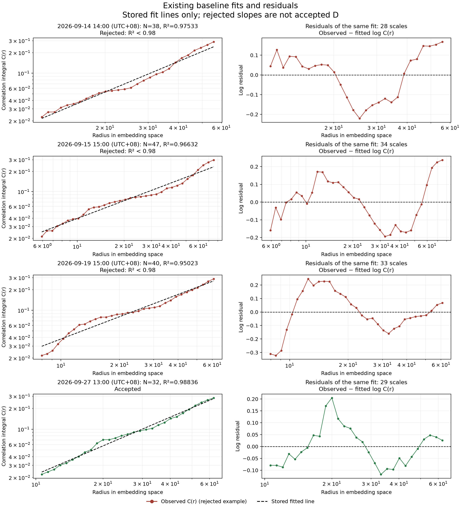
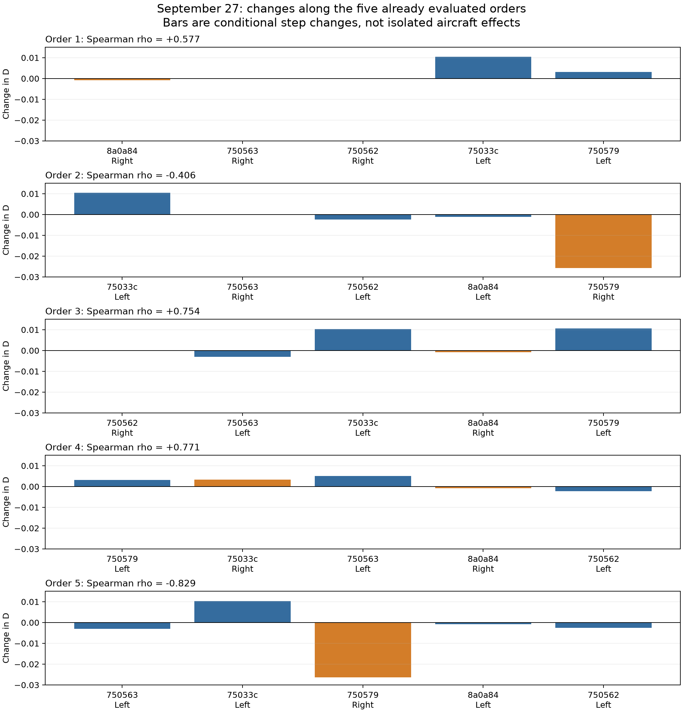

# Diagnosis using the existing four-scene Vectoring results

> Archived stage report. Statements about work not yet run describe this stage only. See the [current combined report](../../report.md) for subsequent results. Publication excludes raw trajectories and model weights; see the [bundle notes](../README.md).

## Scope

This is an analysis of already saved dose curves, embeddings, pair counts, fitting-scale indexes, assignment sequences and fit diagnostics. No new D estimates, alternate estimator, sample-size subsample, left/right swap, trajectory, threshold change or correlation experiment was performed.

## Why the first three scenes fail

The immediate cause is the existing log–log fit quality gate: all 95 attempted D records in those scenes have R² below 0.98. Their zero-injection baselines also fail, so Vectoring injection did not create the initial failure. The number of tracks, distinct embeddings, pair counts and fitting scales satisfy their respective numerical requirements.

| Local baseline time UTC+08 | Aircraft / unique embeddings | Pairs | Fit scales | Radius span ratio | Baseline R² |
|---|---:|---:|---:|---:|---:|
| 2026-09-14 14:00 | 38 / 38 | 703 | 28 | 5.07 | 0.97533 |
| 2026-09-15 15:00 | 47 / 47 | 1081 | 34 | 12.67 | 0.96632 |
| 2026-09-19 15:00 | 40 / 40 | 780 | 33 | 7.64 | 0.95023 |
| 2026-09-27 13:00 | 32 / 32 | 496 | 29 | 5.89 | 0.98836 |

The original line does not approximate the selected log C(r) curve closely enough. Residual plots show where that approximation fails; no better-looking subrange was searched. This is evidence that a single accepted power-law slope is not established over the existing selected scales, not proof that the aircraft data or Encoder are invalid.

Sample size cannot be assigned as the sole cause from these records: the scene with 32 aircraft passes, whereas those with 38, 47 and 40 do not. This disproves a simple ordering by aircraft count, but it does not prove that finite-sample effects are absent. More or differently distributed points could affect the staircase of pair counts; no new sample-size experiment was run to test that possibility.

## Why the fourth scene changes correlation sign

All 30 D records pass the existing quality gates, but the five orders also use different left/right assignments. The stored sequences show that aircraft `750579` is assigned Right in both negative-rho orders, and Left in all three positive-rho orders. This identifies a concrete observed turning point, not a universal rule that Right decreases D.

| Order | rho | `750579` side | D change at its injection | Fitting-scale event |
|---|---:|---|---:|---|
| 1 | +0.576818 | Left | +0.003192 | same scales |
| 2 | -0.405840 | Right | -0.025724 | one scale removed |
| 3 | +0.753702 | Left | +0.010604 | one scale added |
| 4 | +0.771429 | Left | +0.003192 | same scales |
| 5 | -0.828571 | Right | -0.026350 | one scale removed |

In each negative order, that right-side injection changes the count at radius 10.6217104 from **10 pairs to 9 pairs**. With 32 aircraft there are 496 pairs, so C(r) changes from **10/496 = 0.0201613** to **9/496 = 0.0181452**. That point simultaneously falls below the unchanged minimum of ten pairs and the C(r) lower bound of 0.02, and is therefore removed from the fitting scales. The associated accepted D drops by about 0.0257 or 0.0264. This is a visible finite-count boundary event in the estimator, not a missing value or a manual truncation.

The radius grid itself stays fixed. The subset of radii eligible for fitting can change with the point-cloud pair counts, as required by the existing estimator. Aircraft/side-induced distance changes and the estimator boundary therefore act together. D measures the geometry of a whole embedding cloud; changing one aircraft can move it toward or away from other aircraft rather than guaranteeing an increase in D.

Some steps change pair counts only outside the selected fitting scales, leaving D exactly unchanged. Some left/right choices give different signs, and the same choice can have different magnitudes depending on preceding injections. These observations explain why a small number of discrete steps can produce different Spearman signs.

## What can and cannot be concluded

Confirmed: the first three scenes fail the R² gate even at baseline; the fourth has mixed signs; specific aircraft/side changes cross fitting-scale count boundaries. The direction and magnitude of observed sequential changes depend on the current scene state.

Not isolated: how much of the first three failures is finite sample size versus the underlying embedding distribution, how an alternative estimator would behave, or the pure causal effect of side separated from order. Those require additional controlled comparisons. No such experiments were added or used to rescue a positive conclusion.

The current evidence supports diagnosing estimator applicability and discrete sensitivity. It does not support claiming a stable strong positive Vectoring relationship.

## Evidence

`diagnosis.json` retains every observed step, changed count, scale boundary and the incident aircraft-pair crossing, alongside the existing baseline diagnostics. Figures display the original stored fits, including rejected fits explicitly labeled as such. Previous files are unchanged.
