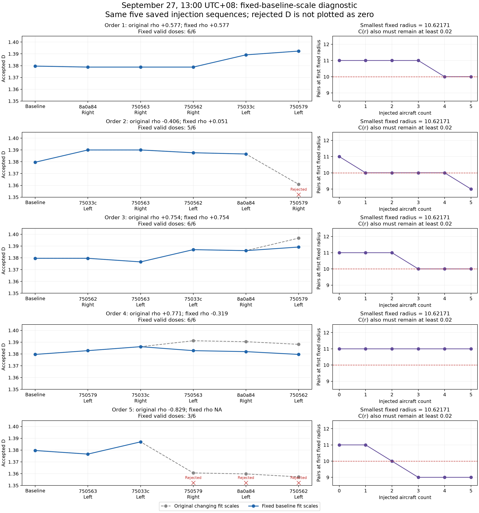

# Fourth-scene Vectoring: fixed baseline fitting scales

> Archived stage report. Statements about work not yet run describe this stage only. See the [current combined report](../../report.md) for subsequent results. Publication excludes raw trajectories and model weights; see the [bundle notes](../README.md).

Only the saved embeddings and original left/right assignments for 2026-09-27 05:00 UTC (13:00 UTC+08) were used. The other three scenes, all previous outputs and production code were left unchanged. No Encoder inference, trajectory generation, left/right experiment, or threshold adjustment was performed.

## Exact diagnostic rule

The baseline selected 29 radii, indexes [17, 18, 19, 20, 21, 22, 23, 24, 25, 26, 27, 28, 29, 30, 31, 32, 33, 34, 35, 36, 37, 38, 39, 40, 41, 42, 43, 44, 45], spanning 10.62171042 to 62.54047678 in embedding-distance units. These exact indexes are used at every dose and in all five orders. The baseline D remains 1.3796196592.

Every fixed scale must meet the existing count and C(r) gates: at least 10 pairs, 0 < C(r) < 1 and 0.02 <= C(r) <= 0.3. Failure of any fixed scale rejects the entire D estimate; that scale is not removed and no replacement scale is added. The existing minimum of 30 aircraft, eight scales, radius ratio 2, positive slope and R² >= 0.98 are retained.

The production explicit-radius-range option was not used because it replaces the C(r) interval gate and may remove deficient scales. A separate local diagnostic implements the original distance counts and regression equations while freezing the exact index set and enforcing every original quality bound.

## Correlations and missing estimates

| Order | Original rho, all six doses | Fixed-scale rho | Original rho on the same fixed-valid doses | Fixed-valid doses |
|---|---:|---:|---:|---|
| 1 | +0.577 | +0.577 | +0.577 | [0, 1, 2, 3, 4, 5] |
| 2 | -0.406 | +0.051 | +0.051 | [0, 1, 2, 3, 4] |
| 3 | +0.754 | +0.754 | +0.754 | [0, 1, 2, 3, 4, 5] |
| 4 | +0.771 | -0.319 | +0.771 | [0, 1, 2, 3, 4, 5] |
| 5 | -0.829 | NA | NA | [0, 1, 2] |

The original method accepted all 30 displayed dose records. The fixed-scale diagnostic accepts 26 and rejects 4. Correlation still requires at least five accepted doses; 4 of five orders meet this requirement. Baseline records are shared across orders and are not independent observations.

## Step-by-step comparison

| Order | Dose | Newly injected aircraft / side | Original D | Fixed D | Fixed − original | Rejection details |
|---|---:|---|---:|---:|---:|---|
| 1 | 0 | Baseline | +1.379620 | +1.379620 | +0.000000 | — |
| 1 | 1 | 8a0a84 / Right | +1.378784 | +1.378784 | +0.000000 | — |
| 1 | 2 | 750563 / Right | +1.378784 | +1.378784 | +0.000000 | — |
| 1 | 3 | 750562 / Right | +1.378784 | +1.378784 | +0.000000 | — |
| 1 | 4 | 75033c / Left | +1.389165 | +1.389165 | +0.000000 | — |
| 1 | 5 | 750579 / Left | +1.392358 | +1.392358 | +0.000000 | — |
| 2 | 0 | Baseline | +1.379620 | +1.379620 | +0.000000 | — |
| 2 | 1 | 75033c / Left | +1.390001 | +1.390001 | +0.000000 | — |
| 2 | 2 | 750563 / Right | +1.390001 | +1.390001 | +0.000000 | — |
| 2 | 3 | 750562 / Left | +1.387641 | +1.387641 | +0.000000 | — |
| 2 | 4 | 8a0a84 / Left | +1.386582 | +1.386582 | +0.000000 | — |
| 2 | 5 | 750579 / Right | +1.360858 | NA | NA | scale 17: 9 pairs, C=0.0181452 |
| 3 | 0 | Baseline | +1.379620 | +1.379620 | +0.000000 | — |
| 3 | 1 | 750562 / Right | +1.379620 | +1.379620 | +0.000000 | — |
| 3 | 2 | 750563 / Left | +1.376583 | +1.376583 | +0.000000 | — |
| 3 | 3 | 75033c / Left | +1.386964 | +1.386964 | +0.000000 | — |
| 3 | 4 | 8a0a84 / Right | +1.386129 | +1.386129 | +0.000000 | — |
| 3 | 5 | 750579 / Left | +1.396733 | +1.389165 | -0.007567 | — |
| 4 | 0 | Baseline | +1.379620 | +1.379620 | +0.000000 | — |
| 4 | 1 | 750579 / Left | +1.382812 | +1.382812 | +0.000000 | — |
| 4 | 2 | 75033c / Right | +1.386177 | +1.386177 | +0.000000 | — |
| 4 | 3 | 750563 / Left | +1.391196 | +1.382812 | -0.008384 | — |
| 4 | 4 | 8a0a84 / Right | +1.390394 | +1.381977 | -0.008418 | — |
| 4 | 5 | 750562 / Left | +1.388171 | +1.379617 | -0.008554 | — |
| 5 | 0 | Baseline | +1.379620 | +1.379620 | +0.000000 | — |
| 5 | 1 | 750563 / Left | +1.376583 | +1.376583 | +0.000000 | — |
| 5 | 2 | 75033c / Left | +1.386964 | +1.386964 | +0.000000 | — |
| 5 | 3 | 750579 / Right | +1.360614 | NA | NA | scale 17: 9 pairs, C=0.0181452 |
| 5 | 4 | 8a0a84 / Left | +1.359782 | NA | NA | scale 17: 9 pairs, C=0.0181452 |
| 5 | 5 | 750562 / Left | +1.357273 | NA | NA | scale 17: 9 pairs, C=0.0181452 |

## Interpretation boundaries

Order 4 is the clearest same-data comparison: all six doses pass both policies, but rho changes from +0.771 to −0.319. At dose 3 (`750563`, Left), the original estimator adds radius index 16, while the fixed policy retains indexes 17–45. That step increases original D by about 0.00502 but decreases fixed-scale D by about 0.00337. Thus scale eligibility can change the sign of the observed relationship even without dropping any dose. This is not evidence of a large physical complexity decrease: accepted D values fluctuate over a small range near 1.38.

Order 2 changes from −0.406 to +0.051 only after dose 5 becomes unestimable; the original method evaluated on the same retained doses also gives +0.051. Order 5 has only three valid doses and cannot support a correlation under the unchanged five-dose minimum. Orders 1 and 3 retain their original rank correlations, although Order 3's final D decreases under the fixed-scale calculation.

When a right-side injection makes a baseline scale fail, the fixed-scale policy withholds D instead of discarding that scale and reporting a slope over the remainder. A previously negative correlation may therefore become unavailable, or may become positive only because later doses are no longer estimable. That is not evidence that the full-dose trajectory response has changed sign. The matched-dose original-rho column separates this missing-dose effect from changes to accepted D values.

Conversely, when the original method admits an extra small scale, this diagnostic ignores that added scale. Any accepted D difference then compares the identical embedding cloud with different fit-index sets. This diagnoses scale-selection sensitivity; it does not isolate the causal effect of aircraft choice or left/right direction.

These are conditional descriptive results from one scene and five dependent orders. They do not establish a stable strong positive Vectoring relationship, do not validate the first three scenes, and are not a replacement for the archived primary evaluation.

## Evidence

- `policy.json`: frozen baseline indices, original configuration, input hashes and restrictions.
- `results/step-comparison.json`: original and fixed results at all 30 displayed doses, full pair counts, failed scales and step changes.
- `results/summary.json`: original, fixed and matched-dose correlations with valid-dose identifiers.
- `results/fixed-dose-curves.json`: complete diagnostic output, including rejections.
- `verification.json`: exact original-output replay, independent OLS/rank verification and protected-file hashes.
