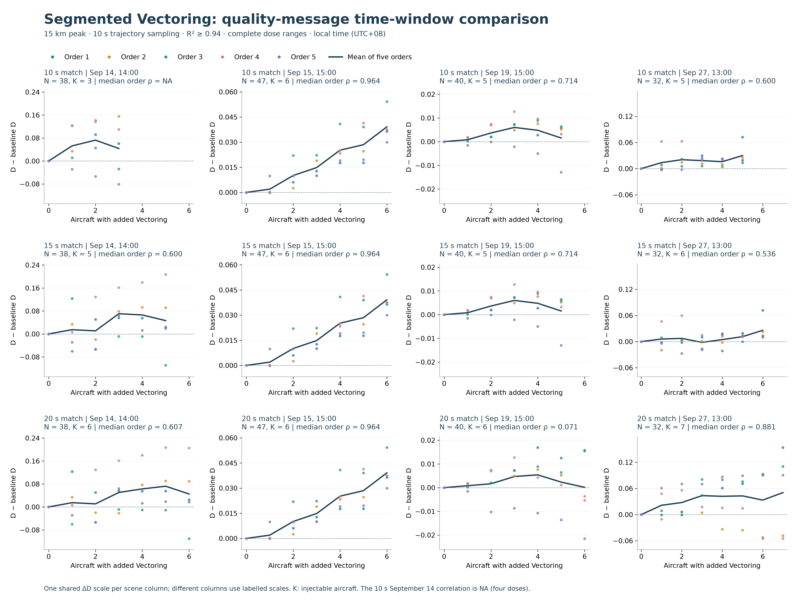
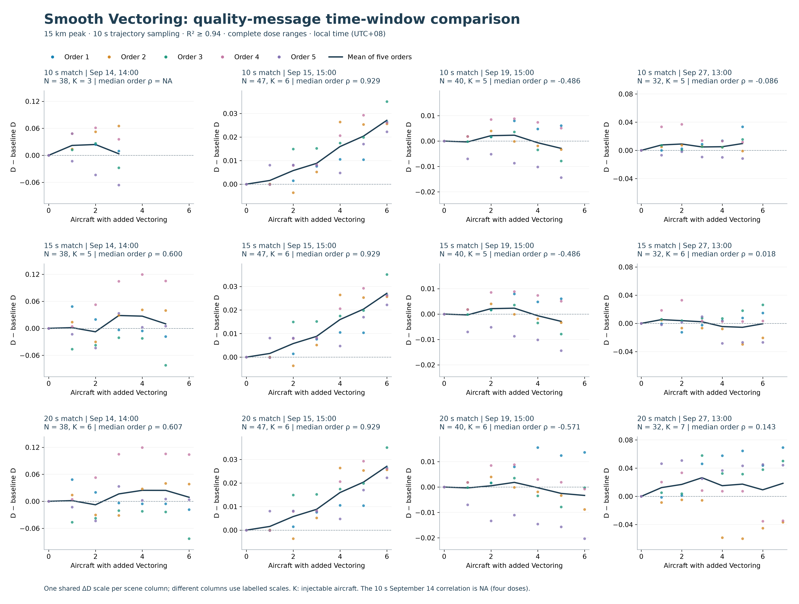
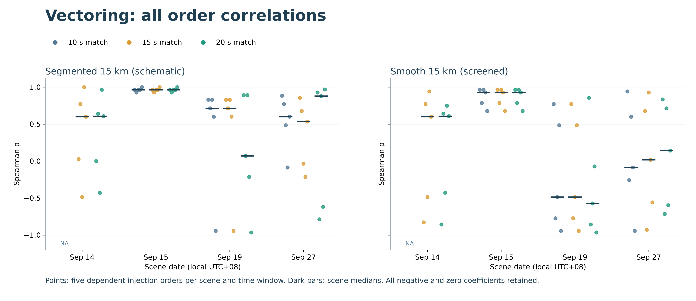

# Vectoring: 10-, 15- and 20-second quality-message matching

> Publication note: this package contains reports, figures and execution-source snapshots only. Population arrays, embeddings, per-dose JSON, assignments, quality evidence and manifests remain local. Statements about “no Git push” describe the original experiment run; this reviewed presentation was subsequently published. No experiment was rerun for publication.

2026-10-27. Independent, user-authorized sensitivity versions. The original 10-second result, current publication figures and Holding results remain unchanged. All three windows and both route shapes are reported; no window or scene is selected by its correlation. No Git push.

## What changed

Only the maximum distance from a real position timestamp to each of its two agreeing positive NACp status messages changes: 10, 15 or 20 seconds. **This is not the trajectory sampling interval**: the Encoder input remains strict 10 seconds. Exact position/NIC matching, source-age/gap limits, direction/geometry/motion conditions, 600-second intervention, frozen Encoder and R² ≥ 0.94 D gates remain unchanged. The active stimulus is 15 km; the inherited 5 km route pre-screen is also retained.

The 15/20-second choices are engineering sensitivity values authorized before these D results, not standards-certified quality validity intervals. The 21 union candidates were frozen from cached status evidence before any new D. Four bounded queries returned exactly 1,891 matching airborne position messages for 1,891 listed original source points. All have unambiguous positive NIC/HCR evidence. No missing values or intermediate timestamps were filled.

## How many candidates were actually recovered?

| Local start (UTC+08) | Background N | Original 10 s injectable | Additional 15 s quality-complete | Final 15 s injectable | Additional 20 s quality-complete | Final 20 s injectable |
|---|---:|---:|---:|---:|---:|---:|
| Sep 14, 14:00 | 38 | 3 | 4 | 5 | 6 | 6 |
| Sep 15, 15:00 | 47 | 6 | 1 | 6 | 3 | 6 |
| Sep 19, 15:00 | 40 | 5 | 1 | 5 | 5 | 6 |
| Sep 27, 13:00 | 32 | 5 | 4 | 6 | 7 | 7 |
| **Total** | **157** | **19** | **10** | **22** | **21** | **25** |

Time matching was a real candidate bottleneck, but not the only one. All 21 newly quality-supported tracks fit successfully; 9 fail reference geometry/direction, 1 fails the inherited 5 km route solve/check, and 5 fail the subsequent 15 km verification. Only 6 pass both route shapes at 20 seconds; 3 of those are also eligible at 15 seconds. The remaining 69 of the originally flagged 90 records still do not satisfy the 20-second status rule, or have other status-evidence problems.

The nine reference failures consist of eight nonpositive chord-progress cases and one unreliable continuous direction case. Among the five 15 km failures, four encounter acceleration violations and three encounter unresolved projection precision, with two tracks having both reasons on different sides. These reason counts overlap; they are not seven separate rejected candidates. The reference/generator family and numerical caps were not changed to accept them.

## Complete-range correlation results

| Shape | Status window | Accepted D / attempted | Positive order coefficients | Negative | Zero | Median order ρ |
|---|---|---:|---:|---:|---:|---:|
| segmented | 10 s | 115/115 | 13/15 | 2 | 0 | 0.829 |
| segmented | 15 s | 130/130 | 16/20 | 4 | 0 | 0.743 |
| segmented | 20 s | 145/145 | 14/20 | 5 | 1 | 0.887 |
| smooth | 10 s | 115/115 | 9/15 | 6 | 0 | 0.600 |
| smooth | 15 s | 130/130 | 13/20 | 7 | 0 | 0.639 |
| smooth | 20 s | 145/145 | 12/20 | 8 | 0 | 0.625 |

All D fits pass in all six comparisons. Lowering R² cannot recover any further point in these runs. The original September 14 scene had four doses including baseline, below the existing five-valid-dose requirement for correlation; the expanded 15/20-second versions now have enough doses. Thus 10-second totals cover 15 computable curves in three scenes, while 15/20-second totals cover 20 curves in four scenes. These aggregate populations differ.

| Local scene | Segmented 10 s | Segmented 15 s | Segmented 20 s | Smooth 10 s | Smooth 15 s | Smooth 20 s |
|---|---:|---:|---:|---:|---:|---:|
| Sep 14, 14:00 | NA | 0.600 | 0.607 | NA | 0.600 | 0.607 |
| Sep 15, 15:00 | 0.964 | 0.964 | 0.964 | 0.929 | 0.929 | 0.929 |
| Sep 19, 15:00 | 0.714 | 0.714 | 0.071 | -0.486 | -0.486 | -0.571 |
| Sep 27, 13:00 | 0.600 | 0.536 | 0.881 | -0.086 | 0.018 | 0.143 |

[Segmented vector PDF](figures/vectoring-segmented-time-window-delta.pdf)

[Smooth vector PDF](figures/vectoring-smooth-time-window-delta.pdf)

[Correlation vector PDF](figures/vectoring-time-window-correlations.pdf)

**Figure caption.** Full dose-range change in D relative to each version's unmodified baseline. Rows use status matching distances of 10, 15 and 20 seconds per side; columns are the four fixed scenes. Colored points denote five injection orders, with the dark line their arithmetic mean; no smoothing or cutoff selection is applied. Each scene column shares its ΔD and dose axes across rows; different scene columns have individually labelled vertical scales. Panel rho is the median of per-order Spearman coefficients, not the correlation of the mean. The correlation summary retains negative, zero and unavailable coefficients. The repeats share aircraft and are dependent; they are not independent scenes or confidence intervals.

## What the comparison means

- Enlarging the status window genuinely increases the injectable population, from 19 to 22 or 25, and makes all four scenes correlation-estimable. It does not recover all 21 extra quality-complete candidates.
- The segmented 20-second median is 0.887, but 5/20 coefficients are negative and one is zero. Its positive fraction is 70%, compared with 86.7% among the original computable curves; the latter excludes the previously non-estimable September 14 scene. A higher median is not uniform improvement.
- September 15 remains strongly positive under every version and both shapes. September 19 remains problematic: adding one candidate at 20 seconds reduces its segmented scene median from 0.714 to 0.071, and the smooth median is -0.571. That directly contradicts a claim that more candidates necessarily produce stronger positive association.
- September 27's segmented median improves to 0.881 at 20 seconds, while two orders remain negative. The response still depends on the aircraft/side sequence. Smooth responses remain mixed, with aggregate medians around 0.6.
- Candidate scarcity contributes limited dose resolution, but the observed instability also reflects the intervention, left/right assignments and scene representation. No saved-result analysis here identifies a single causal mechanism or proves that the D estimator is intrinsically invalid.
- Segmented routes remain the existing schematic stimulus and do not inherit the smooth C2/acceleration/bank certificate. The new candidates must pass the smooth route checks to enter the shared cohort, but the segmented trajectories themselves are not motion-certified. This was not changed or newly bypassed by the time-window sensitivity.

## Baseline pairing, scales and order preservation

All variants retain the same 157 basic-QC background identities. In accordance with the existing population rule, each newly quality-qualified successful whole-track fit becomes that variant's baseline before route acceptance, even if the route later fails. Injected and baseline trajectories therefore receive the same processing. This can change baseline embeddings and D between time-window variants; this comparison is a screening-policy sensitivity, not a pure increase-N intervention with every baseline point fixed.

| Local scene | Baseline D, 10 s | Baseline D, 15 s | Baseline D, 20 s |
|---|---:|---:|---:|
| Sep 14, 14:00 | 1.489801 | 1.489841 | 1.489841 |
| Sep 15, 15:00 | 0.882959 | 0.882957 | 0.882957 |
| Sep 19, 15:00 | 1.084240 | 1.084668 | 1.084668 |
| Sep 27, 13:00 | 1.379620 | 1.377338 | 1.383009 |

The original baseline-derived 64-radius rule is retained. The grid is fixed within a scene/version and shared by both shapes, but can differ between status-window versions when the baseline changes. Adaptive fitting subsets and all original gates remain unchanged. ΔD is computed relative to each version's own baseline. Identical D values do not imply identical fitted trajectories: finite pair-count steps can yield the same dimension despite small coordinate changes.

Old candidates keep their original relative order and side assignments. Before route checks or D, a deterministic random interleaving extended each original sequence to the full 21-candidate union. Both variants and both shapes filter this same master sequence to accepted candidates; there is no outcome-driven reordering or side choice. Only the new trajectories require encoding; unchanged arrays reuse the frozen embeddings. Four baseline inference checks reproduce the archived embeddings exactly, and the four original baseline D values are reproduced.

## Candidate audit

Every listed track passes the 20-second full quality gate. The 15-second column indicates whether it also meets the stricter sensitivity window.

| Source UTC hour | Aircraft | Quality at 15 s | Fit | Reference | 5 km screen | Both 15 km shapes | Rejection detail |
|---|---|---|---|---|---|---|---|
| 2026-09-14T06Z | 4d0118 | False | True | True | True | True | Accepted |
| 2026-09-14T06Z | 76d1c9 | True | True | False | False | False | reference_chord_progress_nonpositive |
| 2026-09-14T06Z | 881424 | False | True | False | False | False | reference_chord_progress_nonpositive |
| 2026-09-14T06Z | 8a0988 | True | True | True | True | True | Accepted |
| 2026-09-14T06Z | 8a09b8 | True | True | True | True | True | Accepted |
| 2026-09-14T06Z | 8a09f8 | True | True | True | True | False | left:reference_projection_precision_unresolved; right:continuous_longitudinal_acceleration_over_limit |
| 2026-09-15T07Z | 3c6709 | False | True | True | True | False | left:reference_projection_precision_unresolved |
| 2026-09-15T07Z | 7817ff | True | True | True | True | False | left:continuous_longitudinal_acceleration_over_limit |
| 2026-09-15T07Z | 80169c | False | True | False | False | False | continuous_reference_direction_unreliable |
| 2026-09-19T07Z | 06a110 | False | True | True | False | False | no_validated_path_solver_failed |
| 2026-09-19T07Z | 76b86d | False | True | False | False | False | reference_chord_progress_nonpositive |
| 2026-09-19T07Z | 76d1c7 | True | True | False | False | False | reference_chord_progress_nonpositive |
| 2026-09-19T07Z | 781a4b | False | True | False | False | False | reference_chord_progress_nonpositive |
| 2026-09-19T07Z | 7823c8 | False | True | True | True | True | Accepted |
| 2026-09-27T05Z | 4bca69 | True | True | False | False | False | reference_chord_progress_nonpositive |
| 2026-09-27T05Z | 75052a | False | True | True | True | False | right:continuous_longitudinal_acceleration_over_limit |
| 2026-09-27T05Z | 76cc69 | False | True | False | False | False | reference_chord_progress_nonpositive |
| 2026-09-27T05Z | 76d1c6 | True | True | True | True | False | left:continuous_longitudinal_acceleration_over_limit; right:reference_projection_precision_unresolved |
| 2026-09-27T05Z | 780aa3 | True | True | False | False | False | reference_chord_progress_nonpositive |
| 2026-09-27T05Z | 8014f7 | False | True | True | True | True | Accepted |
| 2026-09-27T05Z | 8a0a67 | True | True | True | True | True | Accepted |

## Artifacts and reproducibility

This directory contains the frozen `policy.json`, `tasks.json`, `assignments.json`, bounded exact-match query results, point-level quality evidence, per-candidate continuous route diagnostics, per-version populations, embeddings, every D fit/failed status, and comparison figures. `prepare.py`, `match_quality.py`, `screen_routes.py`, `run_evaluation.py` and `report_results.py` implement the stages. Cached status timestamps are reused; original source observations are never changed. Authentication tokens were kept in the query client's memory only and the process was closed after the four requests.

Original result hashes are preserved in the screening and evaluation manifests. These new independent versions and their derived data remain local. No main paper result is automatically replaced by whichever version has the largest coefficient.

For the same three originally correlation-estimable scenes (excluding September 14), the descriptive aggregates are:

| Shape | Window | Positive / computable | Median rho |
|---|---|---:|---:|
| segmented | 10 s | 13/15 | 0.829 |
| segmented | 15 s | 12/15 | 0.829 |
| segmented | 20 s | 11/15 | 0.893 |
| smooth | 10 s | 9/15 | 0.600 |
| smooth | 15 s | 10/15 | 0.679 |
| smooth | 20 s | 9/15 | 0.679 |

This keeps the scene set fixed, but expanded candidate sets and paired baselines still differ. It is not a controlled causal attribution to candidate number alone.
