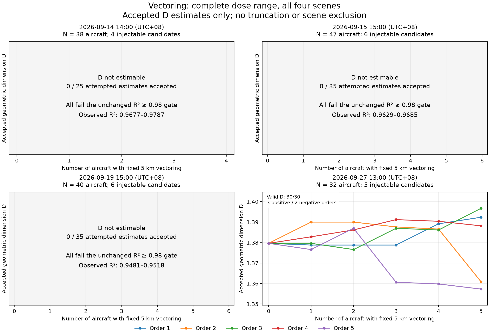
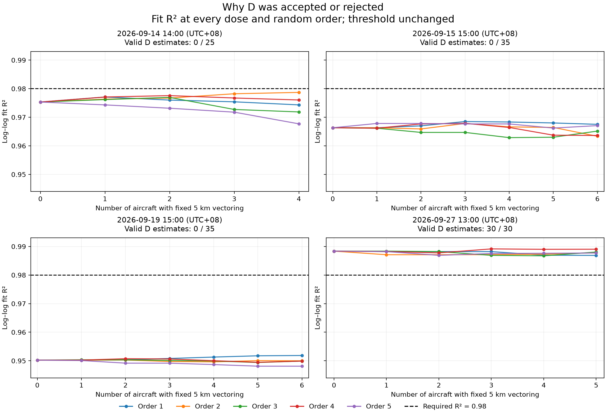

# Four-scene Vectoring correlation evaluation

> Archived stage report. Statements about work not yet run describe this stage only. See the [current combined report](../../../report/report.md) for subsequent results. Publication excludes raw trajectories and model weights; see the [bundle notes](../../../histry/publication-records/runs-index.md).

## Main conclusion

**These results do not establish a stable positive relationship between injected Vectoring count and D.** Three scenes have no accepted D estimates under the existing fit-quality gate. The remaining scene has three positive and two negative Spearman correlations across its five random orders. Its median rho is 0.5768, but the orders are within-scene repeats, not five independent scenes. No negative or unestimable scene/order was removed.

## Frozen scope and method

The four previously screened scenes and all 21 accepted candidate pairs were fixed before inference. Saved paired baselines and accepted left/right routes are used directly; no fit, route generation, resampling, quality relaxation, alternative scene, extra experimental arm, or Holding run was added. Fixed 5 km peak, 600-second maneuver, strict 10-second inputs, barometric-height convention and all screening thresholds remain unchanged.

The same frozen 10-second epoch-90 Encoder checkpoint, training mean/std, nine input features, sum pooling, 16-dimensional embeddings and unnormalized Euclidean distances are used. The checkpoint SHA-256 is `bc1e0d74255cfee60a1c09c64dab8fac5a31f3175c4c234f8cf3983bc07af976`. The existing D estimator/configuration is unchanged: 64 baseline-derived fixed radius values per scene, at least 30 aircraft, at least eight fitting scales, at least ten pairs, C(r) bounds 0.02–0.3, radius span at least 2, and R² at least 0.98.

Five orders per scene use the original seed formula `43019 + scene_index*997 + replicate`, with scenes in the disclosed chronological order (one-based index) and replicates 0–4. Orders and left/right assignments were written before loading the Encoder. Every integer dose from zero through all eligible candidates is included. Correlation uses the existing full-range Spearman function on finite, status-ok D values, requiring at least five valid doses. Invalid values remain null with explicit reasons; they are never replaced by zero.

## Results by scene

Times are local UTC+08. D counts include five copies of the common zero-dose baseline, one in each displayed curve; they are not independent measurements.

| Local scene start | Background aircraft | Injectable | D accepted / attempted | Fit R² range | Estimable orders | Median rho |
|---|---:|---:|---:|---|---:|---|
| 2026-09-14 14:00 | 38 | 4 | 0 / 25 | 0.9677–0.9787 | 0 / 5 | Not estimable |
| 2026-09-15 15:00 | 47 | 6 | 0 / 35 | 0.9629–0.9685 | 0 / 5 | Not estimable |
| 2026-09-19 15:00 | 40 | 6 | 0 / 35 | 0.9481–0.9518 | 0 / 5 | Not estimable |
| 2026-09-27 13:00 | 32 | 5 | 30 / 30 | 0.9867–0.9891 | 5 / 5 | 0.5768 |

All 95 rejected dose records fail `poor_linear_fit`; there are enough fitting scales (28–34) but R² is below 0.98. The failure is in dimension estimation, not candidate trajectory screening or a lack of attempted dose levels. Baselines of those three scenes also fail. The threshold was not reduced, and rejected slopes were not relabeled as D.

For September 27 at 13:00, the five full-range Spearman coefficients are: **+0.5768, −0.4058, +0.7537, +0.7714, −0.8286**. All six doses in each order have accepted D. The common baseline D is **1.37962**; accepted D across all orders/doses ranges from **1.35727 to 1.39673**. Positive and negative outcomes are both retained.

The overall median among computable curves is +0.5768, but all five computable curves come from that single scene. Reporting only this median as broad evidence of positive correlation would omit the three unestimable scenes and the two negative orders. This run neither demonstrates a robust positive association nor proves that no positive association exists.

## Complete figures

Coincident lines/markers represent identical recorded values; no jitter, smoothing or outcome-based cut is applied. SVG copies are also provided for export.

## Every order, including unestimable ones

| Scene UTC | Order | Valid doses / total | Spearman rho | Reason if unavailable |
|---|---:|---:|---|---|
| 2026-09-14T06Z | 1 | 0 / 5 | Not estimable | fewer_than_5_valid_doses |
| 2026-09-14T06Z | 2 | 0 / 5 | Not estimable | fewer_than_5_valid_doses |
| 2026-09-14T06Z | 3 | 0 / 5 | Not estimable | fewer_than_5_valid_doses |
| 2026-09-14T06Z | 4 | 0 / 5 | Not estimable | fewer_than_5_valid_doses |
| 2026-09-14T06Z | 5 | 0 / 5 | Not estimable | fewer_than_5_valid_doses |
| 2026-09-15T07Z | 1 | 0 / 7 | Not estimable | fewer_than_5_valid_doses |
| 2026-09-15T07Z | 2 | 0 / 7 | Not estimable | fewer_than_5_valid_doses |
| 2026-09-15T07Z | 3 | 0 / 7 | Not estimable | fewer_than_5_valid_doses |
| 2026-09-15T07Z | 4 | 0 / 7 | Not estimable | fewer_than_5_valid_doses |
| 2026-09-15T07Z | 5 | 0 / 7 | Not estimable | fewer_than_5_valid_doses |
| 2026-09-19T07Z | 1 | 0 / 7 | Not estimable | fewer_than_5_valid_doses |
| 2026-09-19T07Z | 2 | 0 / 7 | Not estimable | fewer_than_5_valid_doses |
| 2026-09-19T07Z | 3 | 0 / 7 | Not estimable | fewer_than_5_valid_doses |
| 2026-09-19T07Z | 4 | 0 / 7 | Not estimable | fewer_than_5_valid_doses |
| 2026-09-19T07Z | 5 | 0 / 7 | Not estimable | fewer_than_5_valid_doses |
| 2026-09-27T05Z | 1 | 6 / 6 | +0.576818 | None |
| 2026-09-27T05Z | 2 | 6 / 6 | -0.405840 | None |
| 2026-09-27T05Z | 3 | 6 / 6 | +0.753702 | None |
| 2026-09-27T05Z | 4 | 6 / 6 | +0.771429 | None |
| 2026-09-27T05Z | 5 | 6 / 6 | -0.828571 | None |

## Verification and interpretation limits

All 125 displayed dose records were independently replayed from saved embeddings using the fixed assignments and baseline radii; every result and rejection matched exactly. Computable Spearman values were independently checked using tied ranks. The four scenes, all 20 curves, every attempted dose, and unchanged checkpoint/source files were verified. The original evaluation used 199 trajectory encodings and 109 D calculations because each baseline was computed once and reused across five orders. Verification required no re-encoding, new route, parameter tuning or alternate experiment.

Saved screening populations keep 157 fixed members in total; successful candidate fits are used consistently in both zero-dose baselines and corresponding injections. Rejected injection candidates remain background members. Backgrounds without candidate quality evidence use their unchanged basic-QC inputs, following the approved separation policy.

This is a conditional synthetic-perturbation evaluation with four coverage-selected scenes. Candidate geometry and quality verification do not guarantee a scaling regime in the resulting embedding cloud. Five injection orders are dependent repeats. No confirmatory p-values, extra statistical model, threshold adjustment, or new sample-selection rule was introduced. Holding equal-duration control remains unrun.

## Files and preservation

`policy.json` and `assignments.json` freeze the protocol before inference. `results/experiment-results.json` contains full D diagnostics for all doses; `results/point-selection.json` records inclusion status without truncation; `results/*-embeddings.npz` stores baseline and paired route embeddings with fixed radii. `results/run-manifest.json` records source/checkpoint hashes and settings. `verification.json` verifies replay and preservation. All previous screening, evaluation and Holding outputs remain untouched.
